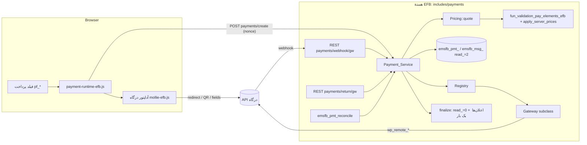

وضعیت: هستهٔ چارچوب پیاده و تست شد (زیرتسک‌های B تا J، ۲۰۲۶-۱۱-۱۲؛ جزئیات در «پیوست: آنچه پیاده شد») · کوپن، مالیات، کارمزد، دوره‌ای، رسید و چند درگاه در فاز بعد · اولویت: P0 · تلاش: L (هسته حدود ۴ تا ۶ هفته؛ هر درگاه جدا در PAY01 تا PAY07) · وابستگی: B3 (رجیستری قابلیت‌ها)، B7 (قیمت سمت سرور)، F18 (دیالوگ ارتقا)، F19 (الگوی ظاهر قابل تنظیم و هم‌خوانی PHP/JS)، F13 (حریم خصوصی)، اختیاری: F04 (فیلد محاسبه)، F05 (موجودی)، F14 (مدیریت پاسخ‌ها)

# PAY00 — چارچوب مشترک پرداخت در هسته و فیلد پرداخت قابل سفارشی‌سازی

تاریخ: ۲۲ آبان ۱۴۰۵ (2026-11-12)، شاخهٔ `dev4`، افزونهٔ 4.3.1، مخزن افزونه‌ها `vendores-efb` شاخهٔ `dev4`. همهٔ ارجاع‌های `file:line` امروز خوانده شده‌اند. عامل دیگری هم‌زمان روی `includes/class-Emsfb-public.php` کار می‌کند؛ پیش از ویرایش، نام تابع را دوباره grep کنید.

مراجع: [دانش‌نامهٔ هسته](../EFB-CORE-KNOWLEDGE-BASE.en.md) (§5 مسیرهای پرداخت دیرهنگام، §6 افزونه‌ها)، [گزارش AutoPilot](../autopilot-integration.md) (B2، B3، B7، B8 و بخش «Add-on changes» و قالب zip)، [راهنمای پیاده‌سازی](../feature-gaps/IMPLEMENTATION-PLAYBOOK.en.md) (§1.6 پاک‌ساز، §3 دستور B، §5 دستور D، §6 دستور E، §7 دستور F، §8 ترجمه، §9 تست)، [F18](../feature-gaps/F18-upgrade-prompt-ux.fa.md)، [F19](../feature-gaps/F19-step-backgrounds.fa.md)، [سازگاری SitePilot](../feature-gaps/reference/sitepilot-compatibility.en.md)، [تصمیم‌های مشترک](../feature-gaps/README.fa.md#تصمیم‌های-مشترک-بین-تسک‌ها)، [ماتریس رقبا](competitor-payment-matrix.en.md).

اسناد درگاه‌ها: [PAY01 Mollie](PAY01-mollie.fa.md) · [PAY02 Payplug](PAY02-payplug.fa.md) · [PAY03 Tap](PAY03-tap.fa.md) · [PAY04 Omise](PAY04-omise.fa.md) · [PAY05 PayTabs](PAY05-paytabs.fa.md) · [PAY06 Paymob](PAY06-paymob.fa.md) · [PAY07 Xendit](PAY07-xendit.fa.md).

---

## ۰. خلاصهٔ تصمیم‌ها

1. **هسته مالک چارچوب است، افزونه مالک درگاه.** کلاس پایهٔ `Emsfb\Payments\Gateway`، رجیستری، جدول‌ها، مسیرهای REST، webhook، بازگشت از درگاه، تطبیق دوره‌ای، قیمت‌گذاری سرور، کوپن، مالیات، رسید، صفحهٔ «پرداخت‌ها» و فیلد پرداخت قابل سفارشی‌سازی در هسته (`includes/payments/`) ساخته می‌شوند. هر درگاه افزونه‌ای جدا در `vendores-efb` است که فقط یک زیرکلاس `Gateway`، اسکریپت آداپتور سمت بازدیدکننده، عبارت‌ها و لوگوها را می‌آورد. Stripe، PayPal و Persia Pay دست‌نخورده کار می‌کنند و بعداً (PAY08+) می‌توانند به چارچوب منتقل شوند.
2. **مبلغ همیشه از سرور است.** مبلغی که به درگاه فرستاده می‌شود خروجی `Pricing::quote()` است که روی `fun_validation_pay_elements_efb()` و `Builder_Api::apply_server_prices()` (B7) ساخته شده و کوپن، مالیات، کارمزد، تعداد و «مبلغ دلخواه» را اضافه می‌کند. مبلغ ارسالی مرورگر فقط برای مقایسه و هشدار خوانده می‌شود.
3. **ثبت موفق فقط پس از تأیید سرور.** وضعیت `paid` فقط وقتی نوشته می‌شود که (الف) webhook با امضای معتبر برسد یا (ب) سرور خودش پرداخت را از API درگاه بخواند. بازگشت مرورگر، پیام JS و پارامتر آدرس هرگز دلیل پرداخت نیستند. «نهایی‌سازی» (تبدیل پاسخ معلق به پاسخ عادی و اجرای اعلان‌ها) با یک `UPDATE … WHERE finalized_at IS NULL` اتمیک فقط یک بار اجرا می‌شود، هر چند webhook و بازگشت و cron هم‌زمان برسند.
4. **پاسخ کامل پیش از رفتن به درگاه ذخیره می‌شود.** برخلاف Persia Pay امروز که پاسخ‌ها را در `localStorage` نگه می‌دارد، پاسخ‌های تأییدشده با `read_=2` (معلق پرداخت) در `emsfb_msg_` و یک ردیف در جدول تازهٔ `emsfb_pmt_` ذخیره می‌شوند. اگر بازدیدکننده هرگز برنگردد، webhook یا cron پاسخ را نهایی می‌کند.
5. **یک جدول پرداخت تازه با مبلغ به کوچک‌ترین واحد.** `emsfb_pmt_` (پرداخت‌ها)، `emsfb_pmt_evt_` (لاگ خام رویدادها با کلید یکتا برای حذف تکرار)، `emsfb_pmt_rfd_` (بازپرداخت‌ها) و `emsfb_coupon_` (کوپن‌ها). جدول قدیمی `emsfb_pay_` (ساختهٔ افزونهٔ Stripe، `decimal(12,2)`) دست نمی‌خورد و صفحهٔ پرداخت‌ها آن را فقط‌خواندنی کنار ردیف‌های تازه نشان می‌دهد.
6. **یک webhook برای همه:** `POST Emsfb/v1/payments/webhook/<gateway>`، با بررسی مخصوص هر درگاه (HMAC، توکن، یا خواندن دوبارهٔ پرداخت از API). شناسهٔ ناشناخته همیشه `200` می‌گیرد و هیچ درخواست بیرونی نمی‌سازد.
7. **رازها رمزنگاری‌شده و بیرون از JSON فرم.** کلیدهای درگاه در گزینهٔ جدای `emsfb_pgw_<slug>` (بدون autoload) با `sodium_crypto_secretbox` ذخیره می‌شوند. JSON فرم به دست بازدیدکننده می‌رسد (`class-Emsfb-public.php:1391-1400`)، پس هیچ کلید، شناسهٔ پروفایل حساس یا آدرس webhook در آن نیست. کلید عمومی لازم برای فیلدهای کارت در پاسخ REST «ساخت پرداخت» داده می‌شود، نه در HTML کش‌شدنی.
8. **Sandbox و Live برای هر درگاه جدا.** هر درگاه سوییچ حالت خودش را دارد؛ در حالت آزمایشی، فرم عمومی برای همه نوار «حالت آزمایشی، پولی کسر نمی‌شود» نشان می‌دهد و ردیف‌ها نشان `TEST` می‌گیرند. حالت توسعهٔ عمومی (`EMSFB_DEV_MODE`) فقط هشدار می‌دهد و حالت درگاه‌های تازه را عوض نمی‌کند.
9. **فیلد پرداخت قابل سفارشی‌سازی** با کلیدهای تخت و پاک‌سازی‌شدهٔ `pf_*` روی ردیف فیلد درگاه: رنگ، حالت hover، گردی، اندازه و آیکون دکمه، ترتیب و نمایش اجزای داخلی (خلاصهٔ مبلغ، انتخاب روش، کوپن، مبلغ دلخواه، ناحیهٔ کارت یا QR، یادداشت امنیت، لوگوها)، جای برچسب، تنظیم جدای موبایل، و متن‌های هر زبان در `pf_i18n_b64`. هیچ CSS خامی پذیرفته نمی‌شود؛ CSS و HTML در PHP و JS از یک داده ساخته می‌شوند و تست هم‌خوانی مثل F19 دارند.
10. **پیشنهاد پلن** (تصمیم با مالک): خود افزونه‌های درگاه Free Plus مثل Stripe/PayPal؛ مبلغ دلخواه، رسید، اقدام‌های تأخیری و ظاهر پایه Free Plus؛ کوپن، مالیات، کارمزد، چند درگاه در یک فرم، پرداخت دوره‌ای و تنظیم موبایل Pro.

11. **قاعدهٔ مالک (۲۰۲۶-۱۱-۱۲): هیچ درگاهی در هسته نیست.** هر درگاه یک افزونهٔ جدا و نصب‌شدنی است، مثل Stripe و PayPal. هسته فقط چارچوب بی‌طرف را دارد (فیلد، قیمت‌گذاری، Store، مسیریابی webhook، صفحهٔ پرداخت‌ها، قرارداد). درگاه آزمایشی `efbmock` در `tests/payments-mock/` است و تست‌ها و mu-plugin سایت e2e آن را مثل یک افزونه با `efb_register_payment_gateways` ثبت می‌کنند. زیرمنوی «پرداخت‌ها»، صفحهٔ آن و کاشی فیلد پرداخت در پالت فقط وقتی دیده می‌شوند که دست‌کم یک افزونهٔ درگاه نصب و فعال باشد. کد هسته جز در فهرست افزونه‌ها (کلید → پوشه، پلن، برچسب) نام هیچ درگاهی را نمی‌برد. هر چیز مخصوص درگاه (روش‌ها، متن دکمه، هشدارها، گزینه‌های فیلد، لوگوها) از افزونه و با هوک‌های اختیاری می‌آید، هرگز سخت‌کد در هسته نیست.

## ۱. هدف

مالک سایت بتواند هر درگاه جدید را مثل Stripe و PayPal به‌شکل یک فیلد پرداخت روی فرم بگذارد، ظاهر و متن‌هایش را به هر زبانی کامل تنظیم کند، و برای خدمات، ثبت‌نام، رزرو و کمک مالی (ثابت، محاسبه‌شده یا دلخواه) پول بگیرد، بی‌آنکه WooCommerce لازم باشد؛ و مطمئن باشد که پاسخ «پرداخت‌شده» فقط وقتی ثبت و اعلان می‌شود که درگاه واقعاً پرداخت را تأیید کرده است، یک بار و فقط یک بار.

## ۲. وضعیت فعلی با شاهد

| موضوع | امروز | شاهد |
|---|---|---|
| ثبت مسیرهای پرداخت | هسته در `rest_api_init` اکشن `efb_register_payment_rest_routes` را صدا می‌زند؛ هر افزونه مسیرهای خودش را ثبت می‌کند ولی callbackها متدهای کلاس عمومی هسته‌اند | `class-Emsfb-public.php:57`؛ `vendores-efb/stripe/routes-efb.php:16-43`؛ `paypal/routes-efb.php`؛ `persiapay/routes-efb.php` |
| بارگذاری مسیرها | فقط وقتی پرچم افزونه روشن و سازگار است | `class-Emsfb.php:615-635` |
| ساخت پرداخت Stripe | در هسته: `pay_stripe_sub_Emsfb_api()` مبلغ را از `fun_validation_pay_elements_efb()` می‌گیرد، PaymentIntent می‌سازد، پاسخ را با `insert_message_db(2,…)` (معلق) ذخیره می‌کند و ردیف `emsfb_pay_` می‌نویسد | `class-Emsfb-public.php:6845-7090`، درج معلق `:7034` |
| تأیید Stripe | `pay_stripe_confirm_Emsfb_api()` PaymentIntent را از Stripe می‌خواند و با ردیف سایت مقایسه می‌کند؛ **webhook ندارد** | `:7096-7210` |
| تطبیق دوره‌ای | فقط Stripe: `reconcile_stripe_payments_efb()` روی WP-Cron، پنجرهٔ ۱۰ دقیقه تا ۷ روز، حداکثر ۲۰ درخواست، قفل transient | `:124-126`، `:7558-7668` |
| ارسال نهایی فرم پرداخت | شاخهٔ `case "payment"` در ارسال: پاسخ معلق را با `payid` پیدا می‌کند، وضعیت Stripe/PayPal را از سرور می‌پرسد، ZarinPal را با claim اتمیک در `wp_options` تأیید می‌کند، سپس `update_message_db()` و اعلان‌ها | `:3862-4105`؛ claim اتمیک `:3966-3990` |
| اعلان‌ها پس از ثبت | `efb_intgrate_with_3rd_party_services_efb()` (تلگرام، Google Sheet، webhook) و ایمیل؛ وابسته به درخواست مرورگر | `:10810`، `:10880-10885`، `:4078-4105` |
| جدول پرداخت | `emsfb_pay_` را **افزونهٔ Stripe** فقط هنگام باز شدن صفحهٔ مدیریتش می‌سازد؛ `amount decimal(12,2)` (برای KWD/BHD/OMR با سه رقم اعشار نادرست)، بدون کلید یکتا، بدون حالت test/live | `vendores-efb/stripe/class-Emsfb-stripe-payment.php:53-95`؛ هسته وجود جدول را با `SHOW TABLES` می‌سنجد `:7217-7223` |
| وضعیت پاسخ | `read_ = 2` یعنی «در انتظار پرداخت» | `IMPLEMENTATION-PLAYBOOK.en.md` §6 |
| قیمت سمت سرور | `fun_validation_pay_elements_efb()` قیمت گزینه‌ها را از فرم ذخیره‌شده حساب می‌کند و `apply_server_prices()` فیلدهای محاسبه‌ای را؛ ولی در خطا خودش `wp_send_json_success` می‌فرستد (تابع خالص نیست) | `:9907-10050`؛ `class-Emsfb-builder-api.php:417`، `:497` |
| کلیدهای درگاه | متن ساده در JSON تنظیمات `emsfb_setting` و گزینهٔ `emsfb_settings`: `stripeSKey`، `paypalSKey`، `payToken` | `class-Emsfb.php:2204-2207`؛ `resolve_payment_key_efb()` `:8690`؛ حذف در پاسخ‌ها با `redact_settings()` `class-Emsfb-builder-api.php:361` |
| کلید عمومی در صفحه | `paymentKey` در `ajax_object_efm` صفحهٔ فرم (کش‌شدنی؛ برای همین Stripe مسیر `stripe/pkey` دارد) | `:1345-1362`، `:1680-1712` |
| یک درگاه برای هر فرم | `valj_efb[0].getway`، `currency`، `paymentmethod` (`charge`/`day`/`week`/`month`/`year`) | `val-efb.js:199-209`، `:2551`؛ `admin-efb.js:7948-8000` |
| نوع‌های فیلد پرداخت | `payCheckbox`، `payRadio`، `paySelect`، `payMultiselect`، `prcfld` (مبلغ دلخواه با Min/Max در `milen`/`mlen`)، `ttlprc` (جمع) | `val-efb.js:166-171`؛ `persiapay/zarinpal.php:280-300` |
| تنظیمات فیلد درگاه | فقط ارز و روش (یکبار/دوره‌ای)؛ هیچ تنظیم ظاهری | `val-efb.js:2290-2318` |
| رندر درگاه | `case 'stripe'|'paypal'|'persiaPay'` جدا در PHP و JS؛ نوع ناشناخته در ارسال حذف می‌شود | `class-Emsfb-formbuilder.php:3233-3280`؛ `admin-efb.js:7948-8000`؛ `filter_attributes_by_type_efb()` |
| نمایش در پاسخ‌ها | نمایشگر فقط `stripe` و `paypal` را با جزئیات نشان می‌دهد | `response-viewer-efb.js:1074-1090` |
| CSV | فقط `paymentIntent` | `list_form-efb.js:3870` |
| رجیستری پلن | `setting:payment_stripe|paypal|persiapay`، `payment_keys` فقط بولی | `class-Emsfb-builder-api.php:238`، `:275-277`، `:340-343` |
| رجیستری افزونه | `get_all_addon_keys_efb()`، `get_addon_required_files_efb()`، `get_addon_i18n_required_files_efb()`، `addon_required_package_efb()` | `functions.php:5096`، `:5130`، `:5164`، `:4986` |
| بارگذاری متن افزونه | `emsfb_load_addon_textdomain_efb($slug)`؛ کلاس عبارت با `SLUG`/`DOMAIN` | `functions.php:994`؛ `stripe/stripe-phrases-efb.php:25-50` |
| حالت توسعه | `EMSFB_DEV_MODE` هر دو Stripe و PayPal را به sandbox می‌برد | `paypal/class-Emsfb-paypal-handler.php:122`؛ دانش‌نامه §1 |
| نسخهٔ پایگاه داده | `1.4` (F13) | `emsfb.php:36` |

### ۲.۱ باگ‌ها و کمبودهایی که هنگام نوشتن پیدا شد (به `BUGS-FOUND.fa.md` اضافه شود)

1. `emsfb_pay_.amount` از نوع `decimal(12,2)` است؛ هر درگاهی با KWD، BHD، OMR یا JOD (سه رقم اعشار) مبلغ را گرد می‌کند. (`stripe/class-Emsfb-stripe-payment.php:71`)
2. جدول `emsfb_pay_` را هسته نمی‌سازد؛ سایتی که صفحهٔ Stripe را هرگز باز نکرده جدول ندارد و هسته به راه‌حل جایگزین (`find_stripe_charge_stub_efb`) تکیه می‌کند. (`class-Emsfb-public.php:7149-7165`)
3. نمایشگر پاسخ فقط `stripe` و `paypal` را با جزئیات پرداخت نشان می‌دهد؛ `persiaPay` و هر درگاه آینده بی‌جزئیات می‌ماند. (`response-viewer-efb.js:1074`)
4. `fun_validation_pay_elements_efb()` در خطا خودش پاسخ JSON می‌فرستد؛ برای webhook و cron که پاسخ HTTP دیگری دارند قابل استفاده نیست. (`class-Emsfb-public.php:9916-9946`)
5. Persia Pay `date_default_timezone_set('Iran')` را در وسط درخواست صدا می‌زند و منطقهٔ زمانی کل PHP را عوض می‌کند. (`class-Emsfb-public.php:3992`)

## ۳. پژوهش

### ۳.۱ رقبا (خلاصه؛ جزئیات و منابع در [competitor-payment-matrix.en.md](competitor-payment-matrix.en.md))

| قابلیت | WPForms | Gravity | Fluent | Formidable | Forminator | Jotform | Paperform | EFB امروز |
|---|---|---|---|---|---|---|---|---|
| چند درگاه در یک فرم | با منطق شرطی | چند feed با شرط | فیلد «روش پرداخت» | چند action | با منطق شرطی | بله | یک درگاه | خیر |
| مبلغ دلخواه / کمک مالی | بله | بله | Custom Amount | بله | بله | بله | بله | `prcfld` |
| تعداد | Single/Dropdown | بله | Item Quantity | بله | بله | بله | بله | با منطق B7 |
| کوپن | افزونه (Pro) | افزونه | فیلد Coupon | افزونه (Business) | — | بله | بله | خیر |
| مالیات | — | با ابزار سوم | محدود | — | — | بله | بله | خیر |
| خلاصهٔ سفارش | Total + summary | بله | Payment Summary | بله | — | بله | بله | `ttlprc` |
| اشتراک، دورهٔ آزمایشی، هزینهٔ راه‌اندازی | بله | بله (trial یا setup fee) | بله | بله | Stripe | بله | Stripe/Braintree | روزانه تا سالانه، بدون trial |
| اقدام‌ها پس از پرداخت | — | Post Payment Actions / delayed feeds | بله | — | — | — | — | فقط در جریان مرورگر |
| صفحهٔ پرداخت‌ها و بازپرداخت | بله | بله (دفترچه) | گزارش پرداخت | بله | — | بله | — | صفحهٔ جدا برای Stripe و PayPal |
| حالت آزمایشی | بله | بله | بله | بله | بله | بله | بله | سراسری با dev mode |

### ۳.۲ درگاه‌ها: آنچه در چارچوب اثر دارد

| درگاه | نوع پرداخت | بررسی webhook | کلید یکتایی | مبلغ | بازپرداخت API | دوره‌ای |
|---|---|---|---|---|---|---|
| Mollie | صفحهٔ میزبان؛ Components برای کارت | فقط `id`؛ دوباره خواندن پرداخت | هدر `Idempotency-Key` (۱ ساعت) | رشتهٔ اعشاری `"10.00"` | بله | first + mandate + subscriptions |
| Payplug | صفحهٔ میزبان؛ Integrated Payment | بدون امضا؛ دوباره خواندن | ندارد | سنت، فقط EUR، ۰٫۳۰ تا ۲۰٬۰۰۰ | بله | اقساط ۲ تا ۴، کارت ذخیره |
| Tap | صفحهٔ میزبان (`src_all`، `src_kw.knet`، `src_sa.mada`، `src_bh.benefit`) و Card SDK | هدر `hashstring` با HMAC-SHA256 | `reference.idempotent` | اعشاری، ۳ رقم برای KWD/BHD/OMR | بله | کارت ذخیره و پرداخت به ابتکار فروشنده |
| Omise | QR PromptPay (منبع + charge)، Omise.js برای کارت | هدر `Omise-Signature` HMAC-SHA256 روی `timestamp.body` | `ref_id` | کوچک‌ترین واحد؛ PromptPay ۲۰ تا ۱۵۰٬۰۰۰ THB | کارت بله، **PromptPay خیر** | Schedules (کارت) |
| PayTabs | صفحهٔ میزبان منطقه‌ای | هدر `Signature` HMAC-SHA256 بدنه؛ بازگشت با فیلدهای مرتب | `cart_id` یکتا | اعشاری | `tran_type=refund` | توکن و `tran_class=recurring` |
| Paymob | Intention + Unified Checkout یا Pixel | `hmac` در query، SHA-512 روی ۲۰ فیلد مرتب | `special_reference` | سنت | بله (به‌جز کیوسک) | ماژول Subscriptions |
| Xendit | Payment Session (لینک یا Components) | هدر `x-callback-token` | `reference_id` | واحد ارز | `POST /refunds` | session نوع `SUBSCRIPTION` |

نتیجه برای طراحی: (۱) رابط درگاه باید هر سه شکل بررسی را بپذیرد (امضای بدنه، توکن ثابت، فقط شناسه + خواندن دوباره)؛ (۲) قالب مبلغ در هر درگاه فرق دارد، پس مبلغ داخلی همیشه عدد صحیح کوچک‌ترین واحد ISO 4217 است و هر درگاه خودش تبدیل می‌کند؛ (۳) سه درگاه (Payplug، Mollie برای پرداخت معمولی، PayTabs در بازگشت) امضای webhook ندارند یا امضای دیگری دارند، پس «خواندن دوباره از API» راه پیش‌فرض تأیید است؛ (۴) بازپرداخت باید «پشتیبانی نمی‌شود» را صریح نشان دهد (PromptPay).

## ۴. معماری



### ۴.۱ فایل‌های هسته (همه تازه، مگر ذکر شود)

| فایل | محتوا |
|---|---|
| `includes/payments/class-Emsfb-payment-gateway.php` | کلاس انتزاعی `Emsfb\Payments\Gateway` (§۵) |
| `includes/payments/class-Emsfb-payment-registry.php` | `Registry::register()`, `get($slug)`, `all()`, `enabled()`؛ اکشن `efb_register_payment_gateways` |
| `includes/payments/class-Emsfb-payment-store.php` | خواندن و نوشتن جدول‌ها، ماشین وضعیت، لاگ رویداد |
| `includes/payments/class-Emsfb-payment-service.php` | هماهنگ‌کننده: `create()`، `handle_webhook()`، `handle_return()`، `refresh()`، `finalize()`، `refund()` |
| `includes/payments/class-Emsfb-payment-pricing.php` | `Pricing::quote()` خالص (§۸) |
| `includes/payments/class-Emsfb-payment-money.php` | `Money` و `Currency::exponent()`، قالب‌بندی محلی |
| `includes/payments/class-Emsfb-payment-secrets.php` | رمزنگاری و خواندن تنظیمات درگاه (§۱۳) |
| `includes/payments/class-Emsfb-payment-http.php` | پوشش `wp_remote_request` با timeout، تلاش دوباره فقط برای GET، حذف رازها از لاگ |
| `includes/payments/class-Emsfb-payment-routes.php` | ثبت مسیرهای REST (§۹) |
| `includes/payments/class-Emsfb-payment-admin.php` | صفحهٔ «پرداخت‌ها»، کوپن‌ها، تنظیمات درگاه، AJAX مدیریتی |
| `includes/payments/class-Emsfb-payment-legacy.php` | خواندن فقط‌خواندنی `emsfb_pay_` برای صفحهٔ پرداخت‌ها |
| `includes/payments/payment-field-functions-efb.php` | پاک‌ساز، حل، CSS و HTML فیلد پرداخت (همزاد PHP) |
| `tests/payments-mock/class-Emsfb-payment-mock.php` | درگاه ساختگی `efbmock` برای تست؛ در افزونهٔ منتشرشده نیست (قاعدهٔ ۱۱ بالا)؛ تست‌ها و mu-plugin سایت e2e آن را مثل یک افزونه ثبت می‌کنند |
| `includes/admin/assets/js/payment-field-efb.js` | هستهٔ JS فیلد (همزاد) + پنل سازنده |
| `public/assets/js/payment-runtime-efb.js` | `window.EFBPay`: ثبت آداپتورها، ساخت پرداخت، بازگشت، نمایش وضعیت |
| `public/assets/css/payment-field-efb.css` و `-rtl` | سبک پایهٔ فیلد با ویژگی‌های منطقی CSS |
| `includes/class-Emsfb.php` (تغییر) | `require_once` چارچوب برای همهٔ درخواست‌ها (کلاس‌ها سبک‌اند) و بارگذاری افزونه‌های درگاه |
| `includes/class-Emsfb-install.php` (تغییر) | DDL و مرحلهٔ ارتقای چندبار اجراشدنی |

## ۵. رابط درگاه

```php
namespace Emsfb\Payments;

abstract class Gateway {
    /** 'mollie' – [a-z0-9]{2,20}؛ همان نوع فیلد و بخش آخر آدرس webhook */
    abstract public function slug(): string;
    /** کلید افزونه، مثلاً 'AdnMOL' */
    abstract public function addon_key(): string;
    /** نام نمایشی ترجمه‌شده (text domain خود افزونه) */
    abstract public function label(): string;

    /** قابلیت‌ها؛ هسته بر اساس آن گزینه‌های سازنده و صفحهٔ مدیریت را نشان می‌دهد */
    public function supports(): array { return [
        'flows'          => ['redirect'],   // redirect | embedded | qr
        'refund'         => false, 'partial_refund' => false,
        'recurring'      => false,          // false | 'native' | 'mit'
        'authorize'      => false,          // رزرو و برداشت بعدی
        'currencies'     => [],             // خالی = هر ارزی که درگاه بپذیرد
        'countries'      => [],
        'min_minor'      => [],             // ['EUR'=>30]
        'max_minor'      => [],
        'webhook_auth'   => 'refetch',      // signature | token | refetch
    ]; }

    /** طرح تنظیمات: فیلدهای فرم تنظیمات با نوع و secret بودن (§۱۳) */
    abstract public function settings_schema(): array;
    /** بررسی کلیدها با یک درخواست سبک (مثلاً GET methods)؛ برای دکمهٔ «آزمودن اتصال» */
    abstract public function test_connection(Settings $s, string $mode): Result;

    /** ساخت پرداخت نزد درگاه. باید از $p->amount_minor و $p->currency استفاده کند، نه از درخواست. */
    abstract public function create(Payment $p, Settings $s, Checkout_Context $ctx): Create_Result;
        // Create_Result: gateway_ref, next: {type: redirect|embedded|qr|none, url?, client?: array (فقط داده‌های عمومی), expires_at?}, status

    /** خواندن وضعیت معتبر از API (منبع حقیقت) */
    abstract public function fetch(Payment $p, Settings $s): Remote_State;
        // Remote_State: status (یکی از وضعیت‌های EFB)، amount_minor، currency، paid_at، method، raw (حذف‌شده از راز)

    /** webhook: تأیید و استخراج. null یعنی «مال ما نیست یا نامعتبر» → 200 بی‌اثر یا 401 */
    abstract public function parse_webhook(\WP_REST_Request $r, Settings $s): ?Webhook_Event;
        // Webhook_Event: verified(bool), gateway_ref, event_id, type, needs_refetch(bool), payload

    /** پارامترهای بازگشت مرورگر را به gateway_ref تبدیل می‌کند؛ هرگز وضعیت را از query نمی‌پذیرد */
    public function parse_return(array $query, Payment $p): ?string { return $p->gateway_ref; }

    public function refund(Payment $p, int $amount_minor, string $reason, Settings $s): Refund_Result { return Refund_Result::unsupported(); }
    public function cancel(Payment $p, Settings $s): Result { return Result::unsupported(); }

    /** تبدیل مبلغ داخلی به قالب درگاه و برعکس (پیش‌فرض: Money) */
    public function format_amount(int $minor, string $currency) { return Money::to_decimal_string($minor, $currency); }
    /** چند وقت پس از ساخت، پرداخت معلق «منقضی» حساب شود (ثانیه) */
    public function pending_ttl(Payment $p): int { return DAY_IN_SECONDS; }

    /** اسکریپت‌ها و استایل‌های عمومی آداپتور (هسته فقط وقتی فیلد در فرم است enqueue می‌کند) */
    public function public_assets(): array { return ['js' => [], 'css' => [], 'external' => []]; }
}
```

- ثبت: افزونه در `routes-efb.php` (که امروز هم فقط وقتی پرچم روشن است بارگذاری می‌شود) می‌نویسد: `add_action('efb_register_payment_gateways', fn($reg) => $reg->register(new Mollie_Gateway()));`. اکشن قدیمی `efb_register_payment_rest_routes` برای Stripe/PayPal/Persia Pay باقی می‌ماند.
- `Registry::register()` شناسه را با `/^[a-z][a-z0-9]{1,19}$/` و یکتا بودن، و نسخهٔ API افزونه (`Gateway::API = 1`) را با نسخهٔ هسته (`EMSFB_PAYMENTS_API = 1`) می‌سنجد؛ ناسازگار → ثبت نمی‌شود و یک هشدار مدیریتی «افزونهٔ X را به‌روز کنید» نشان داده می‌شود.
- فیلتر `efb_payment_gateways` فهرست نهایی را می‌دهد (برای ادغام شخص سوم).
- **قرارداد آزمون‌پذیری:** درگاه‌ها فقط با `Http::request()` هسته به شبکه می‌روند؛ تست‌ها با فیلتر `pre_http_request` پاسخ‌های ثبت‌شده را برمی‌گردانند (§۲۱).

## ۶. داده‌ها و جدول‌ها

### ۶.۱ DDL (در `Install::install()` و مرحلهٔ ارتقا؛ نسخهٔ پایگاه داده: نسخهٔ آزاد بعدی، امروز `1.5`، طبق قاعدهٔ ۶ README)

```sql
CREATE TABLE {prefix}emsfb_pmt_ (
  id               BIGINT UNSIGNED NOT NULL AUTO_INCREMENT,
  uid              CHAR(22)        NOT NULL,              -- شناسهٔ عمومی تصادفی base62 (۱۳۰ بیت)؛ در آدرس بازگشت
  form_id          INT UNSIGNED    NOT NULL DEFAULT 0,
  field_id         VARCHAR(40)     NOT NULL DEFAULT '',   -- id_ فیلد درگاه
  msg_id           BIGINT UNSIGNED NULL,                  -- emsfb_msg_.msg_id
  track            VARCHAR(20)     NOT NULL DEFAULT '',
  gateway          VARCHAR(20)     NOT NULL,
  mode             ENUM('test','live') NOT NULL,
  kind             VARCHAR(16)     NOT NULL DEFAULT 'one_time', -- one_time | subscription | renewal
  parent_id        BIGINT UNSIGNED NULL,                  -- renewal → subscription
  status           VARCHAR(20)     NOT NULL DEFAULT 'created',
  amount_minor     BIGINT          NOT NULL,
  currency         CHAR(3)         NOT NULL,
  refunded_minor   BIGINT          NOT NULL DEFAULT 0,
  quote            MEDIUMTEXT      NULL,                  -- JSON خروجی Pricing (اقلام، کوپن، مالیات، کارمزد)
  coupon_code      VARCHAR(40)     NOT NULL DEFAULT '',
  attempt_key      CHAR(36)        NOT NULL,              -- UUID از مرورگر؛ تکرار کلیک = همان ردیف
  idem_key         CHAR(64)        NOT NULL,              -- کلید یکتایی به درگاه: sha256(site|uid|attempt)
  gateway_ref      VARCHAR(100)    NOT NULL DEFAULT '',   -- tr_… / pay_… / chg_… / chrg_… / tran_ref / order id / ps-…
  gateway_sub_ref  VARCHAR(100)    NOT NULL DEFAULT '',   -- اشتراک یا mandate
  method           VARCHAR(40)     NOT NULL DEFAULT '',   -- ideal / wero / mada / promptpay / qris …
  payer_email      VARCHAR(190)    NOT NULL DEFAULT '',
  payer_name       VARCHAR(190)    NOT NULL DEFAULT '',
  return_to        VARCHAR(500)    NOT NULL DEFAULT '',   -- آدرس صفحهٔ فرم، اعتبارسنجی‌شده با wp_validate_redirect
  locale           VARCHAR(20)     NOT NULL DEFAULT '',
  ip               VARCHAR(45)     NOT NULL DEFAULT '',   -- طبق F13 (Privacy::store_ip)
  expires_at       DATETIME        NULL,
  paid_at          DATETIME        NULL,
  finalized_at     DATETIME        NULL,                  -- قفل «فقط یک بار»
  last_checked_at  DATETIME        NULL,
  check_count      SMALLINT UNSIGNED NOT NULL DEFAULT 0,
  created_at       DATETIME        NOT NULL,
  updated_at       DATETIME        NOT NULL,
  PRIMARY KEY  (id),
  UNIQUE KEY uq_uid (uid),
  UNIQUE KEY uq_attempt (form_id, attempt_key),
  KEY idx_gw_ref (gateway, gateway_ref),
  KEY idx_status (status, last_checked_at),
  KEY idx_form (form_id, created_at),
  KEY idx_msg (msg_id),
  KEY idx_track (track)
);

CREATE TABLE {prefix}emsfb_pmt_evt_ (
  id          BIGINT UNSIGNED NOT NULL AUTO_INCREMENT,
  payment_id  BIGINT UNSIGNED NULL,
  gateway     VARCHAR(20)  NOT NULL,
  source      VARCHAR(12)  NOT NULL,     -- webhook | return | cron | admin | api
  event_key   CHAR(64)     NOT NULL,     -- sha256(gateway|event_id یا بدنهٔ خام)
  type        VARCHAR(60)  NOT NULL DEFAULT '',
  verified    TINYINT(1)   NOT NULL DEFAULT 0,
  from_status VARCHAR(20)  NOT NULL DEFAULT '',
  to_status   VARCHAR(20)  NOT NULL DEFAULT '',
  http_code   SMALLINT     NOT NULL DEFAULT 0,
  payload     MEDIUMTEXT   NULL,         -- JSON حذف‌شده از راز و PAN (§۱۴)، حداکثر 64KB
  note        VARCHAR(255) NOT NULL DEFAULT '',
  created_at  DATETIME     NOT NULL,
  PRIMARY KEY (id),
  UNIQUE KEY uq_event (gateway, event_key),
  KEY idx_payment (payment_id, id)
);

CREATE TABLE {prefix}emsfb_pmt_rfd_ (
  id            BIGINT UNSIGNED NOT NULL AUTO_INCREMENT,
  payment_id    BIGINT UNSIGNED NOT NULL,
  amount_minor  BIGINT       NOT NULL,
  currency      CHAR(3)      NOT NULL,
  status        VARCHAR(20)  NOT NULL DEFAULT 'pending',  -- pending | refunded | failed | canceled
  gateway_ref   VARCHAR(100) NOT NULL DEFAULT '',
  reason        VARCHAR(255) NOT NULL DEFAULT '',
  idem_key      CHAR(64)     NOT NULL,
  created_by    BIGINT UNSIGNED NOT NULL DEFAULT 0,
  created_at    DATETIME     NOT NULL,
  updated_at    DATETIME     NOT NULL,
  PRIMARY KEY (id),
  UNIQUE KEY uq_idem (idem_key),
  KEY idx_payment (payment_id)
);

CREATE TABLE {prefix}emsfb_coupon_ (
  id            INT UNSIGNED NOT NULL AUTO_INCREMENT,
  code          VARCHAR(40)  NOT NULL,          -- ذخیره با حروف بزرگ، مقایسه بدون حساسیت
  kind          VARCHAR(8)   NOT NULL,          -- percent | fixed
  value         BIGINT       NOT NULL,          -- percent: صدم درصد (1250 = ۱۲٫۵٪)؛ fixed: کوچک‌ترین واحد
  currency      CHAR(3)      NOT NULL DEFAULT '',-- برای fixed الزامی
  forms         VARCHAR(500) NOT NULL DEFAULT '',-- شناسهٔ فرم‌ها با کاما؛ خالی = همه
  min_total     BIGINT       NOT NULL DEFAULT 0,
  max_uses      INT UNSIGNED NOT NULL DEFAULT 0, -- 0 = نامحدود
  used          INT UNSIGNED NOT NULL DEFAULT 0,
  per_email     TINYINT(1)   NOT NULL DEFAULT 0, -- یک بار برای هر ایمیل
  applies_to    VARCHAR(10)  NOT NULL DEFAULT 'first', -- first | all (برای دوره‌ای)
  starts_at     DATETIME     NULL,
  ends_at       DATETIME     NULL,
  active        TINYINT(1)   NOT NULL DEFAULT 1,
  created_at    DATETIME     NOT NULL,
  PRIMARY KEY (id),
  UNIQUE KEY uq_code (code)
);
```

- مصرف کوپن اتمیک است: `UPDATE emsfb_coupon_ SET used = used + 1 WHERE id = %d AND active = 1 AND (max_uses = 0 OR used < max_uses)` **هنگام paid** (نه هنگام ساخت)؛ هنگام ساخت فقط اعتبار سنجیده می‌شود. اگر هنگام paid ظرفیت پر شده باشد، پرداخت معتبر است (پول گرفته شده) و یک یادداشت «کوپن بیش از سقف مصرف شد» در رویدادها ثبت و به مدیر گزارش می‌شود.
- `create_table_if_absent()` جدول‌ها را می‌سازد و مرحلهٔ ارتقا **پیش از** بازگشت زودهنگام `upgrade_schema()` قرار می‌گیرد (Playbook §7).
- پاک‌سازی: هیچ‌کدام از جدول‌ها با حذف افزونه پاک نمی‌شوند (قرارداد هسته)؛ حذف پاسخ (F13) ردیف پرداخت را **ناشناس** می‌کند (ایمیل، نام، IP خالی) ولی مبلغ و مرجع را برای حسابداری نگه می‌دارد (§۱۵).

### ۶.۲ وضعیت‌ها و ماشین وضعیت

| وضعیت EFB | معنا | پایانی؟ | انتقال‌های مجاز |
|---|---|---|---|
| `created` | ردیف محلی ساخته شد، درگاه هنوز پاسخ نداده | خیر | → `pending`, `failed` |
| `pending` | نزد درگاه ساخته شد و منتظر پرداخت یا تسویه است (QR، بانک، کیف پول، Wero) | خیر | → `authorized`, `paid`, `failed`, `canceled`, `expired` |
| `authorized` | مبلغ رزرو شده، هنوز برداشت نشده | خیر | → `paid`, `canceled`, `expired`, `failed` |
| `paid` | درگاه پرداخت را تأیید کرده | بله* | → `refunded`, `partially_refunded` |
| `failed` | رد شد | بله** | → `paid` (فقط با تأیید دوبارهٔ API؛ مثلاً Mollie پرداخت «open» را پس از شکست تلاش اول باز نگه می‌دارد) |
| `canceled` | بازدیدکننده یا مدیر لغو کرد | بله** | → `paid` (همان شرط) |
| `expired` | مهلت گذشت | بله** | → `paid` (همان شرط؛ پرداخت دیرهنگام بانکی) |
| `partially_refunded` | بخشی برگشت | خیر | → `refunded`, `partially_refunded` |
| `refunded` | کل مبلغ برگشت | بله | — |

\* `paid` هرگز به `pending`/`failed` برنمی‌گردد؛ chargeback به‌شکل رویداد `dispute` و پرچم در صفحهٔ مدیریت ثبت می‌شود، نه تغییر وضعیت.
\*\* بازگشت از وضعیت پایانی منفی به `paid` فقط وقتی پذیرفته است که منبع `fetch()` یا webhook امضاشده باشد و مبلغ و ارز با ردیف برابر باشد؛ در غیر این صورت رویداد «ناسازگار» ثبت و به مدیر ایمیل می‌شود.

- هر انتقال با `UPDATE emsfb_pmt_ SET status=%s, … WHERE id=%d AND status IN (…مجاز…)` انجام می‌شود؛ صفر ردیف = انتقال قبلاً انجام شده یا غیرمجاز (بی‌اثر، ثبت در رویداد).
- **قاعدهٔ تطبیق مبلغ:** وضعیت `paid` فقط وقتی نوشته می‌شود که `Remote_State.amount_minor >= payment.amount_minor` و ارز یکسان باشد. مبلغ کمتر → وضعیت `failed` با یادداشت `amount_mismatch` و ایمیل هشدار.
- اشتراک (`kind=subscription`) ستون وضعیت دیگری لازم دارد: از `status` با معنای «paid = فعال» استفاده نمی‌شود؛ ستون `meta` لازم نیست، چون اشتراک در `gateway_sub_ref` و تمدیدها ردیف‌های `renewal` با `parent_id` هستند. وضعیت اشتراک از روی آخرین تمدید و رویداد `subscription_canceled` محاسبه می‌شود (§۱۱).

### ۶.۳ پیوند با پاسخ‌ها و داده‌های قدیمی

- ساخت پرداخت همان کاری را می‌کند که Stripe امروز می‌کند (`insert_message_db(2,…)`) با یک تفاوت مهم: **همهٔ** ردیف‌های تأییدشدهٔ فرم (نه فقط ردیف‌های قیمت‌دار) با همان مسیر اعتبارسنجی ارسال عادی (`get_form_public_efb()`) ذخیره می‌شوند؛ پس نهایی‌سازی بدون مرورگر ممکن است.
- ردیف پرداخت در `content` پاسخ همان شکل امروز را دارد تا نمایشگر، CSV و ایمیل‌های فعلی کار کنند: `{id_:'payment', type:'payment', paymentGateway:'mollie', paymentIntent:<gateway_ref>, paymentAmount:'12.50', paymentcurrency:'EUR', paymentmethod:'charge'|'month'…, status:'paid'|'pending', paymentCreated, mode:'test'|'live', pay_uid:<uid>, method:'ideal'}`. کلیدهای `mode`، `pay_uid` و `method` تازه و اختیاری‌اند.
- `read_`: هنگام ساخت `2`؛ هنگام نهایی‌سازی `0` (پاسخ تازه). پرداخت ناموفق یا منقضی: ردیف پاسخ با `read_=2` می‌ماند و در فهرست پاسخ‌ها با فیلتر «پرداخت‌نشده» دیده می‌شود (F14)؛ پاک‌سازی خودکار پاسخ‌های پرداخت‌نشدهٔ قدیمی‌تر از N روز (پیش‌فرض ۳۰) با تنظیم F13.
- **Stripe، PayPal و Persia Pay** به `emsfb_pay_` و شاخهٔ `case "payment"` ادامه می‌دهند و هیچ رفتاری از آن‌ها عوض نمی‌شود. `Legacy::rows()` ردیف‌های `emsfb_pay_` را به شکل ردیف‌های صفحهٔ پرداخت‌ها (با `source:'legacy'`، فقط‌خواندنی، عملیات بازپرداخت همان AJAX افزونهٔ خودشان) نگاشت می‌کند: `completed`/`active` → `paid`، `pending` → `pending`، `refunded` → `refunded`، `cancelled` → `canceled`، `failed` → `failed`.
- مهاجرت اختیاری (زیرتسک K، بعد از PAY08): `wp efb payments migrate-legacy` ردیف‌های `emsfb_pay_` را با ستون تازهٔ `legacy_id` (UNIQUE) به `emsfb_pmt_` کپی می‌کند؛ چندبار اجراشدنی؛ `amount` با `Money::from_decimal()` به کوچک‌ترین واحد تبدیل می‌شود.

## ۷. جریان‌ها

### ۷.۱ صفحهٔ میزبان (redirect) — Mollie، Payplug، Tap، PayTabs، Paymob، Xendit

```mermaid
sequenceDiagram
  participant V as بازدیدکننده
  participant JS as payment-runtime-efb.js
  participant WP as EFB REST
  participant G as API درگاه
  V->>JS: کلیک «پرداخت»
  JS->>WP: POST payments/create {form_id, field_id, rows, attempt_key, coupon, locale, page_url} + X-WP-Nonce
  WP->>WP: اعتبارسنجی همهٔ ردیف‌ها، Pricing::quote، insert emsfb_msg_ (read_=2)، insert emsfb_pmt_ (created)
  WP->>G: create (Idempotency) با webhookUrl و returnUrl امضاشده
  G-->>WP: gateway_ref + checkout url
  WP-->>JS: {uid, next:{type:'redirect', url}, test_mode}
  JS->>V: sessionStorage.efb_pay_<form> = uid ؛ location.assign(url)
  V->>G: پرداخت
  G-)WP: POST payments/webhook/mollie (id)
  WP->>G: GET payment (تأیید)
  WP->>WP: انتقال به paid + finalize (یک بار): read_=0، اعلان‌ها، رسید
  G->>V: بازگشت به payments/return/mollie?p=uid&s=sig
  WP->>G: GET payment (اگر هنوز pending)
  WP->>V: 303 به page_url?efb_pay=uid&efb_ps=sig
  V->>JS: صفحهٔ فرم: GET payments/status → «پرداخت موفق، کد پیگیری …»
```



### ۷.۲ تعبیه‌شده (کارت درون صفحه) — Mollie Components، Payplug Integrated، Tap Card SDK، Omise.js، Paymob Pixel، Xendit Components

همان ساخت؛ پاسخ `next:{type:'embedded', client:{…}}` فقط دادهٔ عمومی (کلید عمومی، `payment_id`، `client_secret` نشست) دارد. آداپتور فیلدها را در جایگاه `[data-pf-slot="fields"]` سوار می‌کند. پس از 3DS، آداپتور `EFBPay.poll(uid)` را صدا می‌زند که وضعیت را از سرور می‌گیرد (و سرور در صورت `pending` یک `fetch()` محدود انجام می‌دهد). موفقیت در مرورگر هرگز خودش ثبت نمی‌کند.

### ۷.۳ QR — Omise PromptPay، Xendit QRIS، PayTabs/Paymob Meeza QR

پاسخ `next:{type:'qr', image_url|qr_string, expires_at, amount_text, reference}`. رندر QR: اگر درگاه تصویر می‌دهد (`download_uri` در Omise)، سرور آن را با کلید مخفی واکشی و به `data:` تبدیل می‌کند (تصویر نیاز به احراز دارد)؛ اگر رشتهٔ QR می‌دهد، کتابخانهٔ کوچک QR در مرورگر (`qrcode-generator`، MIT، بسته‌شده در هسته) می‌کشد. شمارش معکوس تا `expires_at`، نظرسنجی با فاصلهٔ ۳ ثانیه تا ۱۵ ثانیه (نمایی) حداکثر تا انقضا، دکمهٔ «QR تازه». متن جایگزین: «کد QR پرداخت ۴۰۰٫۰۰ بات به …؛ با برنامهٔ بانک اسکن کنید». روی موبایل دکمهٔ «ذخیرهٔ تصویر QR» (الگوی رسمی PromptPay).

### ۷.۴ بازگشت از درگاه

- مسیر `GET Emsfb/v1/payments/return/<gateway>?p=<uid>&s=<sig>` که `sig = hash_hmac('sha256', uid|gateway, site_secret)` است (کلید سایت در `emsfb_pmt_site_secret`، تصادفی ۳۲ بایت، بدون autoload).
- سرور ردیف را با `uid` پیدا می‌کند، `parse_return()` (برای PayTabs بررسی امضای POST بازگشت) و اگر وضعیت هنوز `pending` یا `created` است، یک `fetch()` با timeout کوتاه (۸ ثانیه) انجام می‌دهد؛ سپس `303` به `return_to` با `efb_pay=<uid>&efb_ps=<sig>` (هرگز وضعیت در آدرس نیست). اگر `return_to` معتبر نیست، به `home_url()`.
- صفحهٔ فرم می‌تواند در کش صفحه باشد؛ پس نتیجه با `GET Emsfb/v1/payments/status?p&s` (بدون nonce، با `s`) گرفته می‌شود و پاسخ `Cache-Control: no-store` دارد. پاسخ فقط `{state, track?, message_key, can_retry}` است؛ `track` فقط برای `paid` و فقط اگر فرم کد پیگیری نمایش می‌دهد.
- سرور پاسخ را با `efb_track_lookup_allowed()` محدود می‌کند (Playbook §5.1) تا حدس زدن `uid` بی‌فایده بماند (۱۳۰ بیت).

### ۷.۵ نهایی‌سازی و اقدام‌های تأخیری

`Payment_Service::finalize($payment)`:

1. `UPDATE emsfb_pmt_ SET finalized_at = NOW() WHERE id = %d AND finalized_at IS NULL AND status = 'paid'`؛ اگر صفر ردیف → خروج (قبلاً انجام شده).
2. بازخوانی پاسخ (`msg_id`)، افزودن/به‌روزرسانی ردیف `payment` با وضعیت `paid`، `read_=0`، ذخیره با `efb_encode_rows_for_storage_efb()`.
3. مصرف کوپن (§۶.۱)، کاهش موجودی (اگر F05 فعال است: `emsfb_stock_` اتمیک).
4. اجرای اقدام‌ها از طریق تابع تازهٔ `_Public::run_post_submit_actions_efb($form_id, $track, $rows, $context)` که از شاخهٔ `case "payment"` (`:4078-4105`) و ارسال عادی **استخراج** می‌شود: ایمیل مدیر، ایمیل بازدیدکننده، پیامک، تلگرام، Google Sheet، webhookهای منطق شرطی، `do_action('efb_payment_paid', $payment, $context)`. هر کانال در `run_optional_notification_efb()` موجود اجرا می‌شود تا شکست یکی بقیه را نخواباند.
5. رسید پرداخت (§۱۲).

تنظیم فرم (کلیدهای ردیف ۰، همه اختیاری؛ نبودن = `paid`):

| کلید | مقادیر | معنا |
|---|---|---|
| `pay_act_admin_mail` | `paid` · `submit` · `both` | ایمیل مدیر کی برود |
| `pay_act_user_mail` | `paid` · `submit` · `both` | ایمیل بازدیدکننده |
| `pay_act_sms` / `pay_act_tlg` / `pay_act_gs` / `pay_act_wh` | `paid` · `submit` · `both` | پیامک، تلگرام، Google Sheet، webhook |
| `pay_fail_notify` | `''` · `admin` | ایمیل به مدیر هنگام `failed`/`expired` |

«submit» یعنی هنگام ساخت پرداخت (پاسخ معلق)، مناسب «درخواست ثبت شد، منتظر پرداخت»؛ در این حالت داده با وضعیت `pending` در Sheet/webhook می‌رود و هنگام paid یک رویداد دوم با `event_type:'payment_paid'` ارسال می‌شود.

### ۷.۶ تطبیق دوره‌ای (cron)

- اکشن `emsfb_pmt_reconcile` (تعمیم `reconcile_stripe_payments_efb()`): رویداد تکی ۱۰ دقیقه پس از هر ساخت، و تکرار هر ۱۵ دقیقه تا وقتی ردیف معلق هست؛ پشتیبان روزانه از `emsfb_daily_maintenance`.
- انتخاب: `status IN ('created','pending','authorized')` و `created_at` بین ۵ دقیقه و ۱۰ روز پیش، مرتب بر `last_checked_at`، حداکثر ۲۵ ردیف و ۶۰ ثانیه در هر اجرا، قفل transient `emsfb_pmt_reconcile_lock`، توقف برای همان درگاه در اولین خطای شبکه یا 401/429.
- فاصلهٔ بررسی هر ردیف نمایی: ۵، ۱۵، ۶۰ دقیقه، سپس ۶ ساعت. پس از `pending_ttl()` درگاه، اگر `fetch()` هنوز پرداخت‌نشده می‌گوید → `expired` (و `cancel()` اگر درگاه پشتیبانی کند، مثل Xendit session).
- اجرا فقط با WP-Cron یا `wp efb payments reconcile` (WP-CLI)، هرگز درون بارگذاری صفحه. هشدار در صفحهٔ پرداخت‌ها اگر `DISABLE_WP_CRON` روشن است و آخرین اجرا بیش از ۲ ساعت پیش بوده.

## ۸. مبلغ: ثابت، محاسبه‌شده، دلخواه، تعداد، کوپن، مالیات، کارمزد

### ۸.۱ `Pricing::quote(array $form_rows, array $submitted_rows, array $ctx): Quote`

تابع خالص (بدون خروجی HTTP)؛ خطا را با `Quote::error(code)` برمی‌گرداند. کد خطاها: `no_amount`، `price_not_computable` (B7)، `below_min`، `above_max`، `currency_unsupported`، `coupon_invalid`، `coupon_expired`، `coupon_used_up`، `coupon_min_total`، `pwyw_out_of_range`، `qty_out_of_range`.

ترتیب محاسبه (همه در کوچک‌ترین واحد، گرد کردن «نیم به بالا» فقط در پایان هر قلم):

1. **اقلام:** خروجی `fun_validation_pay_elements_efb()` بازنویسی‌شده به `Pricing::items()` (همان منطق، بدون `wp_send_json`؛ تابع قدیمی به آن delegate می‌کند تا رفتار Stripe/PayPal ثابت بماند). شامل `apply_server_prices()` برای `prcfld` محاسبه‌ای و فیلد `calc` با `calc_as_price` (F04).
2. **تعداد:** کلید تازهٔ اختیاری `pay_qty` روی `payRadio`/`paySelect`/`payCheckbox` (`'1'` = نمایش ورودی تعداد کنار گزینهٔ انتخاب‌شده)، `pay_qty_min` (پیش‌فرض ۱)، `pay_qty_max` (پیش‌فرض ۹۹). ردیف ارسالی `qty` می‌گیرد و سرور قیمت × تعداد را از فرم ذخیره‌شده حساب می‌کند. B7 (`{guests} * 5`) هم کار می‌کند.
3. **مبلغ دلخواه / کمک مالی:** روی `prcfld` کلیدهای تازه: `prc_presets` (`"5,10,25,50"`، حداکثر ۸ عدد، به واحد اصلی ارز)، `prc_other` (`'1'` = اجازهٔ مبلغ دیگر)، `prc_default` (یکی از presets یا خالی). حدود همان `milen`/`mlen` امروز. `prc_cover_fee` (`'1'` = چک‌باکس «کارمزد را من می‌پردازم»، فقط برای کمک مالی).
4. **جمع فرعی** = Σ اقلام.
5. **کوپن** (اگر فیلد `coupon` در فرم است و کد داده شده): `percent` روی جمع فرعی، `fixed` با همان ارز؛ حداکثر تا صفر. `min_total` روی جمع فرعی.
6. **کارمزد:** `pay_fee_fixed` (واحد اصلی ارز)، `pay_fee_pct` (۰ تا ۱۰، دو رقم اعشار)، `pay_fee_label`، `pay_fee_mode`: `''` خاموش · `always` · `optional` (فقط با چک‌باکس `prc_cover_fee`). **هشدار در سازنده** برای ارزهای EUR/GBP و سایر ارزهای EEA: «دریافت کارمزد اجباری از کارت‌های مصرف‌کننده در اتحادیهٔ اروپا مجاز نیست (PSD2، مادهٔ ۶۲(۴))؛ فقط حالت اختیاری را برای کمک مالی به کار ببرید». حالت `always` در این ارزها غیرفعال نیست ولی هشدار سرخ می‌گیرد (تصمیم با مالک، پرسش باز ۴).
7. **مالیات:** `pay_tax_rate` (۰ تا ۱۰۰، تا سه رقم اعشار)، `pay_tax_mode` `exclusive` (اضافه می‌شود) یا `inclusive` (درون قیمت است و فقط نمایش داده می‌شود)، `pay_tax_label` (مثلاً «VAT ۹٪»)، و روی گزینه‌ها `tax_exempt:'1'`. مالیات روی (جمع فرعی − تخفیف) محاسبه می‌شود؛ کارمزد مشمول مالیات نیست (پرسش باز ۵). مالیات منطقه‌ای (بر اساس کشور) فاز ۲.
8. **جمع کل** و بررسی حداقل/حداکثر درگاه (`supports.min_minor`) و ارز (`supports.currencies`).

خروجی `Quote`: `{currency, items:[{id, label, qty, unit_minor, total_minor, tax_exempt}], subtotal_minor, discount_minor, coupon:{code,kind,value}|null, fee_minor, tax_minor, tax_inclusive_minor, total_minor, recurring:{interval, count, trial_days, setup_fee_minor}|null, hash}`. `hash` (sha256 JSON مرتب) در `emsfb_pmt_.quote` ذخیره می‌شود و در صفحهٔ مدیریت و رسید نمایش داده می‌شود.

- مرورگر همان محاسبه را برای نمایش زنده دارد (`efbPayQuoteEfb()` در `payment-runtime-efb.js`، همزاد JS با بردارهای تست مشترک)؛ ولی مبلغ درگاه فقط خروجی PHP است. اگر مبلغی که مرورگر نشان داده با سرور فرق دارد، سرور مبلغ خودش را برمی‌گرداند و دکمه پیش از ادامه «مبلغ به‌روز شد: …» نشان می‌دهد (هیچ پرداختی با مبلغ نمایش‌داده‌نشده ساخته نمی‌شود: پاسخ `quote_changed` و بازدیدکننده دوباره کلیک می‌کند).
- ارز: از `valj_efb[0].currency` فرم، هرگز از درخواست. فهرست ارزهای سازنده برای فرمی که فیلد درگاه تازه دارد به اشتراک `supports.currencies` درگاه‌های فرم محدود می‌شود.

### ۸.۲ `Money` و ارزها

- `Currency::exponent($iso)` از جدول ISO 4217 (۰ برای JPY، KRW، VND، CLP، ISK، UGX، XAF، XOF و…؛ ۳ برای BHD، KWD، OMR، JOD، IQD، LYD، TND؛ ۲ پیش‌فرض) با `apply_filters('efb_currency_exponent', $e, $iso, $gateway)` برای استثناهای درگاه (مثلاً IDR در Xendit بدون اعشار ارسال می‌شود ولی ISO آن ۲ است).
- `Money::from_decimal('12.5', 'KWD') → 12500`، `to_decimal_string(12500,'KWD') → '12.500'`، بدون float: رشته جدا و با `bcmath` در صورت وجود یا جمع صحیح.
- قالب‌بندی نمایشی: JS با `Intl.NumberFormat(locale, {style:'currency', currency})`؛ PHP با `NumberFormatter` اگر افزونهٔ intl هست، وگرنه جدول کوچک نماد و جای نماد برای ۴۰ ارز رایج. کلید `pf_digits` (`latn` پیش‌فرض یا `locale`) تعیین می‌کند ارقام فارسی/عربی نمایش داده شوند یا نه؛ مقدار ارسالی به سرور همیشه لاتین است.

## ۹. مسیرهای REST

| مسیر | روش | اجازه | کار |
|---|---|---|---|
| `Emsfb/v1/payments/create` | POST | `check_nonce_permission_efb` + `efb_submit_bot_decision` + نرخ ۱۰ در دقیقه برای هر IP و ۳۰ برای هر فرم | اعتبارسنجی همهٔ ردیف‌ها، quote، ذخیرهٔ معلق، `Gateway::create()`؛ تکرار با همان `attempt_key` همان پاسخ را برمی‌گرداند (`Form_Runtime::begin/replay`) |
| `Emsfb/v1/payments/quote` | POST | nonce + نرخ ۶۰ در دقیقه | فقط محاسبه برای نمایش (بدون ذخیره)؛ برای فرم‌هایی با کوپن/مالیات |
| `Emsfb/v1/payments/coupon` | POST | nonce + نرخ ۱۰ در دقیقه، شکست‌ها با `efb_track_register_failure` | `{valid, discount_text}`؛ پیام یکسان برای «وجود ندارد» و «برای این فرم نیست» تا شمارش کد ممکن نباشد |
| `Emsfb/v1/payments/webhook/(?P<gateway>[a-z][a-z0-9]{1,19})` | POST | `__return_true`؛ بررسی درون درگاه؛ نرخ ۱۲۰ در دقیقه برای هر IP؛ بدنه حداکثر ۲۵۶KB | §۹.۱ |
| `Emsfb/v1/payments/return/(?P<gateway>…)` | GET و POST | `__return_true` + امضای `s` | §۷.۴ |
| `Emsfb/v1/payments/status` | GET | `__return_true` + امضای `s` + محدودکنندهٔ track | وضعیت برای صفحهٔ بازگشت و نظرسنجی |
| `Emsfb/v1/payments/poll` | POST | nonce + `uid` + `attempt_key` همان مرورگر | نظرسنجی تعبیه‌شده/QR؛ حداکثر یک `fetch()` در هر ۱۰ ثانیه برای هر ردیف |

- مسیرها در `Payment_Routes::register()` درون همان `rest_api_init` (کنار `do_action('efb_register_payment_rest_routes')`) ثبت می‌شوند و فقط وقتی دست‌کم یک درگاه ثبت شده است.
- Human Shield فقط مسیرهای ثابت خودش را می‌پاید؛ `payments/create` با `apply_filters('efb_submit_bot_decision', …)` مثل ارسال عادی بررسی می‌شود (Playbook §5.1).
- برای میزبان‌هایی که REST را برای مهمان بسته‌اند: آدرس جایگزین `home_url('/?efb_pay_webhook=<gateway>')` با `parse_request` به همان handler؛ صفحهٔ تنظیمات درگاه هر دو آدرس را نشان می‌دهد و «آزمودن webhook» یک درخواست امضاشدهٔ آزمایشی به خود سایت می‌فرستد.

### ۹.۱ پردازش webhook

```php
public function handle_webhook( \WP_REST_Request $r ) {
    $gw = Registry::get( $r['gateway'] );
    if ( ! $gw ) return new \WP_REST_Response( null, 404 );
    $s  = Settings::load( $gw->slug() );
    $ev = $gw->parse_webhook( $r, $s );                 // امضا یا توکن یا فقط شناسه
    if ( ! $ev ) return new \WP_REST_Response( null, 200 ); // ناشناخته: بی‌اثر، بدون افشا
    if ( $ev->auth_failed ) { Store::log_event( null, $gw->slug(), 'webhook', $ev, 401 ); return new \WP_REST_Response( null, 401 ); }
    if ( ! Store::claim_event( $gw->slug(), $ev->event_key ) ) return new \WP_REST_Response( null, 200 ); // تکراری
    $p = Store::find_by_ref( $gw->slug(), $ev->gateway_ref );
    if ( ! $p ) return new \WP_REST_Response( null, 200 );   // پرداخت ما نیست؛ هیچ درخواست بیرونی
    $state = ( $ev->needs_refetch || ! $ev->verified ) ? $gw->fetch( $p, $s ) : $ev->to_remote_state();
    Payment_Service::apply_remote_state( $p, $state, 'webhook' ); // انتقال اتمیک + finalize در صورت paid
    return new \WP_REST_Response( null, 200 );
}
```

- پاسخ همیشه سریع: اگر `fetch()` شکست بخورد (شبکه)، رویداد ذخیره و `503` برگردانده می‌شود تا درگاه دوباره بفرستد (Mollie تا ۱۰ بار در ۲۶ ساعت، Xendit تا ۶ بار در ۲۴ ساعت)، و cron هم ردیف را بررسی می‌کند.
- اقدام‌های سنگین (ایمیل، Sheet) درون `finalize` پس از پاسخ اجرا می‌شوند: `fastcgi_finish_request()` اگر هست (الگوی `efb_send_json_and_continue()` در `:2274`)، وگرنه رویداد تکی cron `emsfb_pmt_finalize` با شناسهٔ پرداخت.
- شناسهٔ تکراری: `claim_event` با `INSERT IGNORE` روی `uq_event`؛ کلید رویداد از شناسهٔ رویداد درگاه (Omise `id`، Xendit رویداد + `payment_session_id` + `status`) یا sha256 بدنهٔ خام وقتی شناسه ندارد. برای درگاه‌هایی که فقط `id` پرداخت می‌فرستند (Mollie، Payplug)، کلید = `id|minute` تا webhookهای بعدی همان پرداخت (مثلاً refund) پردازش شوند.

## ۱۰. فیلد پرداخت قابل سفارشی‌سازی

### ۱۰.۱ ساختار و اجزا

هر افزونه یک نوع فیلد ثبت می‌کند (`mollie`، `payplug`، `tappay`، `omise`، `paytabs`، `paymob`، `xendit`). هسته برای همه یک پوستهٔ یکسان می‌کشد:

```html
<div class="efb efb-pf" data-pf="{id_}" data-gw="mollie" data-layout="stack" role="group" aria-labelledby="{id_}_lab">
  <div class="efb-pf-test" data-pf-el="test" hidden>…حالت آزمایشی…</div>      <!-- ثابت، بالای همه، قابل جابه‌جایی نیست -->
  <div data-pf-el="summary">…اقلام، تخفیف، مالیات، کارمزد، جمع…</div>
  <div data-pf-el="amount">…presets + مبلغ دیگر (pwyw)…</div>
  <div data-pf-el="coupon">…</div>
  <div data-pf-el="methods" role="radiogroup">…روش‌ها (iDEAL، کارت، Wero…)…</div>
  <div data-pf-el="fields" data-pf-slot="fields">…جای کارت/QR آداپتور…</div>
  <div data-pf-el="button"><button type="button" class="efb efb-pf-btn">…</button></div>
  <div data-pf-el="secure">…یادداشت پرداخت امن…</div>
  <div data-pf-el="logos">…لوگوها…</div>
  <div class="efb-pf-status" role="status" aria-live="polite"></div>
</div>
```

- «روش‌ها» از `supports` و تنظیمات درگاه پر می‌شود (مثلاً Mollie: روش‌های فعال حساب با `GET /v2/methods` که در تنظیمات کش می‌شود؛ مدیر می‌تواند در فیلد زیرمجموعه و ترتیب انتخاب کند: `pf_methods`). اگر فقط یک روش باشد، انتخاب‌گر پنهان است.
- **چند درگاه در یک فرم:** اگر فرم بیش از یک فیلد درگاه دارد، هسته یک انتخاب‌گر «پرداخت با …» بالای اولین فیلد می‌سازد و فقط فیلد انتخاب‌شده فعال است (کلید ردیف ۰ `pay_gw_choice` = `tabs` | `radio` | `select`). منطق شرطی می‌تواند فیلد درگاه را پنهان کند (مثلاً Tap برای کشورهای خلیج). سرور فقط درگاهی را می‌پذیرد که فیلدش در فرم ذخیره‌شده هست و با منطق پنهان نیست.

### ۱۰.۲ کلیدها (روی ردیف فیلد درگاه؛ نبودن کلید = پیش‌فرض؛ هر کلید case پاک‌ساز اختصاصی در `sanitize_obj_msg_efb()`)

| کلید | نوع و مقادیر مجاز | پیش‌فرض |
|---|---|---|
| `pf_btn_text` | متن ≤ 60، بدون تگ؛ `%amount%` جایگذاری می‌شود | خالی → عبارت «پرداخت %amount%» |
| `pf_btn_bg` / `pf_btn_fg` | `#rrggbb`؛ `pf_btn_fg` همچنین `auto` | رنگ دکمهٔ فرم (`button_color`) / `auto` |
| `pf_btn_bg_h` / `pf_btn_fg_h` | `#rrggbb` یا `''` (= ۸٪ تیره‌تر خودکار) | `''` |
| `pf_btn_radius` | عدد صحیح ۰ تا ۴۰ (px) | `8` |
| `pf_btn_size` | `sm` · `md` · `lg` | `md` |
| `pf_btn_width` | `auto` · `full` | `full` |
| `pf_btn_icon` | فهرست مجاز: `none`, `bi-lock`, `bi-lock-fill`, `bi-credit-card`, `bi-wallet2`, `bi-qr-code`, `bi-bag-check`, `bi-heart` | `bi-lock` |
| `pf_btn_icon_pos` | `start` · `end` | `start` |
| `pf_order` | فهرست با کاما از `summary,amount,coupon,methods,fields,button,secure,logos`؛ هر شناسه یک بار؛ شناسهٔ جاافتاده به ترتیب پیش‌فرض در انتها اضافه می‌شود | همین ترتیب |
| `pf_hide` | زیرمجموعه از `summary,coupon,secure,logos,methods` (`fields` و `button` پنهان‌شدنی نیستند) | `''` |
| `pf_layout` | `stack` · `split` (خلاصه کنار بقیه در دسکتاپ ≥ 768px) | `stack` |
| `pf_methods_style` | `list` · `grid` · `tabs` · `select` | `list` |
| `pf_methods` | فهرست با کاما از شناسه‌های روش درگاه، ≤ 20 | همه |
| `pf_summary` | `total` (فقط جمع) · `lines` (اقلام) | `lines` |
| `pf_label_pos` | `top` · `start` · `hidden` (فقط برای صفحه‌خوان) | `top` |
| `pf_card_bg` / `pf_card_border` | `#rrggbb` یا `''` | `''` |
| `pf_card_radius` | ۰ تا ۲۴ | `12` |
| `pf_accent` | `#rrggbb` (حالت انتخاب و حلقهٔ فوکوس) | رنگ دکمه |
| `pf_logo_size` | `sm` · `md` | `sm` |
| `pf_digits` | `latn` · `locale` | `latn` |
| `pf_i18n_b64` | base64url از JSON `{"<locale>":{"btn":"…","secure":"…","summary":"…","methods":"…","pending":"…","success":"…","fail":"…","redirect":"…","qr_hint":"…","test":"…"}}`؛ locale با `/^[a-z]{2,3}(_[A-Z]{2})?(_[a-z0-9]+)?$/`، حداکثر ۳۰ زبان، هر متن ≤ 200 بدون تگ؛ کلید ناشناخته حذف | `''` |
| `pf_secure_text` و دیگر متن‌های پیش‌فرض (`pf_t_summary`, `pf_t_methods`, `pf_t_pending`, `pf_t_success`, `pf_t_fail`) | متن ≤ 200 | خالی → عبارت افزونه |
| `mobile_pf_order` / `mobile_pf_hide` / `mobile_pf_btn_size` / `mobile_pf_btn_width` / `mobile_pf_methods_style` | همان دامنه‌ها | خالی = مثل دسکتاپ؛ Pro (`setting:mobile_layout`) |

اولویت متن: `pf_i18n_b64[determine_locale()]` ← `pf_i18n_b64[زبان بدون منطقه]` ← متن پیش‌فرض فیلد (`pf_btn_text`…) ← عبارت ترجمه‌شدهٔ افزونه در text domain خودش ← انگلیسی. با WPML/Polylang، `determine_locale()` زبان صفحه است؛ ثبت رشته‌ها در WPML String Translation (فاز ۲، پرسش باز ۸).

### ۱۰.۳ ساخت CSS و HTML (همزاد PHP و JS)

- `Emsfb\Payments\Field::sanitize($row)`، `resolve($row, $form0, $is_mobile)`، `css($resolved, $form_id)`، `html($resolved, $texts, $ctx)`؛ و در JS `efbPayFieldCoreEfb.{sanitizeKey, resolve, css, html, contrast, autoText}`. `contrast` و `autoText` از هستهٔ F19 (`efbStepBgCoreEfb`) دوباره استفاده می‌شوند.
- CSS فقط متغیرهای سفارشی و قواعد ثابت می‌سازد، با پیشوند `.efb-pf[data-pf="{id}"]` و `[data-formid="{F}"]` در فرم عمومی: `--efb-pf-btn-bg`، `--efb-pf-btn-fg`، `--efb-pf-btn-bg-h`، `--efb-pf-radius`، `--efb-pf-accent`… ترتیب اجزا با `order:` در flex و **نیز** ترتیب DOM یکسان (برای صفحه‌خوان، ترتیب DOM همان ترتیب دیداری است؛ HTML بر اساس `pf_order` چیده می‌شود، نه فقط CSS).
- فرم قدیمی Stripe/PayPal دست نمی‌خورد؛ پوسته فقط برای نوع‌های ثبت‌شده در رجیستری ساخته می‌شود.
- **تست هم‌خوانی** `node tests/test-pay-field-parity.js` (الگوی `test-step-bg-parity.js`): بردارهای `tests/fixtures/pay-field-vectors.json` برای پاک‌ساز (معتبر، نامعتبر، خصمانه: `"><script>`، `url(`، `expression(`، `\u0000`)، CSS و HTML نرمال‌شده؛ fuzz ۶۰ ردیف تصادفی؛ خروجی بایت‌به‌بایت برابر.
- رندرها: PHP `Formbuilder` (case تازهٔ عمومی `pgw` که برای هر نوع ثبت‌شده فراخوانی می‌شود؛ نوع در `$single_close_efb` نیست و wrapper `-f` را باز می‌کند، Playbook §3 ردیف ۹)، JS `addNewElement()` (case پیش‌فرض: `if (efbPayRegistry[type]) …`)، پیش‌نمایش سازنده و پیش‌نمایش موبایل. `filter_attributes_by_type_efb()` نوع‌های ثبت‌شده را از رجیستری می‌پذیرد.

### ۱۰.۴ پنل سازنده (`show_setting_window_efb`، case پیش‌فرض برای نوع‌های رجیستری)

بخش‌ها (آکاردئون، همه با `<label for>`، قابل استفاده با صفحه‌کلید، RTL با `iconMarginGlobal`):

1. **درگاه:** نام، وضعیت اتصال («Live وصل است» / «فقط Test» / «کلید ندارد → تنظیمات»)، ارز فرم (محدود به ارزهای پشتیبانی‌شده)، یکبار/دوره‌ای (فقط اگر `recurring`)، روش‌ها و ترتیبشان (کشیدن با jQuery UI sortable موجود).
2. **مبلغ:** پیوند به فیلدهای قیمت فرم؛ نمایش «مبلغ از جمع فرم» یا «مبلغ دلخواه» با presets؛ کوپن (افزودن خودکار فیلد `coupon`)، مالیات و کارمزد (کلیدهای ردیف ۰ از همین‌جا ویرایش می‌شوند).
3. **دکمه:** متن (با `%amount%`)، رنگ‌ها و hover، گردی، اندازه، عرض، آیکون و جای آن؛ **نشان کنتراست** زنده (`role="status"`): «کنتراست ۵٫۸:۱ — خوانا» یا هشدار زیر ۴٫۵:۱ (WCAG 2.2 SC 1.4.3) و پیشنهاد «خودکار»؛ و کنتراست حلقهٔ فوکوس `pf_accent` با پس‌زمینهٔ کارت ≥ ۳:۱ (SC 1.4.11).
4. **چیدمان:** فهرست قابل کشیدن اجزا با کلید نمایش/پنهان کنار هر کدام، چیدمان stack/split، سبک روش‌ها، جای برچسب، اندازهٔ لوگو، رنگ کارت.
5. **متن‌ها و زبان‌ها:** انتخاب زبان (زبان سایت، زبان‌های WPML/Polylang اگر فعال‌اند، و «افزودن زبان»)؛ برای هر زبان متن دکمه، یادداشت امنیت، عنوان‌ها و پیام‌های وضعیت؛ دکمهٔ «بازنشانی به ترجمهٔ پیش‌فرض».
6. **موبایل** (در نمای موبایل سازنده، داخل `efbMobileProControlEfb`).
7. **پیش‌نمایش زنده** روی بوم: همان `html()`+`css()`؛ ناحیهٔ کارت/QR در سازنده یک جای‌نگهدار نمونه است (`data-pf-preview="1"`)؛ هیچ اسکریپت درگاه در سازنده بارگذاری نمی‌شود.

### ۱۰.۵ دسترس‌پذیری، RTL و موبایل

- دکمه `type="button"` با `aria-describedby` به یادداشت امنیت و جمع؛ هنگام کار `aria-busy="true"` و متن «در حال انتقال به درگاه…»؛ پیام‌های وضعیت در `role="status"`.
- انتخاب روش `role="radiogroup"`، هر روش `role="radio"` با `aria-checked`، پیمایش با پیکان‌ها؛ نسخهٔ `select` بومی.
- بازگشت از درگاه: فوکوس روی پیام نتیجه (`tabindex="-1"`)، عنوان صفحه پیشوند «پرداخت موفق — »/«پرداخت انجام نشد — ».
- RTL: فقط ویژگی‌های منطقی (`margin-inline-start`، `padding-inline`، `inset-inline-end`)؛ `pf_btn_icon_pos=start` در RTL سمت راست؛ پیکان‌ها با `transform: scaleX(-1)` در `[dir=rtl]`؛ اعداد مبلغ داخل `<bdi>` تا نماد ارز در متن فارسی جابه‌جا نشود.
- اهداف لمسی ≥ ۴۴px در موبایل؛ دکمهٔ `full` پیش‌فرض موبایل؛ `prefers-reduced-motion` چرخنده را ثابت می‌کند؛ `forced-colors` رنگ‌های سفارشی را رها و مرزها را سیستمی می‌کند.

## ۱۱. پرداخت دوره‌ای

- کلیدهای موجود `paymentmethod` (`charge`/`day`/`week`/`month`/`year`) برای درگاه‌های تازه هم خوانده می‌شوند. کلیدهای تازه (ردیف ۰): `pay_recur_count` (۰ = نامحدود، ۲ تا ۱۰۰)، `pay_trial_days` (۰ تا ۳۶۵)، `pay_setup_fee` (واحد اصلی ارز)، `pay_recur_choice` (`'1'` = بازدیدکننده بین یکبار و ماهانه انتخاب کند؛ مخصوص کمک مالی).
- `supports.recurring`: `native` (درگاه زمان‌بندی می‌کند: Mollie subscriptions، Paymob subscriptions، Xendit SUBSCRIPTION، Omise schedules) یا `mit` (درگاه فقط کارت ذخیره دارد و EFB باید هر دوره برداشت کند: Tap، PayTabs، Payplug). فاز ۱ فقط `native`؛ موتور `mit` (cron تمدید، تلاش دوباره، ایمیل کارت منقضی) فاز ۲ و نیاز به تصمیم مالک دارد (پرسش باز ۳).
- تمدیدها از webhook درگاه ردیف `renewal` می‌سازند؛ اقدام‌های «پس از پرداخت» برای تمدید فقط اگر `pay_act_renewal=1` (پیش‌فرض: فقط ایمیل رسید به بازدیدکننده).
- لغو اشتراک از صفحهٔ پرداخت‌ها (`Gateway::cancel()`)؛ لینک لغو برای بازدیدکننده فاز ۲.

## ۱۲. رسید و ایمیل

- رسید به بازدیدکننده پس از `paid` اگر فرم ایمیل بازدیدکننده دارد و `pay_receipt` (ردیف ۰) خاموش نیست (پیش‌فرض روشن وقتی فیلد درگاه تازه هست). قالب: سامانهٔ قالب ایمیل موجود با برچسب‌های تازه:
  `shortcode_payment_amount` (قالب‌بندی‌شده)، `shortcode_payment_status`، `shortcode_payment_gateway`، `shortcode_payment_method`، `shortcode_payment_ref`، `shortcode_payment_date`، `shortcode_payment_items` (جدول اقلام، تخفیف، مالیات، کارمزد)، `shortcode_payment_mode` (فقط وقتی test: «آزمایشی»).
- ایمیل مدیر همان برچسب‌ها را دارد و در حالت آزمایشی پیشوند موضوع «[TEST] ».
- «ارسال دوبارهٔ رسید» در صفحهٔ پرداخت‌ها (AJAX با `current_user_can`).
- رسید PDF فاز ۲ (همراه PDF پاسخ‌ها).

## ۱۳. تنظیمات درگاه، رازها و حالت آزمایشی

- صفحه: «Easy Form Builder ← پرداخت‌ها ← تنظیمات درگاه‌ها»، یک کارت برای هر درگاه ثبت‌شده که فرمش از `settings_schema()` ساخته می‌شود: `[{key:'live_api_key', type:'secret', label, help, pattern}, {key:'test_api_key', type:'secret'}, {key:'profile_id', type:'text', public:true}, {key:'region', type:'select', options}]`.
- ذخیره در گزینهٔ `emsfb_pgw_<slug>` (autoload `no`): `{v:1, mode:'test'|'live', public:{…}, secret:{test:{key:'enc:…'}, live:{…}}, webhook:{…}, methods_cache:{…, fetched_at}}`.
- رمزنگاری: `sodium_crypto_secretbox` (PHP ۷٫۲+ همیشه دارد؛ برای PHP ۷٫۰/۷٫۱ پشتیبان `openssl aes-256-gcm`)، کلید = `sodium_crypto_generichash('efb-payments-v1' . (defined('EFB_PAYMENTS_KEY') ? EFB_PAYMENTS_KEY : wp_salt('secure_auth')))`؛ قالب `enc:v1:<base64(nonce|cipher)>`. اگر saltها عوض شوند و رمزگشایی شکست بخورد، کارت درگاه «کلید باید دوباره وارد شود» و حالت درگاه «قطع» نشان می‌دهد؛ هیچ پرداختی با کلید خالی ساخته نمی‌شود. توصیهٔ مستند: تعریف `EFB_PAYMENTS_KEY` در `wp-config.php`.
- راز هرگز به مرورگر برنمی‌گردد: فرم تنظیمات `•••• abcd` (چهار نویسهٔ آخر) و دکمهٔ «جایگزینی» نشان می‌دهد؛ فیلد خالی هنگام ذخیره یعنی «تغییر نکند». `Builder_Api::redact_settings()` و `drop_unread_setting_markers()` (A7) گسترش می‌یابند تا `NotFoundEl` هرگز کلید را نپوشاند.
- «آزمودن اتصال» (`Gateway::test_connection()`) برای هر حالت؛ نتیجه با پیام قابل فهم («کلید Live روی حالت Test وارد شده است» در Mollie با پیشوند `live_`/`test_`، Paymob با `egy_sk_test_`، Xendit با `xnd_development_`/`xnd_production_`).
- حالت آزمایشی: نوار فرم عمومی برای همه، نشان `TEST` در صفحهٔ پرداخت‌ها، پاسخ‌ها و ایمیل مدیر؛ هشدار در صفحهٔ تنظیمات اگر فرمی منتشرشده با درگاه در حالت Test هست. رفتن به Live یک تأیید دومرحله‌ای («پرداخت‌های واقعی دریافت خواهند شد») دارد.
- `EMSFB_DEV_MODE`: درگاه‌های تازه حالت خودشان را دارند؛ اگر dev mode روشن و درگاه Live است، فقط یک هشدار مدیریتی.

## ۱۴. امنیت

- **رازها:** §۱۳؛ لاگ‌ها (`emsfb_pmt_evt_.payload` و `error_log`) از فیلتر `Redactor` می‌گذرند که کلیدهای `authorization`، `*secret*`، `*token*`، `client_secret`، `api_key`، `card`، `pan`، `cvv`، `cvc`، `number` (۱۳ تا ۱۹ رقم) را `***` می‌کند و فقط ۴ رقم آخر کارت را نگه می‌دارد.
- **PCI:** فقط صفحهٔ میزبان یا فیلدهای میزبان‌شدهٔ درگاه (iframe/SDK)؛ داده‌های کارت هرگز به سرور EFB نمی‌آیند (دامنهٔ SAQ A). هیچ ورودی کارت در HTML خود EFB ساخته نمی‌شود.
- **CSP و اسکریپت بیرونی:** فقط از میزبان‌های رسمی هر درگاه (`js.mollie.com`، `cdn.payplug.com`، `cdn.omise.co`…) و فقط در صفحه‌ای که فیلد آن درگاه را دارد؛ با `wp_enqueue_script` و نسخهٔ ثابت.
- **REST عمومی:** nonce برای ساخت/نظرسنجی/کوپن؛ امضای `s` برای بازگشت/وضعیت؛ webhook با بررسی درگاه؛ نرخ‌ها در §۹؛ محافظت در برابر «آزمودن کارت» (card testing): سقف ساخت پرداخت برای هر IP و هر نشست فرم، و پس از ۳ شکست پیاپی در یک نشست، کپچای F12 در صورت وجود.
- **هدایت باز:** `return_to` هنگام ساخت از `page_url` درخواست گرفته و با `wp_validate_redirect($url, home_url())` و تطبیق میزبان با سایت پذیرفته می‌شود؛ بازگشت فقط به همین مقدار ذخیره‌شده.
- **SSRF:** درگاه‌ها فقط به میزبان‌های ثابت خودشان درخواست می‌دهند؛ `Http::request()` فهرست مجاز میزبان هر درگاه را می‌گیرد و بقیه را رد می‌کند (مثلاً `download_uri` Omise باید زیر `api.omise.co` باشد).
- **مدیریت:** همهٔ AJAXهای مدیریتی `check_ajax_referer('wp_rest','nonce')` + `current_user_can('Emsfb_payments')` (قابلیت تازه که به administrator داده می‌شود؛ پشتیبان `manage_options`). بازپرداخت دو مرحله‌ای (تأیید با نمایش مبلغ) و ثبت `created_by`.
- **بدنهٔ webhook:** حداکثر ۲۵۶KB، فقط `application/json` یا `application/x-www-form-urlencoded`؛ بدنهٔ خام برای HMAC از `$request->get_body()`.

## ۱۵. حریم خصوصی (F13)

- `emsfb_pmt_` نام، ایمیل و IP پرداخت‌کننده را نگه می‌دارد. حذف پاسخ (دستی، خودکار F13، یا ابزار پاک‌کردن دادهٔ شخصی وردپرس) این سه را خالی و `payload` رویدادها را حذف می‌کند ولی مبلغ، ارز، مرجع درگاه و تاریخ را برای الزامات مالیاتی نگه می‌دارد. ثبت‌کننده‌های ابزار «خروجی دادهٔ شخصی» و «پاک‌کردن» وردپرس برای ایمیل پرداخت‌کننده اضافه می‌شوند.
- حالت IP فرم (`prv_ip`) روی ستون `ip` هم اعمال می‌شود.

## ۱۶. صفحهٔ «پرداخت‌ها»، پاسخ‌ها، CSV

- زیرمنوی هستهٔ «پرداخت‌ها» (قابلیت `Emsfb_payments`)؛ صفحه‌های جدای Stripe و PayPal فعلاً می‌مانند و از این صفحه پیوند دارند.
- **فهرست:** صفحه‌بندی سرور (۲۰/۵۰/۱۰۰)، ستون‌ها: تاریخ، فرم، کد پیگیری، درگاه (لوگو)، روش، مبلغ (قالب‌بندی محلی)، وضعیت (نشان رنگی + متن)، حالت (`TEST`/`LIVE`)، پرداخت‌کننده. فیلترها: درگاه، وضعیت، حالت، فرم، بازهٔ تاریخ، جست‌وجو (مرجع، کد پیگیری، ایمیل). آمار بالای صفحه: جمع پرداخت‌شده به تفکیک ارز، تعداد معلق، بازپرداخت.
- **جزئیات (کشو):** خط زمان رویدادها (`emsfb_pmt_evt_`، بدنهٔ حذف‌شده‌از‌راز قابل باز کردن)، quote کامل، پیوند به پاسخ، پیوند به داشبورد درگاه (`dashboard_url($p)` اختیاری در Gateway)، اقدام‌ها: بازپرداخت کامل/جزئی (اگر `supports`؛ وگرنه متن «این روش از بازپرداخت در API پشتیبانی نمی‌کند؛ از داشبورد درگاه انجام دهید»)، لغو اشتراک، «بررسی دوباره اکنون» (یک `fetch()`)، ارسال دوبارهٔ رسید.
- **CSV پرداخت‌ها:** همهٔ ستون‌های فهرست + quote (جمع فرعی، تخفیف، مالیات، کارمزد) + مرجع؛ بدون PII در صورت انتخاب «بدون اطلاعات شخصی».
- **پاسخ‌ها:** نمایشگر (`response-viewer-efb.js:1074`) شرط `stripe||paypal` را به «هر ردیف `type:'payment'`» تعمیم می‌دهد و درگاه، روش، حالت و پیوند «مشاهده در پرداخت‌ها» نشان می‌دهد. فهرست پاسخ‌ها نشان وضعیت پرداخت می‌گیرد. CSV پاسخ‌ها (`list_form-efb.js:3870`) ستون‌های وضعیت، مبلغ، ارز، درگاه و حالت می‌گیرد.
- **پیشخوان:** ویجت داشبورد (`class-Emsfb-dashboard-widget.php`) جمع ۳۰ روز اخیر را اختیاری نشان می‌دهد (فاز ۲).

## ۱۷. منطق شرطی

- `is_paid`/`is_not_paid` (`efb_conditional_payment_state()` `:6321` و `payment_state()` افزونه) ردیف `type:'payment'` با `status:'paid'` را برای درگاه‌های تازه هم درست بخوانند؛ مقدار جدید `pending` = پرداخت‌نشده.
- قواعد اعلان/تأیید/webhook با منبع تازهٔ اختیاری `payment.status` (`paid`, `pending`, `failed`) در فاز ۲ (چهار جا: Playbook §2.6).
- نمایش/پنهان فیلد درگاه با منطق کار می‌کند و سرور درگاه پنهان را رد می‌کند (§۱۰.۱).

## ۱۸. سطح نسخه و رجیستری قابلیت‌ها (B3)

| کلید رجیستری | پیشنهاد | توضیح |
|---|---|---|
| `addon:AdnMOL` … `addon:AdnXND` | `free_plus` (پرسش باز ۱) | `addon_required_package_efb()` و همزاد JS و سرور WhiteStudio |
| `field:mollie` … `field:xendit` | همان افزونه | `field_addons` در `Builder_Api::capabilities()` |
| `setting:pay_style` | `free_plus` | رنگ، متن، ترتیب، زبان‌ها |
| `setting:pay_pwyw` | `free_plus` | presets و «مبلغ دیگر» |
| `setting:pay_receipts` و `setting:pay_delayed_actions` | `free_plus` | |
| `setting:pay_coupons` | `pro` | |
| `setting:pay_tax_fees` | `pro` | |
| `setting:pay_recurring` | `pro` | |
| `setting:pay_multi_gateway` | `pro` | بیش از یک فیلد درگاه در فرم |
| `setting:pay_style_mobile` | `pro` | زیر `setting:mobile_layout` |

- پس از کاهش پلن (تصمیم مشترک ۴): فیلد درگاهی که پلن بازش نمی‌کند در فرم عمومی **نمایش داده نمی‌شود** و ارسال پرداخت رد می‌شود؛ کوپن/مالیات/کارمزد قفل‌شده در محاسبه نادیده گرفته نمی‌شوند بلکه فرم پیام «این فرم موقتاً پرداخت نمی‌پذیرد» نشان می‌دهد (گرفتن مبلغ متفاوت از آنچه مدیر طراحی کرده خطرناک‌تر از نپذیرفتن است).
- `capabilities_efb()` بخش تازه: `payment_gateways: { mollie: {addon:'AdnMOL', installed, configured:{test:bool, live:bool}, mode:'test'|'live', currencies:[…], methods:[…], countries:[…], supports:{…}} }` — بدون هیچ کلید یا شناسهٔ حساب. `payment_keys.mollie` (بولی) برای سازگاری.
- قفل‌ها از `efb_upgrade_prompt_efb({feature:'setting:pay_coupons'})` (F18) باز می‌شوند.

## ۱۹. SitePilot و AutoPilot

- `efb_api_manifest().features.payments = {v:1, plan:'free_plus', gateways:['mollie',…], spec:'PAY00'}` فقط وقتی کد چارچوب هست؛ هر درگاه نصب‌شده خودش را با فیلتر `efb_api_manifest` اضافه می‌کند.
- `efb_api_field_types()`: نوع‌های درگاه با طرح کلیدهای `pf_*` (نوع، دامنه، پیش‌فرض) و یادداشت «`pf_i18n_b64` = base64url(JSON)».
- B2: `efbBuilderApi.newItems('mollie')` و `field_templates_efb('mollie')` ردیف فیلد و `formPatch` (`type:'payment'`، `currency` اولین ارز پشتیبانی‌شده) را می‌دهند؛ بدون افزونه `addon_required`. فایل `includes/data/field-templates-efb.json` با `node tests/build-field-templates.js --write` بازسازی می‌شود و دیگر نوع‌ها از رجیستری JS (`efbPayRegistry`) خوانده می‌شوند.
- قانون عامل‌ها: عامل می‌تواند فیلد درگاه بگذارد و ظاهرش را تنظیم کند، ولی **هرگز** کلید درگاه وارد نمی‌کند، حالت Live را روشن نمی‌کند، بازپرداخت نمی‌دهد و پرداخت آزمایشی واقعی نمی‌سازد (همان قاعدهٔ §7.2 سند SitePilot).
- هوک‌ها برای ادغام: `efb_payment_status_changed($payment, $from, $to, $source)`، `efb_payment_paid`، `efb_payment_failed`، `efb_payment_refunded`، فیلترهای `efb_payment_quote`، `efb_payment_gateways`، `efb_payment_create_args` (اجازهٔ افزودن metadata به درخواست درگاه).

## ۲۰. رشته‌های ترجمه (هسته، `text_efb()`؛ فارسی در `languages/easy-form-builder-fa_IR.po`؛ بقیه با خط لولهٔ `tests/core-i18n`)

| کلید | متن انگلیسی |
|---|---|
| `payPayNow` | Pay %s |
| `payDonateNow` | Donate %s |
| `paySecureNote` | Payments are processed securely by %s. Your card details never reach this website. |
| `paySummary` | Order summary |
| `paySubtotal` / `payDiscount` / `payTax` / `payFee` / `payTotal` | Subtotal / Discount / Tax / Fee / Total |
| `payChooseMethod` | Choose a payment method |
| `payWithGateway` | Pay with |
| `payOtherAmount` | Other amount |
| `payCoverFee` | Add %s to cover the processing fee |
| `payCoupon` / `payCouponApply` / `payCouponOk` / `payCouponBad` | Coupon code / Apply / Coupon applied: %s / This coupon cannot be used with this form. |
| `payRedirecting` | Taking you to the secure payment page… |
| `payPending` | We are waiting for the payment confirmation. You can keep this page open; we will update it automatically. |
| `paySuccess` | Payment received. Thank you! |
| `payFailed` | The payment was not completed. You have not been charged. You can try again. |
| `payExpired` | The payment time ran out. Please try again. |
| `payTryAgain` | Try again |
| `payTestBanner` | Test mode: no real payment will be taken. |
| `payQrHint` | Scan this QR code with your banking app to pay %s. |
| `payQrSave` | Save QR image |
| `payQrExpires` | This code expires in %s. |
| `payAmountChanged` | The amount was updated to %s. Please check and press Pay again. |
| `payUnavailable` | This form cannot take payments at the moment. Please contact the site owner. |
| `payMinAmount` / `payMaxAmount` | The amount must be at least %s. / The amount must be at most %s. |
| `paySt_created` … `paySt_partially_refunded` | Created / Pending / Authorized / Paid / Failed / Canceled / Expired / Refunded / Partially refunded |
| `payAdmPayments` | Payments |
| `payAdmRefund` / `payAdmRefundConfirm` | Refund / Refund %1$s to the payer? This cannot be undone. |
| `payAdmNoApiRefund` | This payment method cannot be refunded through the API. Use the %s dashboard. |
| `payAdmRecheck` / `payAdmResend` | Check status now / Resend receipt |
| `payAdmKeysMissing` / `payAdmKeysReenter` | No keys yet. / The saved keys can no longer be read. Please enter them again. |
| `payAdmGoLive` / `payAdmGoLiveConfirm` | Switch to Live / Real payments will be taken from now on. Continue? |
| `payAdmCronOff` | WP-Cron is disabled and pending payments are not being checked. |
| `payAdmContrastLow` | The button text may be hard to read: contrast %s:1, at least 4.5:1 is needed. |
| `payAdmSurchargeEu` | Charging a mandatory fee on consumer cards is not allowed in the EU. Use the optional “cover the fee” setting for donations instead. |
| `upgFtrPayCoupons` / `upgFtrPayTaxFees` / `upgFtrPayRecurring` / `upgFtrPayMultiGw` / `upgFtrPayStyle` | Payment coupons / Tax and fees on payments / Recurring payments / Several payment gateways in one form / Payment button and layout design |

متن‌های مخصوص هر درگاه (نام روش‌ها، پیام خطاهای درگاه، راهنمای تنظیمات) در text domain خود افزونه (`efb-mollie` …) هستند (اسناد PAY01 تا PAY07).

## ۲۱. تست

- قرارداد ثبت پاسخ HTTP: `tests/fixtures/payments/<gateway>/<name>.json` با `{source_url, captured:'2026-11-12', request:{method,url,headers?,body?}, response:{code, headers, body}}`. نمونه‌ها از مثال‌های **رسمی** مستندات کپی می‌شوند (منبع در `source_url`) و رازها جایگزین می‌شوند. کمک‌کنندهٔ `tests/pay-http-mock.php` فیلتر `pre_http_request` را با این فایل‌ها پاسخ می‌دهد و درخواست‌ها را ضبط می‌کند تا تست ترتیب و بدنه را بسنجد.
- درگاه ساختگی `efbmock` (در `tests/payments-mock/`، مثل یک افزونه ثبت می‌شود) هر سه جریان redirect/embedded/qr و webhook امضاشده را بدون شبکه شبیه‌سازی می‌کند تا تست‌های Playwright کل چرخه را بسنجند.

| تست | چه می‌سنجد |
|---|---|
| `php tests/test-pay-money.php` | توان‌های ISO، تبدیل رشته↔کوچک‌ترین واحد بدون float، KWD سه رقم، JPY صفر |
| `php tests/test-pay-pricing.php` | quote با گزینه‌ها، تعداد، B7، pwyw و حدود، کوپن درصدی/ثابت/حداقل، مالیات inclusive/exclusive، کارمزد اختیاری، گرد کردن؛ بردارهای مشترک با JS |
| `node tests/test-pay-pricing-parity.js` | همزاد JS همان بردارها |
| `php tests/test-pay-store.php` | DDL روی SQLite درون‌حافظه، ماشین وضعیت (همهٔ انتقال‌های مجاز و غیرمجاز)، یکتایی `attempt_key` و رویداد |
| `php tests/test-pay-finalize-once.php` | ۱۰ فراخوانی هم‌زمان webhook/return/cron → یک نهایی‌سازی، یک ایمیل، یک مصرف کوپن |
| `php tests/test-pay-webhook.php` | شناسهٔ ناشناخته → 200 بدون HTTP بیرونی؛ امضای بد → 401؛ تکراری → بی‌اثر؛ شبکهٔ قطع → 503 و رویداد |
| `php tests/test-pay-return-status.php` | امضای `s`، هدایت فقط به `return_to`، `no-store`، محدودکنندهٔ track |
| `php tests/test-pay-reconcile.php` | انتخاب، فاصلهٔ نمایی، قفل، انقضا، توقف روی 429 |
| `php tests/test-pay-secrets.php` | رمز/رمزگشایی، salt عوض‌شده، هرگز راز در `capabilities_efb()` یا پاسخ AJAX |
| `node tests/test-pay-field-parity.js` | §۱۰.۳ |
| `node tests/test-pay-field-builder-browser.js` | پنل، پیش‌نمایش زنده، کنتراست، کشیدن ترتیب، زبان‌ها، RTL |
| `node tests/test-pay-public-browser.js` | با `efbmock`: هر سه جریان، بازگشت، نوار test، فوکوس و `aria-live`، موبایل ۳۷۵px، RTL فارسی و عربی |
| `node tests/test-pay-capabilities.js` | ورودی‌های رجیستری، `payment_gateways` بدون راز، plan gating |
| `php tests/test-pay-legacy.php` | Stripe/PayPal دست‌نخورده؛ `Legacy::rows()` نگاشت وضعیت‌ها |

همهٔ تست‌های موجود پرداخت (`test-ap-b7-*`، `test-addon-paypal-*`، `test-addon-stripe-server-price.php`، `test-addon-persiapay-*`) باید سبز بمانند.

## ۲۲. زیرتسک‌ها

### A. سند و پژوهش
- فایل‌ها: همین سند، [competitor-payment-matrix.en.md](competitor-payment-matrix.en.md)، PAY01 تا PAY07.
- پذیرش: همهٔ بخش‌های بریف؛ منابع پیوند دارند؛ پرسش‌های باز برای مالک فهرست شده‌اند.

**Checkpoint**
- فایل‌های تغییرکرده:
- تست‌ها:
- وضعیت ترجمه:
- مورد باز:
- اقدام بعدی:

### B. طرح‌وارهٔ پایگاه داده و Store
- فایل‌ها: `includes/class-Emsfb-install.php`، `emsfb.php` (`EMSFB_DB_VERSION`)، `includes/payments/class-Emsfb-payment-store.php`، `docs/migrations/payments-schema-<date>.md`.
- پذیرش: نصب تازه و ارتقا هر چهار جدول را می‌سازند؛ مرحلهٔ ارتقا چندبار اجراشدنی و پیش از بازگشت زودهنگام؛ انتقال‌های وضعیت فقط طبق §۶.۲؛ `claim_event` و `uq_attempt` تکرار را می‌گیرند.
- تست‌ها: `php tests/test-pay-store.php`.

**Checkpoint**
- فایل‌های تغییرکرده: `includes/payments/class-Emsfb-payment-store.php`، `class-Emsfb-install.php` (`upgrade_payments_schema()`)، `emsfb.php` (1.5)، `docs/migrations/payments-schema-2026-11-12.md`
- تست‌ها: `php tests/test-pay-store.php` ۴۶ موفق؛ `test-privacy-schema.php` ۳۵ موفق
- وضعیت ترجمه: عبارت‌ها در text domain `easy-form-builder`؛ `extract.php` اجرا شد (فهرست و `.pot` به‌روز)؛ به دستور مالک ترجمه نشد (۱۷۳ عبارت تازه/بازگشته در fa_IR و de_DE ترجمه‌نشده)
- مورد باز: ستون `next_json` (پاسخ ساخت برای تکرار کلیک) به DDL اضافه شد.
- اقدام بعدی: —

### C. Money و Pricing
- فایل‌ها: `class-Emsfb-payment-money.php`، `class-Emsfb-payment-pricing.php`، `class-Emsfb-public.php` (`fun_validation_pay_elements_efb()` به `Pricing::items()` delegate می‌کند و رفتار و پاسخ‌های خطای امروزش را نگه می‌دارد)، `tests/fixtures/pay-pricing-vectors.json`.
- پذیرش: §۸؛ همهٔ تست‌های B7 و PayPal/Stripe/Persia Pay سبز؛ هیچ float در مسیر مبلغ.
- تست‌ها: `php tests/test-pay-money.php`، `php tests/test-pay-pricing.php`، `node tests/test-pay-pricing-parity.js`، تست‌های موجود B7.

**Checkpoint**
- فایل‌های تغییرکرده: `class-Emsfb-payment-money.php`، `class-Emsfb-payment-pricing.php`، `public/assets/js/payment-core-efb.js` (`quote`)، `tests/fixtures/pay-pricing-vectors.json`
- تست‌ها: `test-pay-money.php` ۲۱، `test-pay-pricing.php` ۲۲ (با موتور واقعی منطق شرطی)، `test-pay-pricing-parity.js` ۱۱؛ B7 و PayPal/Persia Pay سبز
- وضعیت ترجمه: عبارت‌ها در text domain `easy-form-builder`؛ `extract.php` اجرا شد (فهرست و `.pot` به‌روز)؛ به دستور مالک ترجمه نشد (۱۷۳ عبارت تازه/بازگشته در fa_IR و de_DE ترجمه‌نشده)
- مورد باز: `fun_validation_pay_elements_efb()` هنوز به `Pricing` واگذار نمی‌کند (مسیر Stripe/PayPal دست نخورد؛ PAY08). تعداد (`pay_qty`) فاز بعد؛ «مبلغ دلخواه» روی خود فیلد پرداخت است (`pf_amount=donation`، `pf_presets`…) نه روی `prcfld`.
- اقدام بعدی: کوپن، مالیات، کارمزد

### D. رابط درگاه، رجیستری، رازها، HTTP، صفحهٔ تنظیمات
- فایل‌ها: `class-Emsfb-payment-gateway.php`، `-registry.php`، `-secrets.php`، `-http.php`، `-admin.php` (بخش تنظیمات)، `includes/class-Emsfb.php`، `includes/functions.php` (هفت کلید افزونه در `get_all_addon_keys_efb()`، `get_addon_required_files_efb()`، `get_addon_i18n_required_files_efb()`، `addon_required_package_efb()`، نام‌ها در نقشهٔ برچسب)، `includes/class-Emsfb-addon-compatibility.php` (حداقل PHP هر افزونه)، `class-Emsfb-builder-api.php` (`redact_settings`).
- پذیرش: درگاه ساختگی ثبت و در صفحهٔ تنظیمات دیده می‌شود؛ راز هرگز در خروجی؛ «آزمودن اتصال» با fixture؛ ناسازگاری نسخهٔ API هشدار می‌دهد.
- تست‌ها: `php tests/test-pay-secrets.php`، تست‌های موجود افزونه (`test-addon-install-plan-gate`، `test-addon-recovery-flow`، `test-addon-require-guards`).

**Checkpoint**
- فایل‌های تغییرکرده: `class-Emsfb-payment-gateway.php`، `-registry.php`، `-secrets.php`، `-http.php`، `gateways/class-Emsfb-payment-mock.php` (اکنون `tests/payments-mock/`)، `payments-efb.php`، `class-Emsfb.php`، `functions.php` (هفت کلید افزونه)، `admin-efb.js` (همزاد سطح)
- تست‌ها: `test-pay-secrets.php` ۳۸؛ `test-ap-b3-capabilities.js` ۴۹
- وضعیت ترجمه: عبارت‌ها در text domain `easy-form-builder`؛ `extract.php` اجرا شد (فهرست و `.pot` به‌روز)؛ به دستور مالک ترجمه نشد (۱۷۳ عبارت تازه/بازگشته در fa_IR و de_DE ترجمه‌نشده)
- مورد باز: حداقل PHP هر افزونه در `class-Emsfb-addon-compatibility.php` هنگام ساخت افزونه‌ها.
- اقدام بعدی: افزونه‌های درگاه در `vendores-efb`

### E. مسیرهای REST: ساخت، webhook، بازگشت، وضعیت، کوپن
- فایل‌ها: `class-Emsfb-payment-routes.php`، `class-Emsfb-payment-service.php`، `class-Emsfb-public.php` (فقط فراخوانی ثبت مسیرها کنار اکشن قدیمی و استخراج تابع اعتبارسنجی ردیف‌ها برای استفادهٔ دوباره).
- پذیرش: §۷ و §۹؛ تکرار `attempt_key` بی‌اثر؛ مبلغ همیشه از quote؛ webhook شناسهٔ ناشناخته بی‌اثر.
- تست‌ها: `php tests/test-pay-webhook.php`، `php tests/test-pay-return-status.php`.

**Checkpoint**
- فایل‌های تغییرکرده: `class-Emsfb-payment-service.php`، `class-Emsfb-payment-frontend.php` (`Routes`)، `class-Emsfb-public.php` (`payment_create_api_efb`، شاخهٔ چارچوب در `case "payment"`، ردیف فیلد درگاه، `filter_attributes_by_type_efb`)
- تست‌ها: `test-pay-webhook.php` ۳۵، `test-pay-return-status.php` ۱۹
- وضعیت ترجمه: عبارت‌ها در text domain `easy-form-builder`؛ `extract.php` اجرا شد (فهرست و `.pot` به‌روز)؛ به دستور مالک ترجمه نشد (۱۷۳ عبارت تازه/بازگشته در fa_IR و de_DE ترجمه‌نشده)
- مورد باز: نشانی جایگزین `?efb_pay_webhook=` برای میزبان بدون REST پیاده نشد.
- اقدام بعدی: —

### F. نهایی‌سازی، اقدام‌های تأخیری، رسید
- فایل‌ها: `class-Emsfb-public.php` (استخراج `run_post_submit_actions_efb()` از شاخهٔ `case "payment"` و ارسال عادی بدون تغییر رفتار آن‌ها)، `class-Emsfb-payment-service.php`، قالب ایمیل (برچسب‌های `shortcode_payment_*`)، `val-efb.js` (کلیدهای `pay_act_*` در تنظیمات فرم).
- پذیرش: §۷.۵ و §۱۲؛ یک بار؛ ایمیل‌ها با وضعیت درست؛ ارسال عادی و Stripe/PayPal همان خروجی امروز.
- تست‌ها: `php tests/test-pay-finalize-once.php`، تست‌های موجود ایمیل و `test-ap-*`.

**Checkpoint**
- فایل‌های تغییرکرده: `class-Emsfb-payment-service.php` (`finalize`)، `class-Emsfb-public.php` (`run_payment_actions_efb()`، `channels` در `dispatch_optional_integrations_efb`)
- تست‌ها: `test-pay-finalize-once.php` ۱۴؛ سناریوی ۹ (ایمیل فقط پس از پرداخت)
- وضعیت ترجمه: عبارت‌ها در text domain `easy-form-builder`؛ `extract.php` اجرا شد (فهرست و `.pot` به‌روز)؛ به دستور مالک ترجمه نشد (۱۷۳ عبارت تازه/بازگشته در fa_IR و de_DE ترجمه‌نشده)
- مورد باز: برچسب‌های `shortcode_payment_*` و رسید جدا فاز بعد؛ شاخهٔ قدیمی پرداخت و ارسال عادی دست نخورده‌اند (تابع تازه، نه استخراج). رویداد یکپارچگی پس از پرداخت `payment` و هنگام ساخت `payment_pending` است.
- اقدام بعدی: —

### G. تطبیق دوره‌ای
- فایل‌ها: `class-Emsfb-payment-service.php`، `class-Emsfb-public.php` (ثبت اکشن کنار `emsfb_stripe_reconcile_efb`)، فرمان WP-CLI اختیاری.
- پذیرش: §۷.۶.
- تست‌ها: `php tests/test-pay-reconcile.php`.

**Checkpoint**
- فایل‌های تغییرکرده: `class-Emsfb-payment-service.php` (`reconcile`)، `payments-efb.php` (اکشن‌ها)
- تست‌ها: `test-pay-reconcile.php` ۱۱
- وضعیت ترجمه: عبارت‌ها در text domain `easy-form-builder`؛ `extract.php` اجرا شد (فهرست و `.pot` به‌روز)؛ به دستور مالک ترجمه نشد (۱۷۳ عبارت تازه/بازگشته در fa_IR و de_DE ترجمه‌نشده)
- مورد باز: فرمان WP-CLI پیاده نشد (`ctl.php reconcile` برای آزمون).
- اقدام بعدی: —

### H. فیلد پرداخت قابل سفارشی‌سازی و runtime عمومی
- فایل‌ها: `payment-field-functions-efb.php`، `payment-field-efb.js`، `payment-runtime-efb.js`، `payment-field-efb.css` و RTL، `functions.php` (case پاک‌ساز برای هر کلید §۱۰.۲)، `class-Emsfb-formbuilder.php`، `admin-efb.js` (`addNewElement` و `sampleElpush_efb`)، `val-efb.js` (پنل و palette از رجیستری)، `core-efb.js` (`createStepsOfPublic`)، `class-Emsfb-public.php` (`filter_attributes_by_type_efb`، enqueue شرطی)، `tests/fixtures/pay-field-vectors.json`.
- پذیرش: §۱۰؛ هم‌خوانی بایت‌به‌بایت؛ فرم بدون فیلد درگاه تازه هیچ CSS/JS تازه‌ای نمی‌گیرد؛ شمارش تگ‌های بسته درست.
- تست‌ها: `node tests/test-pay-field-parity.js`، `node tests/test-pay-field-builder-browser.js`، `node tests/test-pay-public-browser.js`.

**Checkpoint**
- فایل‌های تغییرکرده: `payment-field-functions-efb.php`، `public/assets/js/payment-core-efb.js`، `includes/admin/assets/js/payment-field-efb.js`، `public/assets/js/payment-runtime-efb.js`، `public/assets/css/payment-field-efb.css` (ویژگی‌های منطقی؛ فایل RTL جدا لازم نشد)، `functions.php` (۵۱ case)، `class-Emsfb-formbuilder.php`، `admin-efb.js`، `val-efb.js`، `core-efb.js`، `class-Emsfb-admin.php`
- تست‌ها: `test-pay-field-parity.js` ۱۳ (۵۶۳ بردار + ۶۰ تصادفی)، `test-pay-save-roundtrip.php` ۴، سناریوی ۹ (سازنده، عمومی، RTL، ۳۷۵px)
- وضعیت ترجمه: عبارت‌ها در text domain `easy-form-builder`؛ `extract.php` اجرا شد (فهرست و `.pot` به‌روز)؛ به دستور مالک ترجمه نشد (۱۷۳ عبارت تازه/بازگشته در fa_IR و de_DE ترجمه‌نشده)
- مورد باز: کشیدن ترتیب با دکمه‌های بالا/پایین (دسترس‌پذیرتر از کشیدن)؛ ترتیب موبایل با `order:` CSS.
- اقدام بعدی: —

### I. صفحهٔ پرداخت‌ها، کوپن‌ها، بازپرداخت، CSV، نمایشگر پاسخ
- فایل‌ها: `class-Emsfb-payment-admin.php`، `class-Emsfb-payment-legacy.php`، `includes/admin/assets/js/payments-admin-efb.js` و CSS، `response-viewer-efb.js`، `list_form-efb.js`.
- پذیرش: §۱۶؛ ردیف‌های Stripe/PayPal قدیمی فقط‌خواندنی دیده می‌شوند؛ بازپرداخت یک‌باره با `idem_key`؛ CSV با ارز درست.
- تست‌ها: `php tests/test-pay-legacy.php`، `node tests/test-pay-admin-browser.js` (تازه).

**Checkpoint**
- فایل‌های تغییرکرده: `class-Emsfb-payment-admin.php`، `response-viewer-efb.js`
- تست‌ها: سناریوی ۹f (فهرست، جزئیات، بازپرداخت، کلید پنهان، آزمودن اتصال)
- وضعیت ترجمه: عبارت‌ها در text domain `easy-form-builder`؛ `extract.php` اجرا شد (فهرست و `.pot` به‌روز)؛ به دستور مالک ترجمه نشد (۱۷۳ عبارت تازه/بازگشته در fa_IR و de_DE ترجمه‌نشده)
- مورد باز: نمایش فقط‌خواندنی `emsfb_pay_` (Legacy)، CSV پرداخت‌ها و ستون‌های CSV پاسخ‌ها فاز بعد.
- اقدام بعدی: —

### J. رجیستری قابلیت‌ها، پلن، SitePilot
- فایل‌ها: `class-Emsfb-builder-api.php`، `builder-api-functions-efb.php`، `builder-api-efb.js`، `includes/data/field-templates-efb.json`، `docs/autopilot-integration.md` (بخش تازهٔ PAY)، `docs/feature-gaps/reference/sitepilot-compatibility.en.md`.
- پذیرش: §۱۸ و §۱۹؛ هیچ راز در خروجی؛ `newItems('mollie')` بدون افزونه `addon_required`.
- تست‌ها: `node tests/test-pay-capabilities.js`، `node tests/test-ap-b3-capabilities.js`، `node tests/test-ap-b2-field-templates.js`.

**Checkpoint**
- فایل‌های تغییرکرده: `class-Emsfb-builder-api.php`، `builder-api-efb.js`، `docs/autopilot-integration.md`، `docs/feature-gaps/reference/sitepilot-compatibility.en.md`
- تست‌ها: `test-pay-capabilities.php` ۱۳، `test-ap-b2-field-templates.js` ۳۰، سناریوی ۹a
- وضعیت ترجمه: عبارت‌ها در text domain `easy-form-builder`؛ `extract.php` اجرا شد (فهرست و `.pot` به‌روز)؛ به دستور مالک ترجمه نشد (۱۷۳ عبارت تازه/بازگشته در fa_IR و de_DE ترجمه‌نشده)
- مورد باز: `efb_api_manifest()` هنوز وجود ندارد؛ نشانگر در `capabilities_efb()['payments']` است.
- اقدام بعدی: —

### K. داده‌های قدیمی (اختیاری، پس از PAY08)
- فایل‌ها: `class-Emsfb-payment-legacy.php` (مهاجرت)، ستون `legacy_id`.
- پذیرش: کپی چندبار اجراشدنی؛ هیچ ردیف `emsfb_pay_` تغییر نمی‌کند.
- تست‌ها: `php tests/test-pay-legacy.php --migrate`.

**Checkpoint**
- فایل‌های تغییرکرده:
- تست‌ها:
- وضعیت ترجمه:
- مورد باز:
- اقدام بعدی:

### L. ترجمه، دسترس‌پذیری، مستندات کاربر
- فایل‌ها: `functions.php` (`text_efb`، فهرست کلیدهای عمومی `$this->text_`)، `languages/easy-form-builder-fa_IR.po`، `docs/payments/README` در صورت نیاز، `readme.txt` (changelog).
- پذیرش: §۲۰؛ ممیزی axe روی فرم با فیلد پرداخت بدون خطای سطح A/AA.
- تست‌ها: خط لولهٔ `tests/core-i18n`، `node tests/test-pay-public-browser.js` (بخش a11y).

**Checkpoint**
- فایل‌های تغییرکرده:
- تست‌ها:
- وضعیت ترجمه:
- مورد باز:
- اقدام بعدی:

## ۲۳. گسترش‌های فاز ۲ مرتبط

- موتور تمدید `mit` برای Tap، PayTabs و Payplug (cron تمدید، تلاش دوباره ۳ بار، ایمیل کارت منقضی، لینک به‌روزرسانی کارت).
- انتقال Stripe و PayPal به چارچوب (PAY08، PAY09): webhook واقعی Stripe (`Stripe-Signature`) و PayPal (`verify-webhook-signature`)، کنار گذاشتن `reconcile_stripe_payments_efb()`.
- مالیات بر اساس کشور، شمارهٔ فاکتور ترتیبی، رسید و فاکتور PDF.
- «پرداخت بعداً» و پرداخت آفلاین (حواله، نقدی) با تأیید دستی مدیر — Paperform و Jotform دارند.
- لینک پرداخت برای پاسخ موجود («درخواست پرداخت» از صفحهٔ پاسخ)، و تلاش دوباره از ایمیل برای پرداخت ناتمام.
- فیلد «فهرست محصولات» با تصویر، موجودی (F05) و تعداد — الگوی Jotform.
- Apple Pay و Google Pay در فیلدهای تعبیه‌شده (نیاز به تأیید دامنه نزد هر درگاه).
- لینک لغو اشتراک برای بازدیدکننده و پورتال مشتری.
- ثبت رشته‌ها در WPML/Polylang String Translation.
- ویجت داشبورد درآمد و گزارش ماهانه.

## ۲۴. پرسش‌های باز برای مالک

1. سطح افزونه‌های درگاه: همه Free Plus مثل Stripe/PayPal، یا Pro؟ و آیا سرور WhiteStudio (`addons_get_link_fun`) هفت کلید تازه را می‌شناسد؟
2. کلیدهای پیشنهادی افزونه (`AdnMOL`، `AdnPPG`، `AdnTAP`، `AdnOMS`، `AdnPTB`، `AdnPMB`، `AdnXND`) و نام پوشه‌ها (`mollie`، `payplug`، `tappay`، `omise`، `paytabs`، `paymob`، `xendit`) تأیید شود.
3. پرداخت دوره‌ای برای درگاه‌هایی که فقط کارت ذخیره دارند (Tap، PayTabs، Payplug): آیا EFB خودش زمان‌بندی و برداشت کند (مسئولیت تلاش دوباره و ایمیل‌ها با ما) یا فقط یکبار؟
4. کارمزد اجباری برای ارزهای EEA: کاملاً ممنوع شود یا فقط هشدار؟
5. مالیات روی کارمزد: محاسبه شود یا نه؟ و فاکتور رسمی (شمارهٔ ترتیبی) در فاز ۱ لازم است؟
6. صفحهٔ جدای Stripe/PayPal پس از صفحهٔ مشترک «پرداخت‌ها» حذف شود یا بماند؟
7. نوار حالت آزمایشی برای همهٔ بازدیدکنندگان یا فقط مدیران؟ (پیشنهاد: همه، تا کسی گمان نکند پرداخت واقعی کرده است.)
8. ترجمهٔ متن‌های فیلد با WPML/Polylang در فاز ۱ لازم است یا ویرایشگر زبان داخلی کافی است؟
9. پاک‌سازی خودکار پاسخ‌های پرداخت‌نشده: پیش‌فرض ۳۰ روز مناسب است؟
10. آیا لوگوی روش‌ها (iDEAL | Wero، mada، KNET، PromptPay، QRIS) با رعایت راهنمای برند هر طرح در افزونه‌ها بسته‌بندی شوند یا از CDN درگاه (مثلاً `image.svg` Mollie) گرفته شوند؟


## پیوست: آنچه پیاده شد (۲۰۲۶-۱۱-۱۲)

### پیش‌فرض‌های پیشنهادی (هنوز با مالک تأیید نشده)

| موضوع | پیش‌فرض پیاده‌شده | کجا تغییر می‌کند |
|---|---|---|
| سطح چارچوب | Free Plus | فیلتر `efb_payments_required_plan` |
| کلید و پوشهٔ افزونه‌ها | `AdnMOL`/mollie، `AdnPPG`/payplug، `AdnTAP`/tappay، `AdnOMS`/omise، `AdnPTB`/paytabs، `AdnPMB`/paymob، `AdnXND`/xendit؛ همه Free Plus | `Registry::ADDONS`، فیلتر `efb_payment_gateway_addons`، `addon_required_package_efb()` |
| دوره‌ای | در فاز ۱ نیست (Tap، PayTabs و Payplug هم) | `supports['recurring']` |
| کارمزد اجباری کارت در اتحادیهٔ اروپا | کارمزد پیاده نشده؛ پنل برای ارزهای EEA هشدار می‌دهد | — |
| شمارهٔ فاکتور | ندارد | — |
| صفحه‌های Stripe و PayPal | همان‌طور که هستند | — |
| نوار حالت آزمایشی | برای همهٔ بازدیدکنندگان | — |
| WPML | در فاز ۱ نیست (ویرایشگر زبان داخلی `pf_i18n_b64`) | — |
| پاک‌سازی | از مسیر F13 (`efb_entries_purged` → `Store::anonymize_for_messages()`) | فیلتر `efb_privacy_keep_payment_entries` |
| لوگوها | از پوشهٔ خود افزونه (`Gateway::logos()`)، نه CDN | — |

### Add-on contract (for PAY01–PAY07 in `vendores-efb`, no core change needed)

```
vendor/<dir>/                       e.g. vendor/mollie/  (add-on key AdnMOL; dir from Registry::ADDONS)
  routes-efb.php                    loaded by core when the add-on flag is on (Registry::load_addons):
                                      add_action('efb_register_payment_gateways', fn($reg) => $reg->register(new Mollie_Gateway()));
  class-Emsfb-<dir>-gateway.php     class Mollie_Gateway extends \Emsfb\Payments\Gateway
  <dir>-phrases-efb.php             phrases class (SLUG/DOMAIN 'efb-<dir>'), emsfb_load_addon_textdomain_efb('<dir>')
  languages/locales.json, efb-<dir>-<locale>.po/.mo/.l10n.php
  assets/js/<dir>-efb.js            optional browser adapter: EFBPay.registerAdapter('<slug>', {mount(ctx){…}}) for embedded/QR
  assets/img/*.svg                  method logos, served locally (Gateway::logos())
```

`\Emsfb\Payments\Gateway` (const `API = 1`; `Registry::API` = `EMSFB_PAYMENTS_API` = 1):

| Method | Must | Notes |
|---|---|---|
| `slug()` | yes | `[a-z][a-z0-9]{1,19}`, = field type, option `emsfb_pgw_<slug>`, `payments/webhook/<slug>`, `payments/return/<slug>` |
| `addon_key()`, `label()` | yes | label in the add-on's text domain |
| `supports()` | no | `flows`, `refund`, `partial_refund`, `recurring`, `currencies`, `countries`, `min_minor`, `max_minor` (checked by Pricing), `webhook_auth` |
| `settings_schema()` | yes | `[{key, type: secret\|text\|select\|checkbox, per_mode, required, label, help, pattern, options}]`; the Gateway settings card, encryption and "•••• abcd" come from core |
| `test_connection(Settings $s, $mode)` | yes | `Result::ok()` / `Result::fail(code, message)` (e.g. "a Live key in Test") |
| `create(Payment $p, Settings $s, Checkout_Context $ctx)` | yes | charge `$p->amount_minor` `$p->currency` (`format_amount()`); idempotency `$p->idem_key`; `$ctx->return_url`, `webhook_url`, `cancel_url`, `locale`, `method`, `metadata['efb_uid']`; return `Create_Result::redirect($ref, $url)` or `next` = `{type: embedded\|qr, client: public data only, expires_at}` |
| `fetch(Payment $p, Settings $s)` | yes | the provider's truth: `Remote_State::of(status, amount_minor, currency, [paid_at, method, refunded_minor, raw])`; statuses `pending authorized paid failed canceled expired refunded partially_refunded`; `Remote_State::error(code)` on network/HTTP errors |
| `parse_webhook(\WP_REST_Request $r, Settings $s)` | yes | `null` = not ours (200, no call); `Webhook_Event::rejected()` = bad signature (401); otherwise `new Webhook_Event([verified, gateway_ref, event_id, type, needs_refetch, state?, payload])`; raw body `$r->get_body()`; refetch is the default |
| `parse_return(array $query, Payment $p)` | no | the reference to check (never a status) |
| `refund(…)`, `cancel(…)` | no | `Refund_Result` / `Result::unsupported()` |
| `methods(Settings $s)`, `logos()`, `api_hosts()`, `pending_ttl()`, `public_assets()`, `dashboard_url()`, `is_configured()` | no | `api_hosts()` is the allow-list of `$this->request()` (SSRF); tests answer with `pre_http_request` fixtures |

Core does everything else: tables, pricing (the gateway never sees a browser amount), the state
machine and `finalize()` once, notifications by `pay_act_*`, reconcile cron (back-off, expiry,
`cancel()`), Payments screen, refunds with idempotency, F13 anonymization, the payment field and its
runtime (`EFBPay`), test-mode banner, capabilities (`field:<slug>`, `payment_gateways`). The
reference implementation is `tests/payments-mock/class-Emsfb-payment-mock.php` (`efbmock`, not shipped;
registered like an add-on by the tests and by the e2e site's mu-plugin), tested by `tests/test-pay-*.php`
and scenario 9 of `tests/e2e-wp/run.js`.

#### Optional hooks (Gateway API stays 1; every one has a safe default in the base class)

Added 2026-11-12 from the gaps the gateway add-on builders reported (BUGS-FOUND, payment sections).
An add-on written before them works unchanged; an add-on that uses them still says `API = 1`.

| Hook / value | Default | What core does with it |
|---|---|---|
| `methods( $s )` entries `array( id, label, extras )` | `[id, label]` | `extras`: `logo` (URL of the method's mark, drawn in its tile, decorative), `currencies` (core drops the method for other form currencies), `min_minor` / `max_minor` (`CUR => int`: checked before `create()`, the visitor sees "iDEAL accepts amounts from €50.00…", the page checks it too) |
| `methods_for( $s, array $ctx )` | `methods( $s )` | `$ctx = ['currency' => 'EUR', 'amount_minor' => int\|null]`; for lists that depend on the currency or the amount (public page, builder, `create()` limits) |
| `field_schema()` | `[]` | options on the gateway field row: `[{key: pgw_[a-z0-9_]{1,40}, type: field\|select\|text\|code\|checkbox, label, help, required, options, max, field_types, default}]`; each key is sanitized from this schema on Save (`sanitize_obj_msg_efb` → `Field::sanitize_gateway_key`, JS twin `efbPayCoreEfb.sanitizeGatewayKey`; unknown `pgw_*` kept conservatively, malformed dropped), drawn in the builder panel ("Payer details and gateway options": field pickers list the form's own fields of `field_types`), round-tripped by getForm / setForm / insertItems, listed for AutoPilot (`payment_gateways[slug].field_schema`, feature `setting:pay_gateway_options`). Standard payer keys: `pgw_map_name/first/last/email/phone/address/postcode/city/state/country` |
| `Checkout_Context::$payer` | — | `name, first_name, last_name, email, phone, address, postcode, city, state, country` resolved by core from the `pgw_map_*` options (e-mail falls back to the form's confirmation e-mail; name joined / split); stored as `payer_email` / `payer_name` |
| `Checkout_Context::$rows` / `$field` | — | the submitted rows (read only, no payment row) and the field's options (`pf_methods` + every schema key, defaults applied): no gateway reads the stored entry or form again |
| `Checkout_Context::$client_token` / `$client_data` | `''` / `[]` | from the browser adapter's optional `prepare(ctx)` (`EFBPay.registerAdapter(slug, {prepare(ctx){ return {token, data}; }, mount(ctx){…}})`), run after the form is valid and before `payments/create`; token: ≤ 4096 printable ASCII, used once, never stored or logged; data: ≤ 20 flat scalar values, 2 KB. `prepare` may resolve `false` (stop, the adapter showed its message) or throw (message shown) |
| `Result::for_visitor( $text )` | — | a `create()` refusal the visitor may read ("Instalments are available for orders between €100 and €3,000.") instead of core's generic one |
| `field_defaults()` | `[]` | `['texts' => [btn, secure, …], 'pf' => [style keys of Field::DEFAULTABLE]]`; the field's own values win (e.g. `btn = "Show PromptPay QR (%amount%)"`, `pf_btn_icon = bi-qr-code`, `pf_methods_style = grid`) |
| `form_warnings( $form, $field, $s )` | `[]` | `[{code, m}]` shown after Save (builder alert) and returned in the save answer (`warnings`, codes `pay_gw_<code>`) to AutoPilot; core adds its own from the declarations: currency outside `supports()['currencies']` (`pay_currency`), a required option empty (`pay_option_required`), a mapped field gone or of the wrong type (`pay_option_field_missing` / `_type`); the builder panel shows core's live |
| `settings_notices( $s )`, `settings_actions( $s )`, `run_settings_action( $id, $s, $mode )` | `[]`, `[]`, unsupported | notices (`info\|warning\|error`) and extra buttons on the gateway's settings card (capability + nonce, audit event); "Test connection" and the buttons show the gateway's own `Result` message |
| `Remote_State::mismatch( $code )` | — | the provider's answer is about another payment, site or mode: core logs a `mismatch` event, answers the webhook `200` (no endless retries), never applies it; past `pending_ttl()` the payment expires |
| `Remote_State::$refunds` | `[]` | `[{ref, status: refunded\|failed\|pending, amount_minor}]`: core settles its pending refunds by reference (else oldest first while the provider's `refunded_minor` covers them) |
| `Refund_Result` status `pending` | — | the refund row stays pending, `refunded_minor` counts confirmed refunds only, a pending amount cannot be refunded again; the owner can "Confirm refund" / "Mark as declined" |
| `pending_ttl( $p )` | 1 day | also the browser's polling window (`poll_until` in the create and status answers, 15 minutes to 24 hours) and the reconcile window (31 days, filter `efb_payment_reconcile_days`) |

Core also added, for every gateway: `payments/retry` (Try again / a new QR for the same pending entry,
the adapter's `ctx.retry()` / `EFBPay.retry(el)`), the Payments screen's "Mark as refunded outside EFB",
pending → refunded when the provider refunded first, the method stored without a status change, and
the webhook through the front door `home_url('/?efb_pay_webhook=<slug>')` (same handler and checks).

Example (a QR gateway):

```php
public function methods( Settings $s ) {
	return array( array( 'promptpay', __( 'PromptPay', 'efb-x' ), array( 'logo' => $this->asset( 'img/promptpay.svg' ), 'currencies' => array( 'THB' ), 'min_minor' => array( 'THB' => 2000 ) ) ) );
}
public function field_schema() {
	return array( array( 'key' => 'pgw_map_email', 'type' => 'field', 'label' => __( 'Payer e-mail', 'efb-x' ), 'field_types' => array( 'email' ), 'required' => true ) );
}
public function field_defaults() {
	return array( 'texts' => array( 'btn' => __( 'Show PromptPay QR (%amount%)', 'efb-x' ) ), 'pf' => array( 'pf_btn_icon' => 'bi-qr-code' ) );
}
public function create( Payment $p, Settings $s, Checkout_Context $ctx ) {
	$email = $ctx->payer['email'];               // resolved by core from pgw_map_email
	$card  = $ctx->client_token;                 // from the adapter's prepare(), when it has one
	if ( $declined ) return Create_Result::fail( 'declined', 'log text' )->for_visitor( __( 'The card was declined.', 'efb-x' ) );
	// …
}
public function fetch( Payment $p, Settings $s ) {
	if ( $answer_uid !== $p->uid ) return Remote_State::mismatch( 'uid_mismatch' );
	// …
}
```

```js
EFBPay.registerAdapter('x', {
  prepare(ctx) { return fields.createToken().then((t) => ({ token: t.id, data: { brand: t.brand } })); },
  mount(ctx) { /* QR / 3-D Secure …; ctx.poll(), ctx.retry() */ }
});
```

#### Checkpoint: core gaps of the gateway add-ons closed (2026-11-12)

- Files: `includes/payments/*` (Gateway hooks, Registry `normalize_methods` / `field_defaults` / `field_schema` / `form_warnings`, Field gateway options + payer + warnings + defaults + method logos, Service retry / refunds / mismatch / poll window / token, Store refund settle, Admin card and refunds, Frontend fallback webhook and `payments/retry`), `public/assets/js/payment-core-efb.js` (twins), `payment-runtime-efb.js` (prepare, retry, poll_until, method limits), `payment-field-efb.js` (options, methods order, live warnings, defaults), `payment-field-efb.css` (method logos), `functions.php` (`pgw_*` sanitizer path), `class-Emsfb-builder-api.php` (capabilities), save handlers (warnings), `class-Emsfb-public.php` (token pass-through), `class-Emsfb-addon-compatibility.php` (seven keys). The test gateway moved to `tests/payments-mock/`.
- Tests: `test-pay-hooks.php` 34, `test-pay-lifecycle.php` 45, `test-pay-gateway-options.js` 32, `test-pay-runtime-hooks.js` (Chromium) 19, `test-pay-no-gateway.php` 11, `test-pay-save-roundtrip.php` 8, `test-pay-capabilities.php` 15; the four finished add-ons use the hooks and their tests were extended (Mollie 119, Payplug 165, Tap 237, Omise 151).
- Commits were partly absorbed by shared "wip(payments): snapshot" commits taken while the work was in progress (7a66549c, e6c9f828, 3300ce09, 0d87ec50 in core; e067a46 in vendores-efb).
- To confirm with the owner: pending → refunded without finalize (no "paid" notifications for a payment refunded before EFB saw it paid) while partial refund first finalizes; 10 attempts per entry; the reconcile window 31 days; a second paid attempt of the same entry is kept paid but not finalized again (owner mailed to refund one); the description sent to the gateway is the stored form name.
