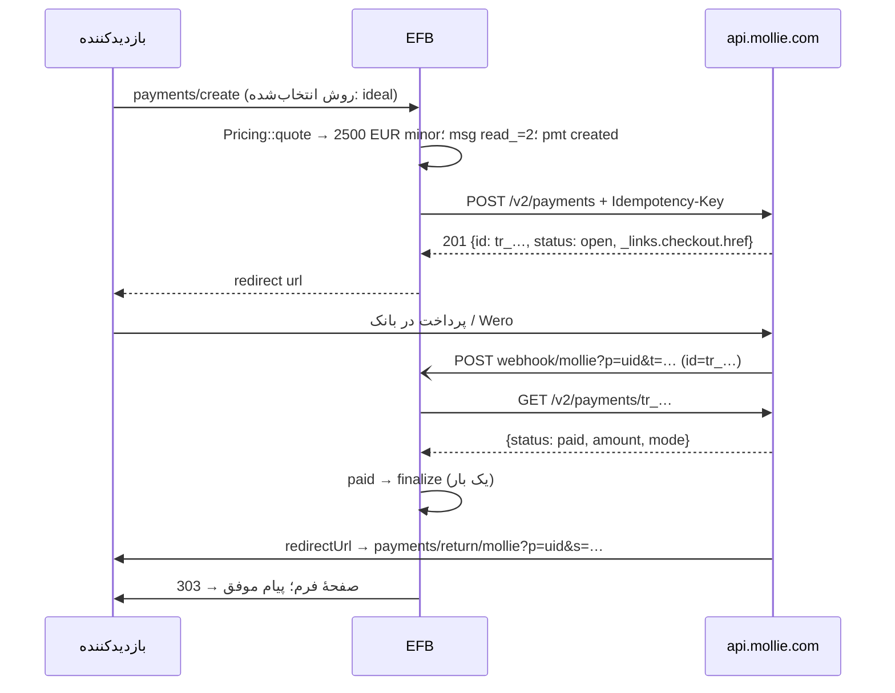

وضعیت: فاز ۱ پیاده و تست شد (۲۰۲۶-۱۱-۱۲؛ صفحهٔ میزبان، webhook با خواندن دوباره، بازپرداخت، Test/Live؛ جزئیات در «پیوست: آنچه پیاده شد») · Components و دوره‌ای فاز ۱b · اولویت: P0 (اولین درگاه) · تلاش: M · وابستگی: PAY00 (زیرتسک‌های B تا H)

# PAY01 — افزونهٔ Mollie (اروپا: iDEAL | Wero، Wero، Bancontact، کارت و روش‌های محلی)

تاریخ: ۲۲ آبان ۱۴۰۵ (2026-11-12). بر پایهٔ [PAY00](PAY00-payment-framework.fa.md)؛ هر چیزی که این‌جا تکرار نشده (جدول‌ها، وضعیت‌ها، فیلد قابل سفارشی‌سازی، رازها، صفحهٔ پرداخت‌ها) همان PAY00 است.

---

## ۰. خلاصهٔ تصمیم‌ها

1. افزونهٔ `vendores-efb/mollie`، کلید `AdnMOL`، نوع فیلد `mollie`، text domain `efb-mollie`.
2. جریان پیش‌فرض **صفحهٔ میزبان Mollie** (redirect) برای همهٔ روش‌ها؛ برای کارت، حالت اختیاری **Mollie Components** (فیلدهای کارت درون فرم، توکن یک‌ساعته، سپس 3DS با redirect).
3. فهرست روش‌ها از `GET /v2/methods` با مبلغ و ارز همان فرم گرفته می‌شود؛ پس وقتی Mollie روش `wero` را برای هلند یا فرانسه فعال کند، بدون تغییر کد در فیلد ظاهر می‌شود.
4. webhook کلاسیک Mollie فقط `id` می‌فرستد و امضا ندارد؛ تأیید همیشه با `GET /v2/payments/{id}` و مقایسهٔ مبلغ، ارز و `mode`.
5. هدر `Idempotency-Key` برای هر `POST` (ساخت پرداخت و بازپرداخت).
6. دوره‌ای در فاز ۱b: مشتری + پرداخت اول `sequenceType=first` + Subscriptions API (کارت، PayPal، و روش‌هایی که mandate SEPA می‌سازند مثل iDEAL و Bancontact).

## ۱. هدف

پذیرش iDEAL (هلند)، Wero (آلمان و بلژیک، سپس فرانسه و هلند)، Bancontact (بلژیک)، کارت‌ها، Apple Pay و روش‌های دیگر Mollie در فرم‌های EFB، با مبلغ سمت سرور، تأیید webhook، و Sandbox/Live.

## ۲. پژوهش (مستندات رسمی)

| موضوع | واقعیت | منبع |
|---|---|---|
| میزبان API | `https://api.mollie.com/v2/…` برای Test و Live؛ حالت را کلید تعیین می‌کند (کلید Test و Live جفت‌اند) | [Create payment](https://docs.mollie.com/reference/create-payment)، [Testing](https://docs.mollie.com/docs/testing) |
| احراز | `Authorization: Bearer <API key>` (کلید Test با `test_`، Live با `live_` در داشبورد)؛ `testmode` فقط برای OAuth/توکن سازمانی | [Create payment](https://docs.mollie.com/reference/create-payment)، [Authentication](https://docs.mollie.com/reference/authentication) |
| ساخت پرداخت | `POST /v2/payments`؛ الزامی: `amount{currency,value}` (رشته مثل `"10.00"`)، `description` (≤255)؛ معمولاً `redirectUrl`؛ اختیاری `webhookUrl` (نه localhost)، `cancelUrl`، `method` (یکی یا آرایه)، `metadata` (~1KB)، `locale`، `sequenceType` (`oneoff`/`first`/`recurring`)؛ پاسخ `201`، `status:"open"`، هدایت به `_links.checkout.href` | [Create payment](https://docs.mollie.com/reference/create-payment) |
| یکتایی | هدر `Idempotency-Key` روی همهٔ `POST`ها؛ کش یک ساعت؛ همان کلید با بدنهٔ دیگر → `400`؛ درخواست اول هنوز در جریان → `409` | [Idempotency](https://docs.mollie.com/reference/api-idempotency) |
| webhook | `POST` با `application/x-www-form-urlencoded` و تنها پارامتر `id`؛ بدون امضا؛ باید `200` در ۱۵ ثانیه؛ برای شناسهٔ ناشناخته هم `200`؛ ۱۰ تلاش تا ۲۶ ساعت (۰، ۱، ۳، ۷، ۱۵، ۳۱ دقیقه، ۱، ۲، ۴، ۲۶ ساعت)؛ فهرست IP توصیه نمی‌شود (`https://ip-ranges.mollie.com/ips.txt`)؛ redirect فقط `307/308` | [Webhooks](https://docs.mollie.com/reference/webhooks) |
| وضعیت‌ها | `open` (بدون webhook)، `pending`، `authorized`، `paid`، `failed`، `canceled`، `expired`؛ چهار آخر قطعی؛ پس از شکست یک تلاش در Checkout، پرداخت `open` می‌ماند | [Handling payment status](https://docs.mollie.com/docs/handling-payment-status) |
| روش‌ها | `GET /v2/methods` با `amount[value]`، `amount[currency]`، `locale`، `sequenceType`، `billingCountry`، `includeWallets`؛ هر روش `minimumAmount`، `maximumAmount`، `image.svg`، `status`؛ شناسه‌ها: `alma, applepay, bacs, bancomatpay, bancontact, banktransfer, belfius, billie, billink, bizum, blik, creditcard, directdebit, eps, giftcard, googlepay, ideal, in3, kbc, klarna, mbway, mobilepay, multibanco, mybank, paybybank, paypal, paysafecard, pointofsale, przelewy24, riverty, satispay, swish, trustly, twint, vipps, voucher, wero` | [List methods](https://docs.mollie.com/reference/list-methods) |
| Wero | **بتا با دسترسی محدود** (درخواست از مدیر حساب Mollie)؛ شناسهٔ `wero`؛ کشورهای API: DE، BE؛ برنامهٔ عرضه: آلمان و بلژیک Q3 2026، فرانسه و هلند اکتبر 2026، لوکزامبورگ ژانویه 2027؛ فقط EUR؛ ۰٫۰۱ تا ۱۰٬۰۰۰ یورو (بانک‌های بلژیک پیش‌فرض ۵٬۰۰۰)؛ بازپرداخت کامل و جزئی تا ۷۳۰ روز؛ **بدون دوره‌ای**؛ غیرتضمینی (chargeback تا ۱۲۰ روز)؛ معمولاً تأیید زیر ۶۰ ثانیه و ممکن است کوتاه‌مدت `pending` بماند | [Wero](https://docs.mollie.com/docs/wero)، [changelog](https://docs.mollie.com/changelog/add-wero-as-a-supported-payment-method) |
| iDEAL → Wero (هلند) | نشان مشترک «iDEAL \| Wero» از ۲۹ ژانویه تا ۳۱ مارس 2026 الزامی شد؛ مهاجرت فنی از اکتبر 2026؛ تکمیل تا ۳۱ دسامبر 2027 طبق نقشهٔ راه ژوئیهٔ 2026 | [iDEAL.nl](https://ideal.nl/en/ideal-vanaf-2026-stapsgewijs-over-naar-wero)، [Betaalvereniging](https://www.betaalvereniging.nl/en/?p=5309)، [Stripe support](https://support.stripe.com/questions/ideal-to-wero-migration) |
| بازپرداخت | `POST /v2/payments/{tr_id}/refunds` با `amount{currency,value}` (جزئی مجاز)، `description`، `metadata`؛ وضعیت‌ها `queued, pending, processing, refunded, failed, canceled` | [Create refund](https://docs.mollie.com/reference/create-refund) |
| دوره‌ای | `POST /v2/customers` → پرداخت `sequenceType:first` با `customerId` → mandate (`creditcard`، `paypal`، `directdebit` برای iDEAL/Bancontact/EPS/KBC/Belfius/PayByBank) → `POST /v2/customers/{id}/subscriptions` با `amount`، `times`، `interval` (مثل `"1 month"`)، `description`، `webhookUrl`؛ پرداخت‌های اشتراک `subscriptionId` دارند | [Recurring](https://docs.mollie.com/docs/recurring-payments) |
| Components | `https://js.mollie.com/v1/mollie.js` با **profile ID** (نه کلید)؛ `mollie.createToken()` → `cardToken` یک‌ساعته؛ پرداخت با `method:creditcard` و `cardToken`؛ سپس هدایت به `_links.checkout` برای 3DS؛ Mollie JS به دادهٔ کارت دسترسی نمی‌دهد | [Mollie Components](https://docs.mollie.com/docs/mollie-components) |
| آزمایش | صفحهٔ checkout آزمایشی که وضعیت را انتخاب می‌کنید؛ مبلغ‌های «جادویی» برای دلیل شکست کارت (مثلاً ۱٬۰۰۱٫۰۰ یورو → `invalid_card_number`)؛ کارت‌های آزمایشی Amex/Mastercard/Visa | [Testing](https://docs.mollie.com/docs/testing) |
| SDK | `mollie/mollie-api-php` هست؛ **استفاده نمی‌شود** — REST ساده با `wp_remote_*` (بدون وابستگی composer و تداخل نسخه مثل Stripe) | — |
| PCI | Checkout میزبان و Components → SAQ A | [Mollie Components](https://docs.mollie.com/docs/mollie-components) |
| نرخ | عدد منتشرشده‌ای پیدا نشد؛ `429` را با عقب‌نشینی مدیریت کنید | — |

## ۳. ساختار افزونه

```
mollie/
  mollieefb.php                     # canary؛ کلاس Emsfb\Mollie_Addon؛ enqueue فقط در صفحهٔ فرم دارای فیلد
  routes-efb.php                    # add_action('efb_register_payment_gateways', …)
  class-Emsfb-mollie-gateway.php    # extends Emsfb\Payments\Gateway
  class-Emsfb-mollie-client.php     # درخواست‌ها با Emsfb\Payments\Http (میزبان مجاز: api.mollie.com)
  mollie-phrases-efb.php            # Emsfb_Addon_Phrases_Mollie، SLUG 'mollie'، DOMAIN 'efb-mollie'
  json-efb-compat-efb.php           # همان فایل مشترک افزونه‌ها
  assets/js/mollie-efb.js           # آداپتور: EFBPay.registerGateway('mollie', {...})
  assets/js/mollie-admin-efb.js     # پنل تنظیمات: کش روش‌ها، آزمودن اتصال
  assets/css/mollie-efb.css         # فقط ظرف Components
  assets/img/                       # SVG رسمی روش‌ها (فقط اگر مجوز برند اجازه دهد؛ وگرنه image.svg از API)
  languages/efb-mollie-<locale>.po|.mo|.l10n.php, locales.json, index.php
  index.php
```

- `functions.php` هسته: `'AdnMOL' => array('vendor/mollie/mollieefb.php')` در `get_addon_required_files_efb()`، `'AdnMOL' => array('vendor/mollie/mollie-phrases-efb.php','vendor/mollie/languages/locales.json')` در `get_addon_i18n_required_files_efb()`، کلید در `get_all_addon_keys_efb()`، سطح در `addon_required_package_efb()`، نام «Mollie».
- `class-Emsfb-addon-compatibility.php`: حداقل PHP ۷٫۲ (sodium در هسته) و `functions: ['hash_hmac','json_decode']`.
- `class-Emsfb.php`: بارگذاری `routes-efb.php` وقتی `AdnMOL` روشن و سازگار است (الگوی `:615-635`).
- **zip:** `mollie.zip` با یک پوشهٔ بالایی `mollie/`، مدخل‌های پوشه، مرتب بر مسیر، حالت‌های 0755/0644، تاریخ ثابت 2026-10-18 00:00، deflate سطح ۹، بدون فیلد اضافه، با libzip (`ZipArchive`) — همان قاعدهٔ `docs/autopilot-integration.md` «Distribution zips».

## ۴. تنظیمات (`settings_schema()`)

| کلید | نوع | راز؟ | توضیح |
|---|---|---|---|
| `mode` | `test` · `live` | خیر | |
| `test_api_key` | متن، `^test_[A-Za-z0-9]{20,}$` | بله | |
| `live_api_key` | متن، `^live_[A-Za-z0-9]{20,}$` | بله | پیشوند اشتباه → پیام «این کلید Test است» |
| `profile_id` | `^pfl_[A-Za-z0-9]{6,}$` | خیر (عمومی) | فقط برای Components |
| `card_mode` | `hosted` · `components` | خیر | |
| `methods_cache` | JSON داخلی | خیر | نتیجهٔ `GET /v2/methods` برای هر ارز، ۱۲ ساعت؛ دکمهٔ «تازه‌سازی» |

«آزمودن اتصال» = `GET /v2/methods?amount[value]=10.00&amount[currency]=EUR` با کلید همان حالت؛ `401` → «کلید نامعتبر».

## ۵. روش‌ها و کشورها (پیش‌فرض‌های پیشنهادی فیلد)

| کشور/ارز | روش‌ها به ترتیب پیشنهادی | یادداشت |
|---|---|---|
| هلند EUR | `ideal` (نمایش «iDEAL \| Wero»)، `wero` (وقتی فعال شد)، `creditcard`، `applepay`، `paypal`، `banktransfer` | از اکتبر 2026 مهاجرت؛ لوگوی مشترک الزامی |
| آلمان EUR | `wero`، `paypal`، `creditcard`، `klarna`، `banktransfer` | Wero بتا |
| بلژیک EUR | `bancontact`، `wero`، `kbc`، `belfius`، `creditcard` | |
| فرانسه EUR | `creditcard` (CB از طریق کارت)، `wero` (از اکتبر 2026)، `applepay`، `paypal` | برای Cartes Bancaires بومی‌تر PAY02 |
| اتریش/لهستان/سوئیس | `eps` / `blik`، `przelewy24` / `twint` (CHF) | فقط اگر ارز فرم سازگار است |

`pf_methods` در فیلد فقط از روش‌هایی پر می‌شود که `status = activated` دارند و مبلغ quote میان `minimumAmount` و `maximumAmount` آن‌هاست؛ سرور هنگام ساخت دوباره بررسی می‌کند.

## ۶. جریان‌ها



- **Components:** `next.type = embedded` با `{profileId, locale, testmode}`؛ آداپتور فیلدهای `cardHolder`، `cardNumber`، `expiryDate`، `verificationCode` را سوار می‌کند؛ هنگام کلیک `createToken()` و سپس `POST payments/create` با `card_token` (فقط در همان درخواست، ذخیره نمی‌شود)؛ پاسخ `next.type = redirect` برای 3DS. جایگاه‌های Components در `[data-pf-slot="fields"]` و رنگ‌ها از متغیرهای `--efb-pf-*` به `styles` Mollie داده می‌شوند.
- **سایت محلی:** اگر میزبان `localhost` یا `.test`/`.local` است، Mollie `webhookUrl` را رد می‌کند؛ در حالت Test `webhookUrl` حذف و به بازگشت و cron تکیه می‌شود؛ صفحهٔ تنظیمات هشدار می‌دهد.

## ۷. فراخوانی‌های API

### ۷.۱ ساخت پرداخت

```http
POST https://api.mollie.com/v2/payments
Authorization: Bearer <MOLLIE_TEST_API_KEY>
Idempotency-Key: 6f1c…(sha256 hex از PAY00 idem_key، ۶۴ نویسه)
Content-Type: application/json

{
  "amount": { "currency": "EUR", "value": "25.00" },
  "description": "Workshop registration – Form 12 – EFB-7KQ2M9",
  "redirectUrl": "https://example.com/wp-json/Emsfb/v1/payments/return/mollie?p=Q3x…&s=9b1…",
  "cancelUrl":   "https://example.com/wp-json/Emsfb/v1/payments/return/mollie?p=Q3x…&s=9b1…&c=1",
  "webhookUrl":  "https://example.com/wp-json/Emsfb/v1/payments/webhook/mollie?p=Q3x…&t=4ac…",
  "method": ["ideal", "wero", "creditcard"],
  "locale": "nl_NL",
  "metadata": { "efb_uid": "Q3x…", "form_id": 12, "track": "EFB-7KQ2M9" }
}
```

پاسخ (کوتاه‌شده از نمونهٔ رسمی):

```json
{ "resource": "payment", "id": "tr_5B8cwPMGnU6qLbRvo7qEZo", "mode": "test", "status": "open",
  "amount": { "value": "25.00", "currency": "EUR" },
  "expiresAt": "2026-11-12T13:28:37+00:00",
  "_links": { "checkout": { "href": "https://www.mollie.com/checkout/select-method/7UhSN1zuXS" } } }
```

- `description`: عنوان فرم + کد پیگیری، حداکثر ۲۵۵ نویسه، بدون اطلاعات شخصی.
- `locale`: از `determine_locale()` نگاشت به ۳۰ مقدار پشتیبانی‌شدهٔ Mollie (`fa_IR` → حذف تا Mollie از زبان مرورگر استفاده کند).
- `method`: اگر بازدیدکننده در فیلد روش انتخاب کرده، فقط همان؛ وگرنه آرایهٔ `pf_methods`.
- قالب مبلغ: `Money::to_decimal_string()` با توان ISO (JPY بدون اعشار)؛ Mollie برای ارزهای غیر EUR محدودیت روش دارد که از `GET /v2/methods` با همان ارز خوانده می‌شود.

### ۷.۲ خواندن پرداخت (`fetch`)

`GET /v2/payments/{id}`. بررسی‌ها: `mode` برابر حالت ردیف؛ `amount.currency` و `amount.value` برابر quote؛ `metadata.efb_uid` برابر `uid`. فیلدهای مفید: `status`، `method`، `paidAt`، `amountRefunded`، `amountRemaining`، `amountChargedBack`، `details` (برای iDEAL نام بانک و IBAN مختصر: **ذخیره نمی‌شود**، فقط `method`).

### ۷.۳ بازپرداخت

```http
POST https://api.mollie.com/v2/payments/tr_5B8cwPMGnU6qLbRvo7qEZo/refunds
Authorization: Bearer live_…
Idempotency-Key: <emsfb_pmt_rfd_.idem_key>
{ "amount": { "currency": "EUR", "value": "10.00" }, "description": "EFB refund EFB-7KQ2M9" }
```

پاسخ `refund` با `status` (`queued`/`pending`/`processing`/`refunded`/`failed`/`canceled`) → ستون `emsfb_pmt_rfd_.status`؛ webhook بعدی پرداخت، `amountRefunded` را به‌روز و وضعیت پرداخت را `partially_refunded` یا `refunded` می‌کند.

### ۷.۴ دوره‌ای (فاز ۱b)

1. `POST /v2/customers {name, email}` (فقط وقتی فرم ایمیل دارد؛ وگرنه دوره‌ای غیرفعال).
2. `POST /v2/payments` با `customerId` و `sequenceType:"first"` و مبلغ اولین دوره (یا مبلغ `pay_setup_fee` + اولین دوره).
3. پس از `paid` و mandate معتبر: `POST /v2/customers/{cst}/subscriptions` با `amount`، `interval` از `paymentmethod` (`day`→`"1 day"`، `week`→`"1 week"`، `month`→`"1 month"`، `year`→`"12 months"`)، `times` از `pay_recur_count` (۰ → حذف)، `startDate` (امروز + یک دوره، یا + `pay_trial_days`)، `webhookUrl` همان آدرس.
4. پرداخت‌های بعدی با `subscriptionId` → ردیف `renewal`؛ لغو با `DELETE /v2/customers/{cst}/subscriptions/{sub}`.
- Wero دوره‌ای نیست؛ اگر فرم دوره‌ای است، `wero` از `methods` حذف می‌شود (`GET /v2/methods?sequenceType=first`).

## ۸. بررسی webhook (طرح کد)

```php
public function parse_webhook( \WP_REST_Request $r, Settings $s ): ?Webhook_Event {
    $id  = (string) $r->get_param( 'id' );                    // فقط id؛ هیچ وضعیتی پذیرفته نمی‌شود
    $uid = (string) $r->get_param( 'p' );
    $tok = (string) $r->get_param( 't' );
    if ( ! preg_match( '/^tr_[A-Za-z0-9]{4,40}$/D', $id ) ) return null;          // 200 بی‌اثر
    if ( $uid !== '' && ! hash_equals( Urls::webhook_token( 'mollie', $uid ), $tok ) ) {
        return Webhook_Event::auth_failed();                                    // 401؛ آدرس دست‌ساز
    }
    // کلید رویداد: هر دقیقه یک بار برای هر پرداخت (webhookهای بعدی بازپرداخت هم پردازش شوند)
    return Webhook_Event::refetch( $id, hash( 'sha256', 'mollie|' . $id . '|' . gmdate( 'YmdHi' ) ) );
}

public function fetch( Payment $p, Settings $s ): Remote_State {
    $res = $this->client( $s, $p->mode )->get( '/v2/payments/' . rawurlencode( $p->gateway_ref ) );
    if ( $res->is_network_error() || $res->code() >= 500 || $res->code() === 429 ) return Remote_State::unavailable();
    if ( $res->code() === 404 ) return Remote_State::not_found();
    $j = $res->json();
    if ( ( $j['mode'] ?? '' ) !== $p->mode ) return Remote_State::mismatch( 'mode' );
    if ( ( $j['metadata']['efb_uid'] ?? '' ) !== $p->uid ) return Remote_State::mismatch( 'uid' );
    $amount   = Money::from_decimal( $j['amount']['value'], $j['amount']['currency'] );
    $refunded = isset( $j['amountRefunded'] ) ? Money::from_decimal( $j['amountRefunded']['value'], $j['amountRefunded']['currency'] ) : 0;
    return new Remote_State( self::map_status( $j['status'], $refunded, $amount ), $amount, $j['amount']['currency'], $j['paidAt'] ?? null, $j['method'] ?? '', Redactor::clean( $j ) );
}
```

- Mollie IP ثابت ندارد؛ فهرست IP بررسی نمی‌شود (توصیهٔ رسمی).
- پاسخ همیشه `200` مگر `401` (توکن آدرس نادرست) و `503` (Mollie در دسترس نبود هنگام fetch؛ Mollie دوباره می‌فرستد).

## ۹. نگاشت وضعیت

| Mollie | EFB | یادداشت |
|---|---|---|
| `open` | `pending` | webhook نمی‌آید؛ بازگشت/cron بررسی می‌کند |
| `pending` | `pending` | Wero و بانکی ممکن است کوتاه‌مدت بمانند |
| `authorized` | `authorized` | Klarna/کارت با برداشت دستی؛ فاز ۱ استفاده نمی‌شود |
| `paid` | `paid` | با `amountRefunded > 0` → `partially_refunded`؛ برابر کل → `refunded` |
| `failed` | `failed` | |
| `canceled` | `canceled` | |
| `expired` | `expired` | `pending_ttl()` = `expiresAt` + ۱ ساعت؛ `banktransfer` تا ۲۸ روز |
| `amountChargedBack > 0` | بدون تغییر وضعیت | رویداد `dispute` و نشان در صفحهٔ پرداخت‌ها (Wero: chargeback ممکن است) |

## ۱۰. ویژگی‌های مخصوص فیلد

- لوگوی روش‌ها از `image.svg` پاسخ `GET /v2/methods` (کش‌شده در تنظیمات؛ آدرس‌ها از `mollie.com`) یا SVG بسته‌بندی‌شده؛ برای `ideal` در هلند متن جایگزین «iDEAL | Wero».
- `pf_methods_style=grid` پیش‌فرض این درگاه (کاشی با لوگو).
- انتخاب بانک iDEAL: از ۲۰۲۴ صفحهٔ iDEAL خودش بانک را می‌پرسد؛ EFB انتخاب‌گر بانک نمی‌سازد.
- پیام مخصوص Wero در `pending`: «پرداخت Wero در حال تأیید است؛ معمولاً کمتر از یک دقیقه طول می‌کشد.»

## ۱۱. امنیت و نکته‌ها

- میزبان مجاز `Http`: فقط `api.mollie.com`.
- `cardToken` هرگز ذخیره یا لاگ نمی‌شود.
- `metadata` بدون PII (فقط `efb_uid`، `form_id`، `track`).
- کلید اشتباه حالت: `live_` در فیلد Test → ذخیره رد می‌شود.

## ۱۲. سطح نسخه

افزونه: پیشنهاد Free Plus (مثل Stripe/PayPal). دوره‌ای و Components بخشی از `setting:pay_recurring` (Pro) و `setting:pay_style` هستند.

## ۱۳. رشته‌های ترجمه (`efb-mollie`)

| کلید | متن انگلیسی |
|---|---|
| `mollie` | Mollie |
| `mollieApiKeyTest` / `mollieApiKeyLive` | Test API key / Live API key |
| `mollieProfileId` | Profile ID (needed for card fields on your page) |
| `mollieCardMode` / `mollieCardHosted` / `mollieCardComponents` | Card payments / On Mollie's payment page / On your form (Mollie Components) |
| `mollieKeyWrongMode` | This looks like a %1$s key. Paste it in the %1$s field. |
| `mollieMethodsRefresh` | Refresh payment methods |
| `mollieMethodsNone` | No payment methods are active for %s in your Mollie account. |
| `mollieWeroBeta` | Wero is in beta at Mollie. Ask Mollie to enable it for your account. |
| `mollieWeroPending` | Your Wero payment is being confirmed. This usually takes less than a minute. |
| `mollieIdealWero` | iDEAL \| Wero |
| `mollieLocalWebhook` | Mollie cannot reach this site's address (local site). Payments will be checked when the visitor returns and every few minutes. |
| `mollieSecureNote` | Payments are processed by Mollie. |

## ۱۴. تست

### ۱۴.۱ fixtureها (از مثال‌های رسمی، با منبع)

`tests/fixtures/payments/mollie/`: `create-201.json`، `get-open.json`، `get-paid.json`، `get-paid-refunded-partial.json`، `get-failed.json`، `get-expired.json`، `get-mode-mismatch.json`، `methods-eur.json`، `refund-201.json`، `idempotency-409.json`، `webhook-form.txt` (`id=tr_5B8cwPMGnU6qLbRvo7qEZo`).

| تست | چه می‌سنجد |
|---|---|
| `php tests/test-pay-mollie-create.php` | بدنهٔ درخواست (مبلغ رشته‌ای، `method`، `locale`، آدرس‌های امضاشده، `Idempotency-Key` ثابت در تکرار)؛ مبلغ از quote نه از درخواست؛ حذف `webhookUrl` در سایت محلی |
| `php tests/test-pay-mollie-webhook.php` | `id` نامعتبر → 200 بی‌HTTP؛ توکن بد → 401؛ paid → finalize یک بار؛ تکرار در همان دقیقه بی‌اثر؛ `mode` ناسازگار → رد؛ مبلغ کمتر → `failed` + هشدار |
| `php tests/test-pay-mollie-status-map.php` | جدول §۹ |
| `php tests/test-pay-mollie-refund.php` | جزئی و کامل، `idem_key`، به‌روزرسانی وضعیت |
| `node tests/test-pay-mollie-adapter.js` | آداپتور با `efbmock`: انتخاب روش، redirect، Components ساختگی |

### ۱۴.۲ چک‌لیست دستی Sandbox

- [ ] کلید Test، فرم ۲۵ یورو، iDEAL → در checkout آزمایشی «Paid» → پاسخ پرداخت‌شده، یک ایمیل، کد پیگیری.
- [ ] همان با «Failed»، «Canceled»، «Expired»؛ پیام درست و دکمهٔ تلاش دوباره.
- [ ] بستن مرورگر پیش از بازگشت → پاسخ با webhook نهایی می‌شود.
- [ ] کارت با Components و 3DS؛ مبلغ جادویی ۱٬۰۰۱٫۰۰ → `invalid_card_number`.
- [ ] بازپرداخت جزئی از صفحهٔ پرداخت‌ها.
- [ ] اشتراک ماهانه با کارت آزمایشی؛ لغو.
- [ ] Wero (اگر حساب دسترسی بتا دارد) در DE؛ وضعیت `pending` و سپس `paid`.
- [ ] RTL (فارسی) و موبایل ۳۷۵px؛ نوار Test.

## ۱۵. زیرتسک‌ها

### A. اسکلت افزونه، ثبت در هسته، تنظیمات
- فایل‌ها: پوشهٔ `mollie/` (§۳)، `functions.php` و `class-Emsfb-addon-compatibility.php` هسته.
- پذیرش: افزونه نصب/فعال؛ کارت تنظیمات؛ آزمودن اتصال با fixture؛ راز هرگز در خروجی.
- تست‌ها: `php tests/test-pay-mollie-create.php` (بخش تنظیمات)، `node tests/test-pay-capabilities.js`.

**Checkpoint**
- فایل‌های تغییرکرده: `vendores-efb/mollie/` (`routes-efb.php`، `mollieefb.php`، `class-Emsfb-mollie-gateway.php`، `class-Emsfb-mollie-client.php`، `mollie-phrases-efb.php`، `json-efb-compat-efb.php`، `languages/`، `assets/img/`)؛ هسته تغییری نکرد (کلید `AdnMOL` و فایل‌های لازم از PAY00 در `functions.php` و `Registry::ADDONS` بودند).
- تست‌ها: `php tests/test-addon-mollie-refund-settings.php` ۳۱ موفق (تنظیمات، کلید حالت دیگر ذخیره نمی‌شود، آزمودن اتصال، راز هرگز در خروجی).
- وضعیت ترجمه: فقط متن انگلیسی و `languages/efb-mollie.pot` (۱۰ عبارت)؛ `locales.json` بی‌زبان؛ به دستور مالک ترجمه نشد.
- مورد باز: تنظیم `profile_id` و `card_mode` ساخته نشد (Components فاز ۱b)؛ `class-Emsfb-addon-compatibility.php` مدخل `AdnMOL` ندارد (پیش‌فرض سازگار؛ تغییر هسته لازم نبود).
- اقدام بعدی: —

### B. ساخت، بازگشت، webhook، fetch، نگاشت وضعیت
- فایل‌ها: `class-Emsfb-mollie-gateway.php`، `class-Emsfb-mollie-client.php`، `assets/js/mollie-efb.js`.
- پذیرش: §۶ تا §۹.
- تست‌ها: `test-pay-mollie-create.php`، `test-pay-mollie-webhook.php`، `test-pay-mollie-status-map.php`، `test-pay-mollie-adapter.js`.

**Checkpoint**
- فایل‌های تغییرکرده: `class-Emsfb-mollie-gateway.php`، `class-Emsfb-mollie-client.php`؛ آداپتور JS لازم نشد (redirect را runtime هسته انجام می‌دهد).
- تست‌ها: `php tests/test-addon-mollie-create.php` ۴۳ موفق، `php tests/test-addon-mollie-webhook.php` ۳۸ موفق (نگاشت §۹ هم در همین فایل)؛ سناریوی `mollie` در `tests/e2e-wp/run.js` ۲۵ موفق.
- وضعیت ترجمه: همان بالا.
- مورد باز: نام فایل‌های تست `test-addon-mollie-*` است (قرارداد افزونه‌ها) نه `test-pay-mollie-*`.
- اقدام بعدی: —

### C. روش‌ها، لوگوها، Components
- فایل‌ها: gateway (کش روش‌ها)، آداپتور (Components)، CSS.
- پذیرش: روش‌ها با مبلغ/ارز فیلتر می‌شوند؛ Components با رنگ‌های فیلد؛ کارت هرگز به سرور EFB نمی‌رسد.
- تست‌ها: `test-pay-mollie-adapter.js`، چک‌لیست دستی.

**Checkpoint**
- فایل‌های تغییرکرده: gateway (`methods()`، `logos()`، `choose_methods()`)، `assets/img/*.svg`.
- تست‌ها: انتخاب روش در `test-addon-mollie-create.php`، نمایش روش‌ها و لوگوها در سناریوی `mollie`.
- وضعیت ترجمه: همان بالا.
- مورد باز: **Components ساخته نشد**: هسته راهی ندارد که آداپتور پیش از `payments/create` توکن کارت را به درخواست و `Checkout_Context` بدهد (در BUGS-FOUND). پنل سازنده برای `pf_methods` رابط ندارد (فقط API)؛ پیش‌فرض `pf_methods_style=grid` برای این درگاه ممکن نیست (پیش‌فرض هسته `list`). لوگوها نشان سادهٔ نام‌اند، نه طرح رسمی برندها.
- اقدام بعدی: Components پس از افزودن هوک هسته؛ جایگزینی لوگوها با طرح رسمی پس از بررسی راهنمای برند.

### D. بازپرداخت و دوره‌ای
- فایل‌ها: gateway (`refund()`، `cancel()`، اشتراک).
- پذیرش: §۷.۳ و §۷.۴.
- تست‌ها: `test-pay-mollie-refund.php`، `test-pay-mollie-subscription.php` (تازه).

**Checkpoint**
- فایل‌های تغییرکرده: gateway (`refund()`، `cancel()`).
- تست‌ها: `test-addon-mollie-refund-settings.php` (جزئی، کامل، `Idempotency-Key` = `emsfb_pmt_rfd_.idem_key`، تلاش دوباره همان بازپرداخت، ۴۲۲، وضعیت failed، JPY)؛ بازپرداخت کامل در سناریوی `mollie`.
- وضعیت ترجمه: همان بالا.
- مورد باز: **دوره‌ای پیاده نشد** (`supports.recurring = false`؛ PAY00 فاز ۱ دوره‌ای ندارد).
- اقدام بعدی: دوره‌ای (customers، mandate، subscriptions) در فاز ۱b.

### E. ترجمه و zip
- فایل‌ها: `mollie-phrases-efb.php`، `languages/`، `mollie.zip`.
- پذیرش: §۱۳ با فارسی، آلمانی، هلندی و فرانسوی؛ zip طبق قاعده.
- تست‌ها: خط لولهٔ i18n افزونه (`docs/addon-i18n`)، بررسی zip.

**Checkpoint**
- فایل‌های تغییرکرده: `mollie-phrases-efb.php`، `languages/efb-mollie.pot`، `languages/locales.json`، `languages/index.php`، `vendores-efb/mollie.zip`.
- تست‌ها: `test-addon-mollie-refund-settings.php` (هر رشتهٔ `efb-mollie` کد در کلاس عبارت و `.pot`؛ چیدمان zip: یک پوشهٔ `mollie/`، مرتب، 0755/0644، تاریخ ثابت).
- وضعیت ترجمه: به دستور مالک هیچ زبانی ترجمه نشد (فارسی، آلمانی، هلندی و فرانسوی §۱۵-E منتظر دستور).
- مورد باز: —
- اقدام بعدی: ترجمه با خط لولهٔ `docs/addon-i18n` وقتی مالک بخواهد.

## ۱۶. پرسش‌های باز

1. Components در فاز ۱ لازم است یا صفحهٔ میزبان کافی است؟ (پیشنهاد: فاز ۱ فقط میزبان؛ Components در ۱b.)
2. حساب Mollie آزمایشی WhiteStudio برای تست Wero (بتا) درخواست شود؟
3. Mollie Connect (OAuth، اتصال با یک کلیک به‌جای چسباندن کلید) — نیاز به ثبت اپ WhiteStudio نزد Mollie دارد؛ ارزش فاز ۲ دارد؟
4. لوگوها از CDN Mollie (`image.svg`) یا بسته‌بندی محلی (حریم خصوصی بازدیدکننده در EU)؟ پیشنهاد: محلی.

## پیوست: آنچه پیاده شد (۲۰۲۶-۱۱-۱۲)

**ساخته شد (فقط با قرارداد PAY00، بدون تغییر هسته):** افزونهٔ `vendores-efb/mollie` (کلید `AdnMOL`، نوع فیلد `mollie`، text domain `efb-mollie`) و `mollie.zip`. صفحهٔ میزبان Mollie برای همهٔ روش‌ها؛ مبلغ ثابت، محاسبه‌شده و کمک مالی همه از quote سرور (`$p->amount_minor`، `$p->currency`)؛ ۲۹ ارز Mollie (JPY و ISK بدون اعشار؛ ارز سه‌رقمی پشتیبانی نمی‌شود و پیش از هر درخواست رد می‌شود)؛ `Idempotency-Key` برای ساخت (= `idem_key` پرداخت) و بازپرداخت (= `idem_key` ردیف بازپرداخت)؛ کلید Test و Live جدا (هر کدام الگوی خودش؛ کلید حالت دیگر ذخیره نمی‌شود)؛ `api_hosts() = ['api.mollie.com']`؛ لوگوهای محلی.

**تأیید webhook:** webhook کلاسیک Mollie فقط `id` دارد و امضا ندارد، پس هیچ چیزش باور نمی‌شود: هر webhook فقط باعث `GET /v2/payments/{id}` می‌شود و پاسخ باید همان `id`، همان `mode` ردیف و همان `metadata.efb_uid` را داشته باشد؛ مبلغ و ارز را هسته می‌سنجد (کمتر یا ارز دیگر → `failed` و ایمیل). آدرس webhook هم `p` و توکن `t` (HMAC با راز سایت) دارد: توکن نادرست → `401` بدون درخواست بیرونی. کلید رویداد `id|دقیقه`.

**تست‌ها:** `test-addon-mollie-create.php` ۴۳، `test-addon-mollie-webhook.php` ۳۸، `test-addon-mollie-refund-settings.php` ۳۱ (جمعاً ۱۱۲، بدون شبکه؛ fake در `tests/mollie-fake-provider.php` با پاسخ‌های `tests/fixtures/payments/mollie` از مثال‌های رسمی)؛ سناریوی `mollie` روی وردپرس واقعی ۲۵ بررسی.

**تصمیم‌ها برای تأیید مالک:**
1. Components و دوره‌ای فاز ۱b (پرسش باز ۱)؛ Components به هوک تازهٔ هسته نیاز دارد.
2. `webhookUrl` در سایت محلی فقط در حالت Test حذف می‌شود؛ در Live فرستاده می‌شود و Mollie رد می‌کند (پیام «پرداخت آغاز نشد»).
3. ناسازگاری `mode`/`efb_uid`/`id` در پاسخ Mollie «باور نشدنی» است و چون هسته حالت «ناسازگار» ندارد، webhook پاسخ `503` می‌گیرد (Mollie تا ۲۶ ساعت دوباره می‌فرستد) و ردیف معلق می‌ماند تا cron منقضی‌اش کند.
4. اگر هیچ‌کدام از روش‌های `pf_methods` برای این مبلغ فعال نباشد، پرداخت ساخته نمی‌شود (محدودیت مالک رعایت می‌شود)؛ بی‌`pf_methods` و روش انتخابی غیرفعال → `method` فرستاده نمی‌شود و صفحهٔ Mollie روش‌های مناسب را نشان می‌دهد.
5. فهرست روش‌های فیلد از «آزمودن اتصال» (۱۰٫۰۰ یورو) در کش تنظیمات هر حالت؛ نوسازی = دوباره «آزمودن اتصال».
6. لوگوها نشان سادهٔ نام روش‌اند (پرسش باز ۴: محلی)؛ طرح رسمی پس از بررسی مجوز برند.
7. حداقل مبلغ هر ارز ۱ واحد کوچک و حداکثر EUR ۵۰٬۰۰۰ (بیشترین سقف روش در مثال رسمی)؛ سقف هر روش را `GET /v2/methods` هنگام ساخت می‌سنجد.

**فقط با کلید Sandbox واقعی آزمودنی:** چک‌لیست §۱۴.۲ (صفحهٔ checkout آزمایشی، مبلغ جادویی کارت، Wero بتا، webhook واقعی از اینترنت، بازپرداخت جزئی واقعی، `amountRefunded` پس از بازپرداخت در وضعیت `queued`).
