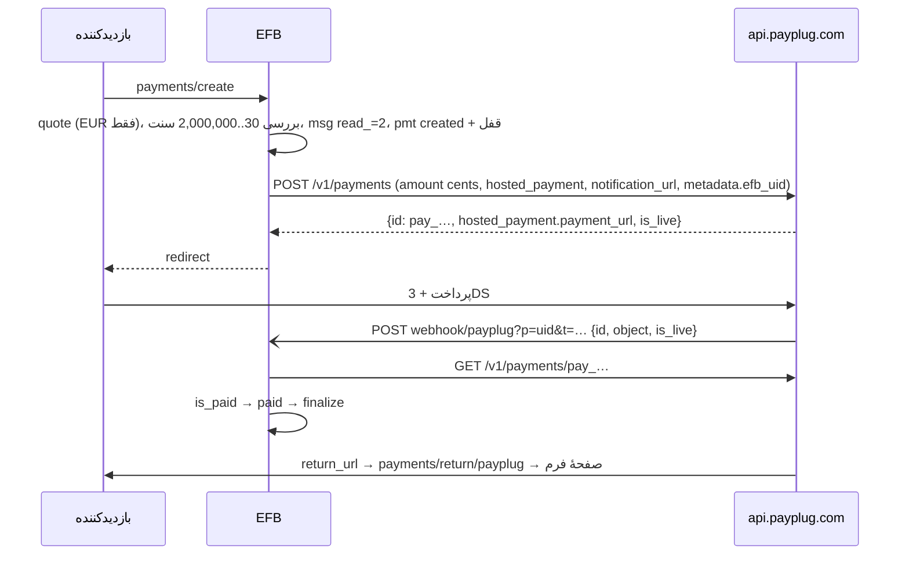

وضعیت: فاز ۱ (پرداخت یک‌باره) پیاده و تست شد، ۲۰۲۶-۱۱-۱۲؛ زیرتسک‌های A تا D و zip؛ ترجمه به دستور مالک انجام نشد (فقط متن انگلیسی و `.pot`)؛ جزئیات در «پیوست: آنچه پیاده شد» · اولویت: P0 (موج اول) · تلاش: M · وابستگی: PAY00 (B تا H)

# PAY02 — افزونهٔ Payplug (فرانسه: Cartes Bancaires، کارت، Apple Pay، Bancontact، اقساط Oney)

تاریخ: ۲۲ آبان ۱۴۰۵ (2026-11-12). بر پایهٔ [PAY00](PAY00-payment-framework.fa.md).

---

## ۰. خلاصهٔ تصمیم‌ها

1. افزونهٔ `vendores-efb/payplug`، کلید `AdnPPG`، نوع فیلد `payplug`، text domain `efb-payplug`.
2. جریان پیش‌فرض **صفحهٔ پرداخت میزبان Payplug** (`hosted_payment.payment_url`)؛ حالت اختیاری **Integrated Payment** (فیلدهای کارت درون فرم با انتخاب طرح کارت، از جمله `CARTE_BANCAIRE`).
3. فقط EUR، مبلغ به سنت، ۰٫۳۰ تا ۲۰٬۰۰۰ یورو (روش‌های جایگزین حدود دیگری دارند).
4. اعلان (`notification_url`) امضا ندارد؛ تأیید فقط با `GET /v1/payments/{id}`.
5. Payplug کلید یکتایی ندارد؛ یکتایی با `uq_attempt` محلی و قفل ساخت تضمین می‌شود (§۷.۱).
6. **ریسک احراز:** مستند رسمی کلیدهای `sk_test_`/`sk_live_` را «منسوخ» و «API keys (JWT)» را ترجیح می‌دهد ولی روش گرفتن JWT در صفحه‌های عمومی پیدا نشد؛ پیش از کدنویسی از Payplug پرسیده شود (پرسش باز ۱). طراحی هر دو را می‌پذیرد چون هر دو با `Authorization: Bearer` فرستاده می‌شوند.

## ۱. هدف

پذیرش کارت‌های فرانسوی (Cartes Bancaires و کارت‌های هم‌نشان CB/Visa/Mastercard)، Apple Pay، Amex و روش‌های اروپایی Payplug، و اقساط Oney برای ثبت‌نام و خدمات گران‌تر.

## ۲. پژوهش (مستندات رسمی)

| موضوع | واقعیت | منبع |
|---|---|---|
| میزبان | `https://api.payplug.com`؛ Test و Live با یک میزبان و دو کلید جدا | [API reference](https://docs.payplug.com/api/apiref.html) |
| احراز | `Authorization: Bearer <key>`؛ هدر `PayPlug-Version: 2019-08-06`؛ کلیدهای `sk_live_`/`sk_test_` «obsolete»؛ API keys (JWT) ترجیح دارند | همان |
| ساخت | `POST /v1/payments`؛ نمونهٔ رسمی: `amount` (۳۳۰۰)، `currency` (`EUR`)، `billing`، `shipping`، `hosted_payment{return_url,cancel_url}`، `notification_url`، `metadata`، `save_card`، `force_3ds`؛ پارامترهای دیگر: `payment_method`، `initiator` (`PAYER`/`MERCHANT`)، `auto_capture`، `authorized_amount`، `allow_save_card`، `integration` (`INTEGRATED_PAYMENT`)، `description`، `hosted_payment.sent_by` | همان |
| پاسخ | `id` (`pay_…`)، `is_paid`، `is_live`، `hosted_payment.payment_url`، `failure` (`null` در موفقیت) | همان |
| خواندن | `GET /v1/payments/{payment_id}` | همان |
| اعلان | `POST` JSON با `id`، `object`، `is_live`؛ بدون امضا؛ «retrieve a trusted object with a HTTPS GET request»؛ آدرس باید از اینترنت در دسترس باشد | همان؛ [Quick guide](https://docs.payplug.com/guide-payment-en.html) |
| بازپرداخت | `POST /v1/payments/{id}/refunds` (`amount` اختیاری = کل)؛ `GET …/refunds/{refund_id}`؛ حداقل ۱۰ سنت | [API reference](https://docs.payplug.com/api/apiref.html) |
| مبلغ و ارز | فقط `EUR`؛ ۳۰ تا ۲٬۰۰۰٬۰۰۰ سنت؛ حدود روش‌های جایگزین متفاوت؛ Oney ۱۰٬۰۰۰ تا ۳۰۰٬۰۰۰ سنت | همان |
| روش‌ها (`payment_method`) | `apple_pay`، `american_express`، `bancontact`، `ideal`، `mybank`، `satispay`، `scalapay`، `wero`، `oney_x3_with_fees`، `oney_x4_with_fees`، `oney_x3_without_fees`، `oney_x4_without_fees`؛ کارت (CB/Visa/Mastercard) پیش‌فرض | همان |
| اقساط | Installment plans: ۲، ۳ یا ۴ قسط؛ لغو (`aborted`) | همان |
| Integrated Payment | `https://cdn.payplug.com/js/integrated-payment/v1@1/index.js`؛ `test_mode` در سازنده (پیش‌فرض LIVE)؛ عناصر `cardHolder`، `cardNumber`، `cvv`، `expiration`؛ `Payplug.Scheme.AUTO`/`VISA`/`MASTERCARD`/`CARTE_BANCAIRE`، `getSupportedSchemes()`؛ 3DS `LIGHTBOX` (پیش‌فرض)/`REDIRECT`/`CUSTOM`؛ `onCompleted` شناسهٔ پرداخت را می‌دهد و وضعیت باید از سرور خوانده شود؛ رویدادهای `onCardSchemeChange`، `onValidateForm` | [Integrated Payment reference](https://docs.payplug.com/integratedref.html) |
| SDK | `payplug/payplug-php` هست؛ **استفاده نمی‌شود** (REST ساده) | [GitHub](https://github.com/payplug/payplug-php) |
| یکتایی | در مستند پیدا نشد | — |
| نرخ | منتشرنشده | — |

## ۳. ساختار افزونه

همان الگوی PAY01 §۳ با نام‌های `payplug/payplugefb.php`، `class-Emsfb-payplug-gateway.php`، `class-Emsfb-payplug-client.php` (میزبان مجاز `api.payplug.com`)، `payplug-phrases-efb.php` (`efb-payplug`)، `assets/js/payplug-efb.js`، `assets/js/payplug-admin-efb.js`، `languages/`، و `payplug.zip` با قاعدهٔ یکسان. ثبت در رجیستری هسته با `AdnPPG` و canary `vendor/payplug/payplugefb.php`.

## ۴. تنظیمات

| کلید | نوع | راز؟ |
|---|---|---|
| `mode` | `test` · `live` | خیر |
| `test_key` / `live_key` | متن (`sk_test_…` / `sk_live_…` یا JWT) | بله |
| `card_mode` | `hosted` · `integrated` | خیر |
| `scheme_choice` | `auto` · `let_payer_choose` | خیر |
| `methods` | زیرمجموعه از روش‌های §۲ که حساب فعال کرده (دستی؛ Payplug API فهرست روش ندارد) | خیر |
| `oney` | `off` · `x3` · `x4` (با یا بدون کارمزد مشتری) | خیر |

«آزمودن اتصال»: `GET /v1/payments?per_page=1` (فهرست، فقط‌خواندنی) با کلید همان حالت.

## ۵. Cartes Bancaires و کارت‌های هم‌نشان

- بیشتر کارت‌های فرانسوی هم‌نشان CB + Visa یا CB + Mastercard هستند. در حالت Integrated، `scheme_choice=let_payer_choose` با `getSupportedSchemes()` انتخاب‌گر طرح (با `iconUrl` رسمی) زیر شمارهٔ کارت نشان می‌دهد و `onCardSchemeChange` آن را هماهنگ می‌کند؛ پیش‌فرض `AUTO`. (آیین‌نامهٔ کارمزد کارت اتحادیهٔ اروپا حق انتخاب طرح را به دارنده می‌دهد؛ رفتار دقیق صفحهٔ میزبان Payplug در این باره باید با Payplug تأیید شود — پرسش باز ۲.)
- در فیلد، لوگوی CB کنار Visa/Mastercard با `pf_el=logos`.

## ۶. جریان‌ها



Integrated: ساخت پرداخت با `integration: "INTEGRATED_PAYMENT"` بدون `hosted_payment.payment_url` برای redirect؛ پاسخ `next.type=embedded` با `{payment_id, test_mode}`؛ آداپتور `intPayment.pay(payment_id, scheme)`؛ 3DS در `LIGHTBOX`؛ `onCompleted` → `EFBPay.poll(uid)`.

## ۷. فراخوانی‌های API

### ۷.۱ ساخت

```http
POST https://api.payplug.com/v1/payments
Authorization: Bearer <PAYPLUG_TEST_SECRET_KEY>
PayPlug-Version: 2019-08-06
Content-Type: application/json

{
  "amount": 3300,
  "currency": "EUR",
  "billing":  { "first_name": "…", "last_name": "…", "email": "…", "address1": "…", "postcode": "…", "city": "…", "country": "FR", "language": "fr" },
  "shipping": { "first_name": "…", "last_name": "…", "email": "…", "address1": "…", "postcode": "…", "city": "…", "country": "FR", "language": "fr", "delivery_type": "DIGITAL_GOODS" },
  "hosted_payment": {
    "return_url": "https://example.com/wp-json/Emsfb/v1/payments/return/payplug?p=Q3x…&s=…",
    "cancel_url": "https://example.com/wp-json/Emsfb/v1/payments/return/payplug?p=Q3x…&s=…&c=1"
  },
  "notification_url": "https://example.com/wp-json/Emsfb/v1/payments/webhook/payplug?p=Q3x…&t=…",
  "metadata": { "efb_uid": "Q3x…", "form_id": "12", "track": "EFB-7KQ2M9" },
  "description": "Inscription atelier – EFB-7KQ2M9"
}
```

- `billing`/`shipping`: در نمونهٔ رسمی هستند و برای 3DS2 لازم‌اند؛ از نگاشت فیلدهای فرم (`pgw_map_email`، `pgw_map_first`، `pgw_map_last`، `pgw_map_address`… کلیدهای تنظیم فیلد درگاه که شناسهٔ فیلد فرم را نگه می‌دارند) پر می‌شوند؛ بدون آدرس، Payplug ممکن است رد کند (پرسش باز ۳: حداقل فیلدهای لازم). `delivery_type: DIGITAL_GOODS` برای خدمات و ثبت‌نام (مقدار دقیق از مرجع تأیید شود).
- **یکتایی محلی:** پیش از درخواست، `UPDATE emsfb_pmt_ SET status='created', note='creating' WHERE id=%d AND gateway_ref=''` قفل؛ اگر پاسخ شبکه گم شد، ردیف `created` بی‌مرجع می‌ماند و تلاش دوباره با همان `attempt_key` **درخواست دوم نمی‌سازد** بلکه پیام «اتصال قطع شد، دوباره بزنید» می‌دهد و `attempt_key` تازه می‌خواهد. پرداخت یتیم احتمالی نزد Payplug پرداخت‌نشده است و زیانی ندارد.

### ۷.۲ خواندن

`GET /v1/payments/{id}` → `is_paid`، `paid_at` (در `hosted_payment`)، `is_refunded`، `amount_refunded`، `failure{code,message}`، `authorization` (برای برداشت معوق)، `is_live`، `metadata.efb_uid`. بررسی: `is_live` با حالت ردیف، `amount` و `currency` با quote.

### ۷.۳ بازپرداخت

`POST /v1/payments/{id}/refunds {"amount": 1000, "metadata": {"efb_refund": "<idem_key>"}}`؛ چون یکتایی سمت Payplug نیست، پیش از ارسال ردیف `emsfb_pmt_rfd_` با `idem_key` یکتا درج می‌شود و تکرار همان درخواست از صفحهٔ مدیریت به همان ردیف می‌رسد؛ اگر پاسخ گم شد، `GET …/refunds` فهرست را با `metadata.efb_refund` تطبیق می‌دهد پیش از هر تلاش دوباره.

### ۷.۴ اقساط Oney (فاز ۱b)

`payment_method: "oney_x3_with_fees"` و … در همان ساخت؛ فقط وقتی مبلغ ۱۰۰ تا ۳٬۰۰۰ یورو است. اقساط کارت (Installment plans ۲ تا ۴) با `POST /v1/installment_plans` فاز ۲.

## ۸. بررسی اعلان (طرح کد)

```php
public function parse_webhook( \WP_REST_Request $r, Settings $s ): ?Webhook_Event {
    $j   = json_decode( $r->get_body(), true );
    $id  = is_array( $j ) ? (string) ( $j['id'] ?? '' ) : '';
    $obj = is_array( $j ) ? (string) ( $j['object'] ?? '' ) : '';
    if ( ! preg_match( '/^pay_[A-Za-z0-9]{6,40}$/D', $id ) || ! in_array( $obj, array( 'payment', 'refund' ), true ) ) return null;
    if ( ! hash_equals( Urls::webhook_token( 'payplug', (string) $r->get_param( 'p' ) ), (string) $r->get_param( 't' ) ) ) return Webhook_Event::auth_failed();
    // object=refund → id پرداخت در payment_id
    $pay_id = $obj === 'refund' ? (string) ( $j['payment_id'] ?? '' ) : $id;
    return Webhook_Event::refetch( $pay_id, hash( 'sha256', 'payplug|' . $obj . '|' . $id ) );
}
```

`fetch()` مثل PAY01 §۸ با بررسی `is_live` به‌جای `mode`.

## ۹. نگاشت وضعیت

| Payplug | EFB |
|---|---|
| `is_paid = true` و `is_refunded = false` و `amount_refunded = 0` | `paid` |
| `is_paid = true` و `0 < amount_refunded < amount` | `partially_refunded` |
| `is_refunded = true` | `refunded` |
| `failure.code = aborted` | `canceled` |
| `failure.code = timeout` | `expired` |
| `failure` دیگر (کارت رد شد، 3DS ناموفق…) | `failed` |
| `authorization.authorized_at` و `is_paid = false` | `authorized` (فقط با `auto_capture=false`، فاز ۱ استفاده نمی‌شود) |
| بقیه | `pending`؛ `pending_ttl` = ۱ روز، سپس `expired` |

کدهای دقیق `failure.code` در مرجع بخش «Payment failures» تأیید و در fixture ثبت شوند.

## ۱۰. ویژگی‌های فیلد

- `pf_methods_style=list` پیش‌فرض؛ لوگوها CB، Visa، Mastercard، Apple Pay، Bancontact، Oney.
- متن فرانسوی پیش‌فرض دکمه از text domain افزونه: «Payer %s».
- فقط EUR: اگر ارز فرم EUR نیست، فیلد در سازنده هشدار سرخ و در فرم عمومی پیام `payUnavailable`.

## ۱۱. امنیت

- میزبان‌های مجاز: `api.payplug.com`، اسکریپت فقط `cdn.payplug.com`.
- `billing`/`shipping` شامل PII هستند؛ فقط به Payplug ارسال و در `emsfb_pmt_evt_` حذف (Redactor) می‌شوند.

## ۱۲. سطح نسخه

افزونه Free Plus (پیشنهاد)؛ Oney و Integrated Payment در Free Plus؛ اقساط کارت (فاز ۲) Pro.

## ۱۳. رشته‌های ترجمه (`efb-payplug`)

| کلید | متن انگلیسی |
|---|---|
| `payplug` | Payplug |
| `payplugKeyTest` / `payplugKeyLive` | Test secret key / Live secret key |
| `payplugCardMode` / `payplugHosted` / `payplugIntegrated` | Card payments / On Payplug's payment page / On your form (Integrated Payment) |
| `payplugSchemeChoice` | Let the payer choose the card brand (CB, Visa or Mastercard) |
| `payplugSchemeLabel` | Card brand |
| `payplugEurOnly` | Payplug only accepts payments in euro. Set the form currency to EUR. |
| `payplugAmountRange` | Payplug accepts card payments between €0.30 and €20,000. |
| `payplugOney` / `payplugOneyRange` | Pay in 3 or 4 instalments with Oney / Instalments are available for orders between €100 and €3,000. |
| `payplugBillingMap` | Fields used for the billing address (required for card authentication) |
| `payplugSecureNote` | Payments are processed by Payplug. |

## ۱۴. تست

fixtureها: `tests/fixtures/payments/payplug/`: `create-201.json`، `get-paid.json`، `get-failure-aborted.json`، `get-failure-timeout.json`، `get-refunded-partial.json`، `notification-payment.json`، `notification-refund.json`، `refund-201.json`، `list-refunds.json`.

| تست | چه می‌سنجد |
|---|---|
| `php tests/test-pay-payplug-create.php` | بدنه (سنت، EUR، `PayPlug-Version`، billing از نگاشت)، رد غیر EUR و خارج از بازه، قفل ساخت |
| `php tests/test-pay-payplug-webhook.php` | اعلان پرداخت و بازپرداخت، توکن آدرس، refetch، `is_live` ناسازگار |
| `php tests/test-pay-payplug-status-map.php` | جدول §۹ |
| `php tests/test-pay-payplug-refund.php` | یکتایی محلی و تطبیق پس از پاسخ گم‌شده |
| `node tests/test-pay-payplug-adapter.js` | Integrated ساختگی، انتخاب طرح |

چک‌لیست دستی Sandbox: پرداخت موفق کارت آزمایشی؛ 3DS؛ لغو در صفحه؛ بستن مرورگر و نهایی شدن با اعلان؛ بازپرداخت جزئی؛ Integrated با انتخاب CB؛ Oney (اگر حساب آزمایشی دارد)؛ RTL و موبایل.

## ۱۵. زیرتسک‌ها

### A. اسکلت، ثبت، تنظیمات
- فایل‌ها: پوشهٔ `payplug/`، رجیستری هسته.
- پذیرش: نصب، کارت تنظیمات، آزمودن اتصال، هشدار EUR.
- تست‌ها: `test-pay-payplug-create.php` (بخش تنظیمات).

**Checkpoint** (۲۰۲۶-۱۱-۱۲)
- فایل‌های تغییرکرده: `vendores-efb/payplug/` (`payplugefb.php`، `routes-efb.php`، `class-Emsfb-payplug-gateway.php`، `class-Emsfb-payplug-client.php`، `payplug-phrases-efb.php`، `languages/`، `assets/`)؛ در هسته هیچ تغییری لازم نشد (رجیستری، فایل‌های لازم و i18n افزونه از پیش `AdnPPG` را داشتند).
- تست‌ها: `php tests/test-addon-payplug-create.php` (۵۱ بررسی، بخش تنظیمات و آزمودن اتصال در آن)، `php tests/test-addon-payplug-secrets.php` (۱۸).
- وضعیت ترجمه: فقط متن انگلیسی؛ `languages/efb-payplug.pot` با ۴۵ رشته؛ `locales.json` بدون زبان.
- مورد باز: هشدار سرخ «فقط EUR» در سازنده (هستهٔ هوکی برای هشدار درگاه در پنل ندارد؛ فرم عمومی با ارز دیگر پیام `payUnavailable` می‌دهد)؛ BUGS-FOUND.
- اقدام بعدی: B.

### B. ساخت، اعلان، fetch، بازگشت
- فایل‌ها: gateway، client، آداپتور.
- پذیرش: §۶ تا §۹.
- تست‌ها: `test-pay-payplug-create.php`، `test-pay-payplug-webhook.php`، `test-pay-payplug-status-map.php`.

**Checkpoint** (۲۰۲۶-۱۱-۱۲)
- فایل‌های تغییرکرده: gateway و client افزونه؛ تست‌ها و fixtureها در هسته (`tests/fixtures/payments/payplug/`، `tests/addon-payplug-test-lib.php`).
- تست‌ها: `test-addon-payplug-create.php` (۵۱)، `test-addon-payplug-webhook.php` (۳۵)، `test-addon-payplug-status-map.php` (۲۳)؛ سناریوی e2e `payplug` (۲۵).
- وضعیت ترجمه: انگلیسی.
- مورد باز: اعلان قبل از «پرداخت‌شده» دیدن پرداخت در API (Payplug برای لغو اعلان نمی‌فرستد) با کلید رویداد «id + دقیقه» و cron پوشش داده شد؛ بازپرداخت در پورتال پیش از دیدن paid ردیف را گیر می‌اندازد (BUGS-FOUND).
- اقدام بعدی: C.

### C. Integrated Payment و انتخاب طرح CB
- فایل‌ها: آداپتور، CSS.
- پذیرش: §۵ و §۶.
- تست‌ها: `test-pay-payplug-adapter.js`.

**Checkpoint** (۲۰۲۶-۱۱-۱۲)
- فایل‌های تغییرکرده: `assets/js/payplug-efb.js`، `assets/css/payplug-efb.css`.
- تست‌ها: `node tests/test-addon-payplug-adapter.js` (۱۹، در Chromium با اسکریپت ساختگی Payplug به‌جای CDN).
- وضعیت ترجمه: متن‌های فیلدهای کارت از سرور (`efb-payplug`) در `next.client.texts`.
- مورد باز: آداپتور هسته فقط پس از ساخت پرداخت صدا زده می‌شود، پس فیلدهای کارت پس از کلیک «پرداخت» ظاهر می‌شوند و پرداخت‌کننده یک بار دیگر «تأیید پرداخت» را می‌زند؛ رفتار واقعی `getSupportedSchemes()` و 3DS فقط با کلید Sandbox واقعی آزمودنی است.
- اقدام بعدی: D.

### D. بازپرداخت و Oney
- فایل‌ها: gateway.
- پذیرش: §۷.۳ و §۷.۴.
- تست‌ها: `test-pay-payplug-refund.php`.

**Checkpoint** (۲۰۲۶-۱۱-۱۲)
- فایل‌های تغییرکرده: gateway (`refund()`، `cancel()`، روش‌های Oney).
- تست‌ها: `php tests/test-addon-payplug-refund.php` (۱۷)؛ Oney در `test-addon-payplug-create.php`.
- وضعیت ترجمه: انگلیسی.
- مورد باز: حدود Oney (۱۰۰ تا ۳۰۰۰ یورو) فقط در `create()` سنجیده می‌شود و پیام مرورگر پیام عمومی «پرداخت آغاز نشد» است (`supports()` حد را برای هر روش نمی‌پذیرد؛ BUGS-FOUND). اقساط کارت (installment plans) فاز ۲.
- اقدام بعدی: E.

### E. ترجمه (فرانسوی و فارسی اول) و zip
- فایل‌ها: phrases، `languages/`، `payplug.zip`.
- پذیرش: §۱۳.
- تست‌ها: خط لولهٔ i18n افزونه.

**Checkpoint** (۲۰۲۶-۱۱-۱۲)
- فایل‌های تغییرکرده: `payplug-phrases-efb.php`، `languages/efb-payplug.pot` (با `tests/addon-i18n/build-l10n.php --pot-only`)، `languages/locales.json`، `vendores-efb/payplug.zip`.
- تست‌ها: `test-addon-payplug-secrets.php` (هر رشتهٔ `efb-payplug` در `.pot` هست؛ کلیدهای §۱۳).
- وضعیت ترجمه: **انجام نشد** به دستور مالک؛ فرانسوی و فارسی بعداً با خط لولهٔ i18n افزونه.
- مورد باز: ترجمه؛ متن پیش‌فرض فرانسوی دکمه («Payer %s») هم به همین دلیل اضافه نشد (دکمه متن هستهٔ «Pay %s» را دارد).
- اقدام بعدی: کلید Sandbox واقعی و چک‌لیست دستی §۱۴.

## ۱۶. پرسش‌های باز

1. Payplug: کلیدهای `sk_*` «منسوخ»؛ JWT چطور گرفته و تمدید می‌شود؟ آیا برای افزونه‌های شخص سوم یک «partner/integration» ID لازم است (`PayPlug-Version` و هدر شناسهٔ افزونه)؟
2. رفتار صفحهٔ میزبان در انتخاب طرح کارت هم‌نشان CB.
3. حداقل فیلدهای `billing`/`shipping` الزامی برای 3DS2 در فرم‌هایی که آدرس نمی‌پرسند (کمک مالی).
4. کارت‌های آزمایشی و شبیه‌سازی شکست در حالت Test (صفحهٔ «Testing» مرجع).
5. Payplug خدمات را جز فرانسه (بلژیک، اسپانیا، ایتالیا) هم ارائه می‌دهد؟ فهرست کشورها برای `supports.countries`.

## پیوست: آنچه پیاده شد (۲۰۲۶-۱۱-۱۲)

افزونهٔ `vendores-efb/payplug` (کلید `AdnPPG`، نوع فیلد و slug `payplug`، text domain `efb-payplug`) فقط با قرارداد PAY00؛ هسته دست نخورد.

| موضوع | پیاده‌سازی |
|---|---|
| احراز | `Authorization: Bearer <key>` و `PayPlug-Version: 2019-08-06`؛ کلید `api_key` برای هر حالت (`per_mode`)، رمزنگاری‌شده؛ هم کلید JWT (سه بخش) و هم `sk_test_`/`sk_live_` قدیمی پذیرفته می‌شوند؛ «آزمودن اتصال» = `GET /v1/payments?per_page=1`، کلید Live در جای Test (پیشوند قدیمی یا `is_live` پرداخت‌های حساب) نام برده می‌شود |
| ساخت | `POST /v1/payments` با مبلغ سرور به سنت (`$p->amount_minor`)، `EUR`، `billing`/`shipping` (هر دو الزامی؛ از نگاشت `pgw_map_first/last/email/address/postcode/city/country` روی ردیف فیلد درگاه، پاک‌سازی و بریده؛ ایمیل از پرداخت‌کننده، کشور پیش‌فرض تنظیم `default_country` یا `FR`، زبان `fr`/`en`/`it` از locale، `delivery_type: DIGITAL_GOODS`)، `hosted_payment.return_url/cancel_url` (مسیر امضاشدهٔ هسته)، `notification_url` = webhook هسته با `p`=uid و `t`=HMAC، `metadata` (`efb_uid`، `form_id`، `track`، `efb_idem`)، `save_card: false`؛ پاسخ: `is_live` و `amount` با ردیف سنجیده می‌شوند |
| یکتایی | Payplug کلید یکتایی ندارد؛ `uq_attempt` و ردیف `created` هسته دومین درخواست با همان `attempt_key` را می‌بندد (پاسخ گم‌شده → «attempt_used»، پرداخت یتیم پرداخت‌نشده می‌ماند) |
| اعلان | امضا ندارد؛ توکن خودمان در آدرس (`Payplug_Gateway::notify_token()` = `Service::sign(uid, 'payplug#notify')`)؛ توکن نادرست → `401`؛ توکن یک پرداخت برای پرداخت دیگر → `401`؛ بدنه هرگز باور نمی‌شود: هسته `GET /v1/payments/{id}` می‌زند (`refetch`)؛ `object=refund` → `payment_id`؛ کلید رویداد = `object:id:دقیقه` |
| fetch | `id`، `object`، `is_live` (با حالت ردیف)، `metadata.efb_uid` (با uid ردیف) سنجیده می‌شوند؛ نگاشت §۹ (`map_state`)؛ `billing`/`shipping`/`card` در `raw` ذخیره نمی‌شوند |
| بازپرداخت | `POST /v1/payments/{id}/refunds {amount, metadata.efb_refund}`؛ پیش از هر درخواست فهرست بازپرداخت‌ها با همان کلید خوانده می‌شود (پاسخ گم‌شده دو بار بازپرداخت نمی‌کند)؛ حداقل ۱۰ سنت؛ جزئی و کامل |
| انقضا | `pending_ttl` یک روز؛ هستهٔ cron آن را `expired` و `cancel()` با `PATCH {aborted:true}` در Payplug لغو می‌کند |
| روش‌ها | کارت پیش‌فرض؛ تنظیم‌های `method_american_express`، `method_bancontact`، `method_ideal`، `method_mybank`، `method_satispay`، `method_scalapay`، `method_wero` و `oney` (۳/۴ قسط با یا بدون کارمزد)؛ `pf_methods` هسته زیرمجموعه را برمی‌گزیند؛ روش خاموش رد می‌شود؛ Oney فقط ۱۰۰ تا ۳۰۰۰ یورو |
| Integrated Payment | `card_mode=integrated` فقط برای کارت: `integration: INTEGRATED_PAYMENT`، `next.type=embedded` با `{payment_id, test_mode, scheme_choice, texts}`؛ آداپتور `payplug-efb.js` اسکریپت را فقط از `cdn.payplug.com/js/integrated-payment/v1@1/index.js` و فقط در این لحظه بار می‌کند؛ انتخاب طرح CB/Visa/Mastercard با `getSupportedSchemes()` و `onCardSchemeChange`؛ 3DS در `LIGHTBOX`؛ `onCompleted` فقط `poll` سرور |
| لوگوها | SVGهای ساده و خنثای محلی در `assets/img/` (CB، Visa، Mastercard، و روش‌های روشن)؛ جایگزینی با لوگوی رسمی هر طرح طبق راهنمای برند با مالک (PAY00 پرسش ۱۰) |
| ترجمه | فقط انگلیسی (دستور مالک)؛ `efb-payplug.pot` (۴۵ رشته)؛ `locales.json` خالی |

تست‌ها (همه بدون شبکه؛ پاسخ‌های `api.payplug.com` از نمونه‌های مستند در `tests/fixtures/payments/payplug/`): `test-addon-payplug-create.php` ۵۱، `-webhook.php` ۳۵، `-status-map.php` ۲۳، `-refund.php` ۱۷، `-secrets.php` ۱۸، `node tests/test-addon-payplug-adapter.js` ۱۹ (جمع ۱۶۳)؛ سناریوی `payplug` در `tests/e2e-wp/run.js` روی وردپرس واقعی با Payplug ساختگی (`mu-plugins/efb-e2e-payplug.php`، `ctl-payplug.php`): ۲۵ بررسی.

تصمیم‌هایی که مالک باید تأیید کند:

1. پذیرش هر دو قالب کلید (JWT و `sk_*` قدیمی) در یک فیلد «Secret key» (پرسش باز ۱ هنوز با Payplug).
2. نگاشت آدرس صورت‌حساب با کلیدهای `pgw_map_*` روی ردیف فیلد درگاه (فعلاً فقط از API/JSON، پنل سازنده رابط ندارد) و کشور پیش‌فرض `FR` وقتی فرم کشور نمی‌پرسد (پرسش باز ۳).
3. Apple Pay پیاده نشد (تأیید دامنه و `payment_context` لازم دارد؛ فاز ۲).
4. لوگوهای خنثای محلی تا تصمیم دربارهٔ لوگوی رسمی.
5. Integrated Payment دومرحله‌ای (کلیک «پرداخت» سپس فیلدهای کارت و «تأیید پرداخت») تا هسته راهی برای سوار کردن آداپتور پیش از ساخت بدهد.

فقط با کلید Sandbox واقعی آزمودنی: قالب واقعی پاسخ‌ها (به‌ویژه `payment_method` و کدهای `failure`)، رفتار صفحهٔ میزبان در انتخاب طرح CB، Integrated Payment و 3DS واقعی، Oney، رسیدن اعلان به سایت عمومی، پاسخ `200/202` بازپرداخت.

**به‌روزرسانی ۲۰۲۶-۱۱-۱۲ (هوک‌های اختیاری PAY00):** `field_schema()` نگاشت آدرس صورت‌حساب را در پنل سازنده می‌کشد و هسته پاک‌سازی می‌کند (تصمیم ۲ بالا: اکنون رابط دارد)، آدرس از `$ctx->payer` (دیگر `emsfb_msg_` خوانده نمی‌شود)، روش‌ها با لوگو و حد Oney (پیام مشخص)، `form_warnings()` بی‌نگاشت آدرس، هشدار EUR از `supports` هسته، `Remote_State::mismatch()`. Integrated Payment تک‌مرحله‌ای (هوک `prepare()`) هنوز ساخته نشده. `abc815a`؛ تست‌ها: ۱۶۵.
