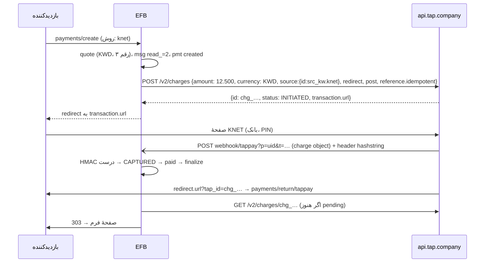

وضعیت: افزونه پیاده و تست شد (زیرتسک‌های A تا E، ۲۰۲۶-۱۱-۱۲؛ جزئیات در «پیوست: آنچه پیاده شد»؛ Card SDK و authorize فاز بعد؛ ترجمه به دستور مالک انجام نشد) · اولویت: P0 (موج اول) · تلاش: M · وابستگی: PAY00 (B تا H)

# PAY03 — افزونهٔ Tap Payments (خلیج فارس: mada، KNET، Benefit، کارت، Apple Pay)

تاریخ: ۲۲ آبان ۱۴۰۵ (2026-11-12). بر پایهٔ [PAY00](PAY00-payment-framework.fa.md).

---

## ۰. خلاصهٔ تصمیم‌ها

1. افزونهٔ `vendores-efb/tappay`، کلید `AdnTAP`، نوع فیلد `tappay` (نه `tap` که بسیار عام است)، text domain `efb-tappay`.
2. جریان پیش‌فرض **صفحهٔ میزبان Tap** با `source.id`: `src_all` (همهٔ روش‌ها)، یا روش انتخاب‌شده در فیلد: `src_card`، `src_sa.mada`، `src_kw.knet`، `src_bh.benefit`. KNET همیشه redirect است. حالت اختیاری **Card SDK** (توکن کارت درون فرم) در فاز ۱b.
3. فقط «charge» (برداشت فوری)؛ «authorize و capture» فاز ۲ (برای رزرو با لغو).
4. webhook با هدر `hashstring` (HMAC-SHA256 با کلید مخفی روی رشتهٔ ساخته‌شده از فیلدهای charge) تأیید می‌شود؛ مبلغ در رشته با دو یا سه رقم اعشار بسته به ارز.
5. یکتایی با `reference.idempotent` در charge و refund.
6. ارز روش‌ها سخت‌گیر است: mada فقط SAR، KNET فقط KWD، Benefit فقط BHD. فیلد روش‌های ناسازگار با ارز فرم را نشان نمی‌دهد.

## ۱. هدف

پذیرش کارت‌های بومی خلیج (mada در عربستان، KNET در کویت، Benefit در بحرین) و کارت‌های بین‌المللی و کیف‌پول‌ها با یک افزونه، برای خدمات، ثبت‌نام، رزرو و کمک مالی.

## ۲. پژوهش (مستندات رسمی)

| موضوع | واقعیت | منبع |
|---|---|---|
| میزبان | `https://api.tap.company/v2/` | [Create a charge](https://developers.tap.company/reference/create-a-charge) |
| احراز | `Authorization: Bearer sk_test_…` (Live: `sk_live_…`)؛ با کلید Test «منبع پرداخت شارژ نمی‌شود» | همان |
| ساخت charge | `POST /v2/charges`؛ الزامی: `amount`، `currency`، `customer` (`first_name`، `email` یا `customer.id`)، `source`، `redirect`؛ `source.id`: `src_all`، `src_card`، `src_kw.knet`، توکن، یا شناسهٔ authorize؛ `redirect.url` برای KNET، mada و 3DS لازم؛ `post.url` = webhook؛ `reference.transaction`، `reference.order`، `reference.idempotent` (جلوگیری از charge تکراری)؛ `metadata` (مثل `udf1`)؛ `threeDSecure` (پیش‌فرض true)؛ `save_card` (نیاز به تلفن)؛ `receipt.email/sms` «دیگر پشتیبانی نمی‌شود» | همان |
| پاسخ | `id` (`chg_…`)، `status: INITIATED`، `response{code:"100",message:"Initiated"}`، `transaction.url` (`https://checkout.payments.tap.company?mode=page&token=…`)، `redirect.status: PENDING` | همان |
| mada | `src_sa.mada` صفحه را فقط mada می‌کند؛ فقط SAR؛ بدون redirect اضافه | [mada](https://developers.tap.company/docs/mada) |
| KNET | «Redirection Payment Page Flow» الزامی؛ فقط KWD؛ اکنون authorization هم دارد؛ ذخیرهٔ کارت KFAST | [KNET](https://developers.tap.company/docs/knet.md) |
| Benefit | `src_bh.benefit`؛ فقط BHD؛ authorization ندارد؛ وضعیت `INITIATED` سپس باز کردن `transaction.url` برای PIN؛ BenefitPay Web SDK جدا | [Benefit](https://developers.tap.company/docs/benefit.md) |
| روش‌های دیگر | Apple Pay، Google Pay، STC Pay، OmanNet، NAPS/QPay، Jaywan، Tabby، Deema، Careem Pay، PayPal (بسته به کشور) | [Test cards](https://developers.tap.company/reference/testing-cards.md)، [Accepted methods](https://support.tap.company/en/support/solutions/articles/153000140246-accepted-payment-method-types-with-tap)، [llms.txt](https://developers.tap.company/llms.txt) |
| webhook | مقایسهٔ هدر `hashstring` با `hash_hmac('sha256', $toBeHashed, $secretKey)`؛ `$toBeHashed = 'x_id'.id.'x_amount'.amount.'x_currency'.currency.'x_gateway_reference'.reference.gateway.'x_payment_reference'.reference.payment.'x_status'.status.'x_created'.transaction.created`؛ مبلغ با رقم اعشار استاندارد ISO (AED، SAR، QAR، USD، EUR، GBP، EGP: ۲؛ BHD، KWD، OMR، JOD: ۳)؛ مرجع خالی = رشتهٔ خالی؛ برای invoice رشتهٔ دیگری با `x_updated` | [Webhook](https://developers.tap.company/docs/webhook) |
| authorize/capture | `POST /v2/authorize` (توکن، `auto` void پس از N ساعت، 3DS، `save_card`)؛ capture = charge با `source.id` = شناسهٔ authorize، مبلغ ≤ مبلغ رزرو | [Authorize and Capture](https://developers.tap.company/docs/authorize-and-capture.md) |
| بازپرداخت | `POST /v2/refunds`؛ الزامی `charge_id`، `amount` (تا ۳ رقم برای BHD/KWD/OMR)، `currency`، `reason`؛ اختیاری `reference.merchant`، `reference.idempotent`، `post.url`؛ کامل یا جزئی؛ پاسخ `re_…`، `status: REFUNDED`، `response.code: "000"` | [Create a refund](https://developers.tap.company/reference/create-a-refund) |
| کارت آزمایشی | KNET `8888880000000001` (09/30، PIN 1234) → CAPTURED؛ Benefit `4600410123456789` (12/27، 1234) → CAPTURED، `1111110123456789` → DECLINED؛ mada `4464040000000007` (3DS)، `5588480000000003`؛ Visa `4508750015741019` (3DS)؛ تاریخ انقضا نتیجه را تعیین می‌کند (01/39 APPROVED، 05/22 DECLINED، 08/28 TIMED_OUT، 05/37 UNKNOWN)؛ شماره‌های آزمایشی STC Pay | [Test Cards](https://developers.tap.company/reference/testing-cards.md) |
| Card SDK | توکنی کردن کارت در مرورگر، سازگار با PCI | [Card SDK](https://developers.tap.company/docs/card-sdk.md) |
| حساب چندکشوری | «Pass the correct Merchant ID related to each country» | [Authorize and Capture](https://developers.tap.company/docs/authorize-and-capture.md) |
| فهرست کامل وضعیت charge | در مرجع عمومی به‌شکل enum پیدا نشد؛ در نمونه‌ها `INITIATED`، `CAPTURED`، `DECLINED`، `NOT CAPTURED` و پاسخ‌های `TIMED_OUT`/`UNKNOWN` دیده شد | همان؛ پرسش باز ۱ |

## ۳. ساختار افزونه

الگوی PAY01 §۳: `tappay/tappayefb.php`، `class-Emsfb-tappay-gateway.php`، `class-Emsfb-tappay-client.php` (میزبان مجاز `api.tap.company`)، `tappay-phrases-efb.php` (`efb-tappay`)، `assets/js/tappay-efb.js`، `assets/js/tappay-admin-efb.js`، `assets/img/` (لوگوهای mada، KNET، Benefit طبق راهنمای برند هر طرح)، `languages/` (عربی و انگلیسی اول)، `tappay.zip`.

## ۴. تنظیمات

| کلید | نوع | راز؟ |
|---|---|---|
| `mode` | `test` · `live` | خیر |
| `test_secret` / `live_secret` | `^sk_(test|live)_[A-Za-z0-9]{10,}$` | بله |
| `test_public` / `live_public` | `^pk_(test|live)_…` (برای Card SDK) | خیر |
| `merchant_ids` | نگاشت کشور → `merchant.id` برای حساب چندکشوری (اختیاری) | خیر |
| `methods` | زیرمجموعه از `card, mada, knet, benefit, applepay, googlepay, stcpay, …` | خیر |
| `card_mode` | `hosted` · `sdk` | خیر |

«آزمودن اتصال»: `GET /v2/charges/<شناسهٔ ساختگی>` → `404` با کلید درست و `401` با کلید نادرست (یا فهرست charge با محدودیت ۱ اگر مرجع اجازه دهد).

## ۵. روش‌ها و ارزها در فیلد

| روش | `source.id` | ارز | جریان |
|---|---|---|---|
| همه (انتخاب در Tap) | `src_all` | ارز فرم | redirect |
| کارت | `src_card` | هر ارز حساب | redirect یا SDK |
| mada | `src_sa.mada` | SAR | redirect |
| KNET | `src_kw.knet` | KWD | redirect الزامی |
| Benefit | `src_bh.benefit` | BHD | redirect (صفحهٔ PIN) |
| Apple Pay / STC Pay / … | از `src_all` | — | redirect |

اگر بازدیدکننده روش را در فیلد انتخاب کند، `source.id` همان می‌شود؛ وگرنه `src_all`. سرور ارز را با جدول بالا دوباره می‌سنجد.

## ۶. جریان



## ۷. فراخوانی‌های API

### ۷.۱ ساخت charge

```http
POST https://api.tap.company/v2/charges
Authorization: Bearer <TAP_TEST_SECRET_KEY>
Content-Type: application/json

{
  "amount": 12.5,
  "currency": "KWD",
  "threeDSecure": true,
  "save_card": false,
  "description": "Course registration – EFB-7KQ2M9",
  "metadata": { "efb_uid": "Q3x…", "form_id": "12" },
  "reference": { "transaction": "EFB-7KQ2M9", "order": "Q3x…", "idempotent": "<idem_key>" },
  "customer": { "first_name": "…", "email": "…", "phone": { "country_code": "965", "number": "…" } },
  "source": { "id": "src_kw.knet" },
  "post":     { "url": "https://example.com/wp-json/Emsfb/v1/payments/webhook/tappay?p=Q3x…&t=…" },
  "redirect": { "url": "https://example.com/wp-json/Emsfb/v1/payments/return/tappay?p=Q3x…&s=…" }
}
```

- `amount` عدد اعشاری از `Money::to_decimal_string()` (KWD سه رقم) که به عدد JSON تبدیل می‌شود.
- `customer.first_name` و `email` الزامی‌اند: از نگاشت فیلدهای فرم (`pgw_map_*`)؛ اگر فرم ایمیل ندارد، فیلد درگاه در سازنده هشدار «Tap به نام و ایمیل نیاز دارد» می‌دهد و ذخیرهٔ فرم با `warnings` انجام می‌شود (الگوی A5).
- `reference.idempotent` = `idem_key` PAY00 (۶۴ نویسه)؛ اگر Tap محدودیت طول دارد (پرسش باز ۲)، ۳۲ نویسهٔ اول.
- حساب چندکشوری: `"merchant": {"id": "<merchant_ids[country]>"}`.

### ۷.۲ خواندن

`GET /v2/charges/{chg_id}` → `status`، `amount`، `currency`، `reference.gateway`، `reference.payment`، `transaction.created`، `source.payment_method`، `card.last_four` (فقط ۴ رقم ذخیره، اختیاری)، `metadata.efb_uid`. بررسی: `metadata.efb_uid`، مبلغ و ارز.

### ۷.۳ بازپرداخت

```http
POST https://api.tap.company/v2/refunds
{ "charge_id": "chg_…", "amount": 5.000, "currency": "KWD", "reason": "requested_by_customer",
  "reference": { "merchant": "EFB-R-…", "idempotent": "<rfd idem_key>" },
  "post": { "url": "https://example.com/wp-json/Emsfb/v1/payments/webhook/tappay?r=1&p=Q3x…&t=…" } }
```

پاسخ `{id: re_…, status: REFUNDED, response:{code:"000"}}` → `emsfb_pmt_rfd_`. webhook بازپرداخت همان قاعدهٔ `hashstring` را دارد (رشتهٔ charge/authorize/refund). مقدار `reason` بین مستند (`duplicate`/`fraudulent`/`requested_by_customer`) و نمونه (متن آزاد) ناسازگار است؛ فقط `requested_by_customer` فرستاده می‌شود.

## ۸. بررسی webhook (طرح کد)

```php
public function parse_webhook( \WP_REST_Request $r, Settings $s ): ?Webhook_Event {
    $raw = $r->get_body();
    $o   = json_decode( $raw, true );
    if ( ! is_array( $o ) || ! preg_match( '/^(chg|re|auth)_[A-Za-z0-9]{6,60}$/D', (string) ( $o['id'] ?? '' ) ) ) return null;
    $mode   = strpos( (string) ( $o['live_mode'] ?? '' ), '1' ) === 0 || ( $o['live_mode'] ?? false ) === true ? 'live' : 'test';
    $secret = $s->secret( $mode, 'secret' );
    $cur    = strtoupper( (string) ( $o['currency'] ?? '' ) );
    $amount = number_format( (float) ( $o['amount'] ?? 0 ), Currency::exponent( $cur ), '.', '' ); // 2 یا 3 رقم
    $str = 'x_id' . $o['id']
         . 'x_amount' . $amount
         . 'x_currency' . $cur
         . 'x_gateway_reference' . ( $o['reference']['gateway'] ?? '' )
         . 'x_payment_reference' . ( $o['reference']['payment'] ?? '' )
         . 'x_status' . ( $o['status'] ?? '' )
         . 'x_created' . ( $o['transaction']['created'] ?? '' );
    $given = (string) $r->get_header( 'hashstring' );
    if ( $given === '' || ! hash_equals( hash_hmac( 'sha256', $str, $secret ), $given ) ) {
        return Webhook_Event::auth_failed();                  // 401 و ثبت؛ cron بعداً GET می‌کند
    }
    $is_refund = strpos( $o['id'], 're_' ) === 0;
    $ref       = $is_refund ? (string) ( $o['charge_id'] ?? '' ) : $o['id'];
    return Webhook_Event::verified( $ref, hash( 'sha256', 'tap|' . $o['id'] . '|' . ( $o['status'] ?? '' ) ), $o, /* needs_refetch */ $is_refund );
}
```

- نکتهٔ مستند: «گرد کردن مبلغ گامی جدا پس از دریافت است»؛ یعنی مبلغ در بدنه ممکن است `12.5` باشد و رشته باید `12.500` بسازد.
- `live_mode` در بدنه برای انتخاب کلید؛ اگر نبود، کلید حالت ردیف پرداخت (پس از یافتن با `id`).
- برای ایمنی بیشتر، اگر وضعیت `CAPTURED` است ولی مبلغ با quote فرق دارد → `fetch()` و قاعدهٔ تطبیق PAY00 §۶.۲.

## ۹. نگاشت وضعیت

| Tap | EFB | یادداشت |
|---|---|---|
| `INITIATED`، `IN_PROGRESS` | `pending` | |
| `AUTHORIZED` | `authorized` | فقط در جریان authorize (فاز ۲) |
| `CAPTURED` | `paid` | |
| `ABANDONED`، `CANCELLED`، `VOID` | `canceled` | |
| `FAILED`، `DECLINED`، `RESTRICTED`، `NOT CAPTURED` | `failed` | |
| `TIMEDOUT` | `expired` | |
| `UNKNOWN` | `pending` | cron دوباره می‌پرسد؛ پس از `pending_ttl` (۲ ساعت برای کارت، ۲۴ ساعت برای Benefit) `expired` |
| refund `REFUNDED` | `refunded`/`partially_refunded` | بر اساس جمع بازپرداخت‌ها |

فهرست وضعیت‌های غیر از `INITIATED`/`CAPTURED`/`DECLINED` باید با Tap تأیید و fixture شود (پرسش باز ۱).

## ۱۰. فیلد و تجربهٔ کاربری

- `pf_methods_style=grid` با لوگوهای mada، KNET، Benefit، Visa/Mastercard، Apple Pay؛ برچسب‌های عربی از text domain.
- RTL کامل؛ مبلغ KWD/BHD با سه رقم و `<bdi>`؛ `pf_digits=locale` برای ارقام عربی-هندی اختیاری.
- Apple Pay روی صفحهٔ میزبان Tap است؛ Apple Pay درون فرم (نیاز به تأیید دامنه) فاز ۲.

## ۱۱. دوره‌ای

Tap در مستندات عمومی موتور اشتراک ندارد؛ فقط ذخیرهٔ کارت (`save_card` + `customer.id`، و KFAST برای KNET) و charge به ابتکار فروشنده. پس `supports.recurring = 'mit'` و در فاز ۱ غیرفعال (PAY00 §۱۱، پرسش باز ۳ PAY00).

## ۱۲. امنیت

- میزبان‌های مجاز: `api.tap.company`؛ اسکریپت SDK فقط از دامنهٔ رسمی Tap.
- تلفن و نام مشتری فقط به Tap؛ در لاگ حذف.
- `hashstring` با `hash_equals`؛ بدنهٔ خام برای JSON.

## ۱۳. سطح نسخه

افزونه Free Plus (پیشنهاد)؛ Card SDK و authorize (فاز ۲) Pro.

## ۱۴. رشته‌های ترجمه (`efb-tappay`)

| کلید | متن انگلیسی |
|---|---|
| `tappay` | Tap Payments |
| `tapSecretTest` / `tapSecretLive` / `tapPublicTest` / `tapPublicLive` | Test secret key / Live secret key / Test publishable key / Live publishable key |
| `tapMerchantIds` | Merchant ID per country (only for accounts in several countries) |
| `tapMethodAll` | All methods (choose on the Tap page) |
| `tapMada` / `tapKnet` / `tapBenefit` / `tapCard` | mada / KNET / BENEFIT / Credit or debit card |
| `tapCurrencyOnly` | %1$s only accepts payments in %2$s. |
| `tapNeedsNameEmail` | Tap needs the payer's name and email. Add a name field and an email field to this form. |
| `tapKnetRedirect` | You will be taken to the KNET page to choose your bank and enter your PIN. |
| `tapBenefitPin` | You will enter your BENEFIT PIN on the next page. |
| `tapSecureNote` | Payments are processed by Tap Payments. |

عربی و فارسی هم‌زمان با انگلیسی؛ بقیه با خط لوله.

## ۱۵. تست

fixtureها `tests/fixtures/payments/tap/`: `charge-create-200.json` (نمونهٔ رسمی)، `charge-captured-webhook.json` + `hashstring`، `charge-declined.json`، `charge-knet-kwd.json` (سه رقم)، `refund-200.json`، `refund-webhook.json`.

| تست | چه می‌سنجد |
|---|---|
| `php tests/test-pay-tap-hashstring.php` | ساخت رشته برای KWD (۳ رقم)، SAR (۲)، مرجع خالی؛ هش درست/نادرست؛ `12.5` → `12.500`؛ بردار ساخته‌شده با پیاده‌سازی مستقل |
| `php tests/test-pay-tap-create.php` | `source.id` بر اساس روش؛ رد ارز ناسازگار؛ `reference.idempotent`؛ مشتری از نگاشت |
| `php tests/test-pay-tap-webhook.php` | CAPTURED → finalize یک بار؛ تکرار؛ امضای بد → 401 |
| `php tests/test-pay-tap-status-map.php` | جدول §۹ |
| `php tests/test-pay-tap-refund.php` | جزئی، سه رقم، یکتایی |

چک‌لیست دستی Sandbox: KNET با کارت آزمایشی `8888880000000001`؛ Benefit `4600410123456789` و حالت DECLINED؛ mada با 3DS؛ Visa با تاریخ‌های انقضای نتیجه (05/22 → رد، 08/28 → TIMED_OUT)؛ بازپرداخت جزئی KWD؛ فرم عربی RTL و موبایل.

## ۱۶. زیرتسک‌ها

### A. اسکلت، ثبت، تنظیمات
- فایل‌ها: پوشهٔ `tappay/`، رجیستری هسته.
- پذیرش: نصب، تنظیمات، آزمودن اتصال.
- تست‌ها: `test-pay-tap-create.php` (بخش تنظیمات).

**Checkpoint**
- فایل‌های تغییرکرده: `vendores-efb/tappay/` (`routes-efb.php`، `class-Emsfb-tappay-gateway.php`، `class-Emsfb-tappay-client.php`، `tappay-phrases-efb.php`، `index.php`ها)؛ هسته: هیچ (رجیستری `AdnTAP` → `tappay` از PAY00 بود)
- تست‌ها: `php tests/test-addon-tappay-create.php` ۶۸ موفق (ثبت، `supports()`، طرح تنظیمات، رمزنگاری کلید، الگوی کلید، «آزمودن اتصال» Test/Live، کلید حالت دیگر، کلید ردشده، بی‌کلید، شبکهٔ قطع، هیچ راز در خروجی)
- وضعیت ترجمه: فقط انگلیسی؛ `languages/efb-tappay.pot` (۲۷ عبارت) و `locales.json` بدون زبان (به دستور مالک ترجمه نشد)
- مورد باز: کلید عمومی و `card_mode` (Card SDK) پیاده نشد (فاز ۱b)؛ `merchant_ids` به‌جای نگاشت کشور، از ارز فرم کشور را می‌گیرد (KWD→KW…)
- اقدام بعدی: —

### B. charge، webhook با hashstring، fetch، بازگشت
- فایل‌ها: gateway، client، آداپتور.
- پذیرش: §۶ تا §۹.
- تست‌ها: `test-pay-tap-hashstring.php`، `test-pay-tap-create.php`، `test-pay-tap-webhook.php`، `test-pay-tap-status-map.php`.

**Checkpoint**
- فایل‌های تغییرکرده: `class-Emsfb-tappay-gateway.php` (`create`، `fetch`، `parse_webhook`، `parse_return`)، `class-Emsfb-tappay-client.php` (hashstring، نگاشت وضعیت، مبلغ بدون float)
- تست‌ها: `test-addon-tappay-hashstring.php` ۶۳ موفق (شکل رشتهٔ نمونهٔ رسمی، ۱۱ ارز، ۲ و ۳ رقم، مرجع خالی، امضای مستقل با `number_format`، دستکاری مبلغ/وضعیت/ارز/مرجع، ۲۰۰۰ مبلغ تصادفی)؛ `test-addon-tappay-create.php` ۶۸ (ثابت، متغیر، محاسبه‌شدهٔ B7 با موتور واقعی منطق، کمک مالی BHD، `"amount":12.625` دقیق، `source.id` هر روش، ارز روش‌ها، فهرست روش مالک، `reference.idempotent`، مشتری از پاسخ، Merchant ID کشوری، Live)؛ `test-addon-tappay-webhook.php` ۵۴ (نگاشت وضعیت §۹، webhook معتبر بدون GET، جعلی، تکراری، خارج از ترتیب، پیش از بازگشت، بازگشت بی‌webhook، مبلغ/ارز ناسازگار → GET → failed، efb_uid دیگر، انقضای ۲ و ۲۴ ساعت، Live، webhook بازپرداخت)
- وضعیت ترجمه: همان A
- مورد باز: webhook امضاشدهٔ CAPTURED با مبلغ و ارز برابر بدون GET پذیرفته می‌شود (مبلغ، ارز و وضعیت درون امضا هستند)؛ ناسازگار → GET (§۸)
- اقدام بعدی: —

### C. روش‌ها و ارزها، لوگوها، RTL
- فایل‌ها: آداپتور، CSS، تصاویر.
- پذیرش: §۵ و §۱۰.
- تست‌ها: `node tests/test-pay-tap-adapter.js`.

**Checkpoint**
- فایل‌های تغییرکرده: `tappay/assets/js/tappay-efb.js`، `assets/css/tappay-efb.css` (فقط ویژگی‌های منطقی)، `assets/img/*.svg` (نشان‌های ساده با متن؛ آثار رسمی برند باید جایگزین شوند)
- تست‌ها: `node tests/test-addon-tappay-adapter.js` ۲۱ موفق (markup واقعی `Field::html()` و runtime هسته در Chromium: KWD/SAR/BHD/USD، list/grid/select، یک روش → انتخاب پنهان، یادداشت KNET/BENEFIT/mada با `aria-live`، عربی RTL در ۳۷۵px بی‌اسکرول افقی، کاشی ≥ ۴۴px، نشان در سمت آغاز، `<bdi>` با ۱۲٫۶۲۵، لوگوی محلی، برابری hashstring PHP با HMAC Node)
- وضعیت ترجمه: متن یادداشت‌ها از `efb-tappay` با `wp_localize_script` (`efb_tappay_vars`)
- مورد باز: هسته به `methods()` ارز فرم را نمی‌دهد و جای لوگو برای هر روش ندارد؛ آداپتور در مرورگر روش ناسازگار را برمی‌دارد و نشان را می‌افزاید (BUGS-FOUND)
- اقدام بعدی: —

### D. بازپرداخت
- فایل‌ها: gateway.
- پذیرش: §۷.۳.
- تست‌ها: `test-pay-tap-refund.php`.

**Checkpoint**
- فایل‌های تغییرکرده: `class-Emsfb-tappay-gateway.php` (`refund`)
- تست‌ها: `php tests/test-addon-tappay-refund.php` ۲۰ موفق (جزئی ۲٫۶۲۵ KWD سپس باقی‌مانده، بدنه و `reference.idempotent`، کلیک دوباره، بیش از باقی‌مانده، PENDING/ACCEPTED، DECLINED، شبکهٔ قطع، کلید Live برای پرداخت Live، BHD ۰٫۰۰۵ و SAR ۱۲٫۵۰)
- وضعیت ترجمه: —
- مورد باز: بازپرداخت PENDING/ACCEPTED در هسته همان لحظه «بازپرداخت‌شده» ثبت می‌شود و راهی برای ثبت شکست بعدی نیست (BUGS-FOUND)
- اقدام بعدی: —

### E. ترجمه (عربی، فارسی، انگلیسی) و zip
- فایل‌ها: phrases، `languages/`، `tappay.zip`.
- پذیرش: §۱۴.
- تست‌ها: خط لولهٔ i18n افزونه.

**Checkpoint**
- فایل‌های تغییرکرده: `tappay-phrases-efb.php`، `languages/efb-tappay.pot`، `languages/locales.json`، `languages/index.php`، `vendores-efb/tappay.zip` (با `build_zip.php`)
- تست‌ها: سناریوی `tappay` در `tests/e2e-wp/run.js` روی وردپرس واقعی: 29 بررسی
- وضعیت ترجمه: به دستور مالک ترجمه نشد؛ فقط انگلیسی و `.pot` (۲۷ عبارت، `tests/addon-i18n/build-l10n.php`)
- مورد باز: ترجمهٔ عربی و فارسی؛ آزمون دستی Sandbox (§۱۵)
- اقدام بعدی: —

## ۱۷. پرسش‌های باز

1. فهرست رسمی و کامل وضعیت‌های charge و refund، و اینکه webhook برای `DECLINED`/`ABANDONED` هم فرستاده می‌شود یا نه.
2. حداکثر طول `reference.idempotent` و مدت اعتبارش.
3. سیاست تلاش دوبارهٔ webhook (تعداد و فاصله) — در مستند نبود.
4. آیا برای افزونه‌های شخص سوم «platform/partner» ID یا اپ Tap (برای اتصال حساب فروشنده) لازم است؟
5. Benefit با BenefitPay Web SDK (QR در فرم) در فاز ۱ لازم است یا صفحهٔ میزبان کافی است؟

## پیوست: آنچه پیاده شد (۲۰۲۶-۱۱-۱۲)

- **افزونه:** `vendores-efb/tappay` (کلید `AdnTAP`، نوع فیلد و slug `tappay`، text domain `efb-tappay`)، فقط از قرارداد PAY00؛ هیچ تغییری در هسته. ثبت در `routes-efb.php` با `efb_register_payment_gateways`.
- **جریان:** فقط صفحهٔ میزبان Tap (`src_all`، `src_card`، `src_sa.mada`، `src_kw.knet`، `src_bh.benefit`)؛ مبلغ همیشه `$p->amount_minor`/`$p->currency` و در بدنهٔ JSON عدد دقیق با ۲ یا ۳ رقم (`12.625`)، بی‌float. `reference.idempotent` = ۳۲ نویسهٔ اول `idem_key` (Tap طولی مستند نکرده؛ اعتبار ۲۴ ساعت). `transaction.url` فقط اگر https روی `tap.company`.
- **تأیید webhook:** هدر `hashstring` = HMAC-SHA256 با کلید مخفی حالتی که `live_mode` می‌گوید (بی `live_mode` هر دو)، `hash_equals`، مبلغ با رقم ISO بازسازی می‌شود؛ برای refund `created` و `transaction.created` هر دو آزموده می‌شوند (نمونهٔ رسمی ناسازگار است). امضای بد → 401. وضعیت امضاشده بدون GET اعمال می‌شود؛ اگر مبلغ یا ارز با ردیف فرق دارد → GET (`fetch()`)؛ `fetch()` شناسه و `metadata.efb_uid` را می‌سنجد. payload رویداد بدون نام، ایمیل، تلفن و کارت.
- **بازگشت:** `tap_id` فقط مرجع است؛ هسته در صورت معلق بودن GET می‌کند.
- **وضعیت‌ها:** فهرست رسمی Charges (`INITIATED, ABANDONED, CANCELLED, FAILED, DECLINED, RESTRICTED, CAPTURED, VOID, TIMEDOUT, UNKNOWN`) + `IN_PROGRESS`، `NOT CAPTURED`، `TIMED_OUT` مطابق §۹؛ `UNKNOWN` معلق تا `pending_ttl` (۲ ساعت، BENEFIT ۲۴ ساعت).
- **ارزها و حدود (پیشنهاد، تأیید مالک):** KWD، BHD، OMR، JOD (۳ رقم)، SAR، AED، QAR، EGP، USD، EUR، GBP (۲ رقم)؛ حداقل ۰٫۱۰۰ / ۱٫۰۰ و حداکثر ۱۰۰٬۰۰۰ واحد (Tap حدی منتشر نکرده).
- **مشتری:** نام از فیلد متنی‌ای که برچسبش «name/nom/الاسم/نام…» دارد (کلمهٔ اول نام، بقیه نام خانوادگی)، وگرنه بخش پیش از @ ایمیل؛ ایمیل از `email_to` یا اولین فیلد ایمیل؛ بی‌ایمیل → پرداخت ساخته نمی‌شود (`needs_name_email` در رویدادها). تلفن فرستاده نمی‌شود.
- **بازپرداخت:** `POST /v2/refunds` کامل/جزئی، `reason: requested_by_customer`، `reference.merchant = EFB-R-…`، `reference.idempotent`، `post.url`؛ webhook بازپرداختی که از EFB نیست (داشبورد Tap) به ردیف اضافه می‌شود.
- **تست‌ها:** ۲۲۶ بررسی در ۵ فایل (`test-addon-tappay-hashstring.php` ۶۳، `-create.php` ۶۸، `-webhook.php` ۵۴، `-refund.php` ۲۰، `-adapter.js` ۲۱)؛ fixtureها در `tests/fixtures/payments/tap/` از نمونه‌های رسمی؛ سناریوی e2e `tappay`: 29 بررسی.
- **تصمیم‌هایی که مالک باید تأیید کند:** حدود مبلغ؛ ۳۲ نویسه برای `reference.idempotent`؛ پذیرش وضعیت امضاشده بدون GET؛ نام از برچسب فیلد؛ نشان‌های SVG ساده به‌جای آثار رسمی mada/KNET/BENEFIT/Visa/Mastercard/Apple Pay؛ Card SDK و authorize در فاز بعد.
- **فقط با کلید واقعی Sandbox قابل آزمودن:** شکل دقیق webhook refund و فیلد `created` آن، رفتار `reference.idempotent` و طول مجازش، وضعیت‌های `ABANDONED`/`TIMEDOUT` در عمل، صفحهٔ KNET/BENEFIT واقعی، کارت‌های آزمایشی §۲.

**به‌روزرسانی ۲۰۲۶-۱۱-۱۲ (هوک‌های اختیاری PAY00):** هر روش ارز و نشان خود را اعلام می‌کند و هسته فقط روش‌های ارز فرم را نشان می‌دهد (آداپتور فقط یادداشت‌ها را دارد)، `field_schema()` نام و ایمیل پرداخت‌کننده، پرداخت‌کننده از `$ctx->payer`/`$ctx->rows` (دیگر پاسخ ذخیره‌شده خوانده نمی‌شود)، `pf_methods` فیلد در سرور، `form_warnings()` «Tap به نام و ایمیل نیاز دارد»، `Remote_State::mismatch()`، بازپرداخت در انتظار با webhook بازپرداخت Tap تسویه می‌شود. `ebe31f4`؛ تست‌ها: ۲۳۷.

#### Checkpoint: error scenarios (2026-11-12)

Tap: the payer e-mail is required (format email; the confirmation e-mail field counts), the add-on's own `needs_name_email` Save warning is replaced by core's `pay_option_required`; an address Tap refuses → `payer_invalid` at the field; unpaid charges carry a reason (RESTRICTED, CANCELLED / ABANDONED, TIMEDOUT, DECLINED by Tap's response message). The hosted page follows the visitor's language: request header `lang_code` `ar` for `ar`, `ar_*`, `ary`, else `en` (Tap documents en and ar; Persian visitors get English). vendores-efb `aa92d45`; tests `test-addon-tappay-errors.php` (18) and the e2e scenario `tappay-lang` (en_US, ar, fa_IR). Matrix: [payment-error-matrix.en.md](payment-error-matrix.en.md).
