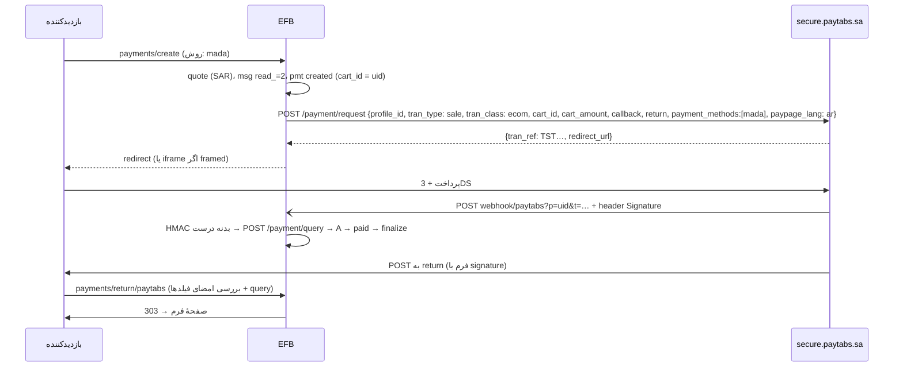

وضعیت: افزونه پیاده و تست شد (زیرتسک‌های A تا E، ۲۰۲۶-۱۱-۱۲؛ جزئیات در «پیوست: آنچه پیاده شد»؛ دوره‌ای، authorize و Managed Form فاز بعد؛ ترجمه به دستور مالک انجام نشد) · اولویت: P0 (موج دوم) · تلاش: M · وابستگی: PAY00 (B تا H)

# PAY05 — افزونهٔ PayTabs (خاورمیانه: کارت، mada، STC Pay، Apple Pay، KNET، OmanNet، Meeza QR، valU و روش‌های منطقه‌ای)

تاریخ: ۲۲ آبان ۱۴۰۵ (2026-11-12). بر پایهٔ [PAY00](PAY00-payment-framework.fa.md).

---

## ۰. خلاصهٔ تصمیم‌ها

1. افزونهٔ `vendores-efb/paytabs`، کلید `AdnPTB`، نوع فیلد `paytabs`، text domain `efb-paytabs`.
2. **منطقه اجباری است:** هر پروفایل PayTabs به یک دامنهٔ منطقه‌ای تعلق دارد (عربستان، امارات، مصر، عمان، اردن، عراق، سراسری)؛ استفاده از دامنهٔ اشتباه به خطای احراز می‌رسد. تنظیمات منطقه را جدا برای Test و Live می‌گیرد.
3. جریان پیش‌فرض **Hosted Payment Page** (`POST {domain}/payment/request` → `redirect_url`)؛ حالت اختیاری `framed: true` (همان صفحه درون iframe در فیلد) به‌عنوان «تعبیه‌شده».
4. callback سرور‌به‌سرور با هدر `Signature` = HMAC-SHA256 بدنهٔ خام با Server Key تأیید می‌شود؛ بازگشت مرورگر (POST با فیلدها) با روش جدا (حذف `signature`، حذف خالی‌ها، مرتب‌سازی کلید، `http_build_query`، HMAC). در هر دو حال وضعیت قطعی با `POST {domain}/payment/query`.
5. یکتایی با `cart_id` یکتا (همان `uid` پرداخت).
6. `donation_mode` PayTabs (وارد کردن مبلغ در صفحهٔ PayTabs) **استفاده نمی‌شود** چون مبلغ را از کنترل سرور EFB خارج می‌کند؛ کمک مالی با مبلغ دلخواه EFB (PAY00 §۸) ساخته می‌شود.

## ۱. هدف

یک افزونه برای فروشندگان خاورمیانه و شمال آفریقا که از PayTabs استفاده می‌کنند، با روش‌های بومی هر کشور، عربی/انگلیسی/فرانسوی در صفحهٔ پرداخت، و تأیید امضاشده.

## ۲. پژوهش (مستندات رسمی)

| موضوع | واقعیت | منبع |
|---|---|---|
| دامنه‌ها | عربستان `secure.paytabs.sa`، امارات `secure.paytabs.com`، مصر `secure-egypt.paytabs.com`، عمان `secure-oman.paytabs.com`، اردن `secure-jordan.paytabs.com`، عراق `secure-iraq.paytabs.com`، بقیه `secure-global.paytabs.com`؛ شناسهٔ پروفایل، Server Key و دامنه باید از یک منطقه باشند؛ صفحهٔ Apple Pay میزبان‌های کویت، مراکش و دوحه را هم نام می‌برد | [Switch between regions](https://support.paytabs.com/en/support/solutions/articles/60000712880-how-to-switch-between-profiles-based-in-different-regions-within-your-integration-)، [Apple Pay](https://docs.paytabs.com/PT2-API-Endpoints/Integration-Types-Manuals/Direct-Payment-Methods/applepay) |
| ساخت | `POST {domain}/payment/request`؛ الزامی: `profile_id`، `tran_type` (`sale`، `auth`، `void`، `release`، `capture`، `refund`، `register`)، `tran_class` (`ecom`، `recurring`، `moto`)، `cart_id` (۱ تا ۶۴، یکتا نزد فروشنده)، `cart_description` (۱ تا ۱۲۸)، `cart_currency`، `cart_amount` (۰٫۰۱ تا ۹۹۹۹۹۹۹۹۹۹٫۹۹)؛ اختیاری: `return`، `callback` (≤۲۵۵)، `hide_shipping`، `paypage_lang` (`en`/`ar`/`fr`)، `payment_methods`، `framed`، `customer_details`، `user_defined`، `tokenise`، `show_save_card`، `donation_mode`، `card_filter`؛ پاسخ `tran_ref` و `redirect_url`؛ «دامنهٔ اشتباه → خطای احراز» | [HPP: Initiating the payment](https://docs.paytabs.com/PT2-API-Endpoints/Integration-Types-Manuals/Hosted-Payment-Page/HPP-Step-3-Initiating-Payment/HPP-Initiating-Payment) |
| احراز | هدر `authorization` با Server Key همان پروفایل | [Switch between regions](https://support.paytabs.com/en/support/solutions/articles/60000712880-how-to-switch-between-profiles-based-in-different-regions-within-your-integration-) |
| callback (IPN) | هدر سفارشی `Signature` = `hash_hmac('sha256', <کل بدنه>, <Server Key>)`؛ مقایسه با `hash_equals` | [Validate callback/return](https://support.paytabs.com/en/support/solutions/articles/60000718961)، [HPP step 5](https://docs.paytabs.com/manuals/PT-API-Endpoints/Integration-Types-Manuals/Hosted-Payment-Page/HPP-Step-5-handle-the-payment-response/HPP-Step-5-Landing) |
| بازگشت (POST مرورگر) | حذف `signature`، حذف پارامترهای خالی، `ksort`، `http_build_query`، HMAC-SHA256 با Server Key | [Validate callback/return](https://support.paytabs.com/en/support/solutions/articles/60000718961) |
| وضعیت | `payment_result.response_status`: `A` Authorized، `H` Hold (مجاز ولی در بررسی ضدتقلب)، `P` Pending (برای بازپرداخت)، `V` Voided، `E` Error، `D` Declined؛ `response_code` جزئیات `E`/`D` | [Response code vs status](https://support.paytabs.com/en/support/solutions/articles/60000711358)، [respStatus](https://support.paytabs.com/en/support/solutions/articles/60000812327-return-response-parameters-response-status-respstatus-) |
| `tran_ref` | مرجع یکتای تراکنش برای query، بازپرداخت، capture و void | [tran_ref](https://docs.paytabs.com/PT2-API-Endpoints/Integration-Types-Manuals/Request-Response-Parameters/Request-Response-Parameter-Tran-Ref) |
| بازپرداخت | همان `payment/request` با `tran_type: "refund"` و `tran_ref` اصلی | همان |
| تعبیه | `framed: true` صفحهٔ پرداخت را در iframe نشان می‌دهد | [HPP: Initiating the payment](https://docs.paytabs.com/PT2-API-Endpoints/Integration-Types-Manuals/Hosted-Payment-Page/HPP-Step-3-Initiating-Payment/HPP-Initiating-Payment) |
| تلاش دوبارهٔ callback | در مستند رسمی پیدا نشد (یک مشخصهٔ غیررسمی AsyncAPI «تا ۵ بار» می‌گوید) | [apis.io (غیررسمی)](https://apis.io/asyncapis/paytabs/paytabs-webhooks-asyncapi/) |

## ۳. ساختار افزونه

الگوی PAY01 §۳: `paytabs/paytabsefb.php`، `class-Emsfb-paytabs-gateway.php`، `class-Emsfb-paytabs-client.php` (میزبان‌های مجاز: هفت دامنهٔ منطقه‌ای)، `paytabs-phrases-efb.php` (`efb-paytabs`)، `assets/js/paytabs-efb.js` (redirect یا iframe)، `assets/img/` (mada، STC Pay، Meeza، KNET، OmanNet، valU طبق راهنمای برند)، `languages/` (عربی، انگلیسی، فرانسوی)، `paytabs.zip`.

## ۴. تنظیمات

| کلید | نوع | راز؟ |
|---|---|---|
| `mode` | `test` · `live` | خیر |
| `test_region` / `live_region` | `sa` · `ae` · `eg` · `om` · `jo` · `iq` · `global` | خیر |
| `test_profile_id` / `live_profile_id` | عدد صحیح | خیر |
| `test_server_key` / `live_server_key` | متن | بله |
| `test_client_key` / `live_client_key` | متن (فقط برای Managed Form؛ فاز ۲) | خیر |
| `methods` | زیرمجموعه از مقادیر `payment_methods` که حساب فعال کرده | خیر |
| `framed` | `0` · `1` | خیر |
| `paypage_lang` | `auto` · `en` · `ar` · `fr` | خیر |

در PayTabs پروفایل‌های Test جدا هستند (همان دامنهٔ منطقه)، پس «حالت» یعنی کدام جفت `profile_id`/`server_key`. «آزمودن اتصال»: `POST {domain}/payment/query` با یک `tran_ref` ساختگی؛ پاسخ «تراکنش پیدا نشد» = کلید و دامنه درست، `401`/«authentication» = نادرست (همراه پیام «منطقه را بررسی کنید»).

## ۵. روش‌ها

مقادیر `payment_methods` (بسته به منطقه و حساب؛ فهرست دقیق از مرجع «Payment Methods» در پیاده‌سازی تأیید شود): `creditcard`، `mada`، `stcpay`، `applepay`، `amex`، `urpay` (عربستان)؛ `knet` (کویت)؛ `omannet` (عمان)؛ `meezaqr`، `valu`، `fawry`، `aman`، `souhoola` (مصر)؛ `unionpay`؛ `tabby`، `tamara` (اقساط). فیلد فقط روش‌های تنظیم‌شده را نشان می‌دهد؛ انتخاب بازدیدکننده به آرایهٔ تک‌عضوی `payment_methods` تبدیل می‌شود، وگرنه همهٔ روش‌های تنظیم‌شده.

## ۶. جریان



- بازگشت PayTabs **POST** است (نه GET)؛ مسیر بازگشت PAY00 هر دو روش را می‌پذیرد. چون POST میان‌سایتی است، کوکی `SameSite=Lax` همراهش نمی‌آید؛ پس بازگشت فقط به `uid` و امضا تکیه می‌کند (طراحی PAY00 همین است).
- در حالت `framed`، `redirect_url` در iframe درون جایگاه `fields` بارگذاری می‌شود و `return` به صفحهٔ کوچک `payments/return/paytabs?framed=1` می‌رود که با `postMessage` به صفحهٔ والد خبر می‌دهد (مبدأ بررسی می‌شود) و والد `EFBPay.poll()` را صدا می‌زند.

## ۷. فراخوانی‌های API

### ۷.۱ ساخت

```http
POST https://secure.paytabs.sa/payment/request
authorization: SXXXXXXXXX-XXXXXXXXXX-XXXXXXXXXX
Content-Type: application/json

{
  "profile_id": 83061,
  "tran_type": "sale",
  "tran_class": "ecom",
  "cart_id": "Q3x…",
  "cart_currency": "SAR",
  "cart_amount": 200.00,
  "cart_description": "تسجيل ورشة – EFB-7KQ2M9",
  "paypage_lang": "ar",
  "payment_methods": ["mada"],
  "hide_shipping": true,
  "customer_details": { "name": "…", "email": "…", "phone": "…", "street1": "-", "city": "…", "country": "SA" },
  "callback": "https://example.com/wp-json/Emsfb/v1/payments/webhook/paytabs?p=Q3x…&t=…",
  "return":   "https://example.com/wp-json/Emsfb/v1/payments/return/paytabs?p=Q3x…&s=…",
  "user_defined": { "udf1": "efb", "udf2": "12" }
}
```

پاسخ (کوتاه‌شده از نمونهٔ رسمی): `{"tran_ref": "TSTXXXXXX1198379", "cart_id": "Q3x…", "cart_amount": "200.00", "cart_currency": "SAR", "redirect_url": "https://secure.paytabs.sa/payment/page/XXXXXCFB3935"}`.

- `callback` و `return` ≤ ۲۵۵ نویسه: `uid` ۲۲ و امضاها ۳۲ نویسهٔ hex کوتاه‌شده؛ آدرس جایگزین کوتاه `?efb_pay_webhook=paytabs` اگر آدرس REST طولانی است.
- `customer_details`: از نگاشت فیلدها؛ PayTabs برای برخی حساب‌ها آن را الزامی می‌کند (پرسش باز ۲)؛ مقدار جای‌گزین برای فیلدهای ناموجود فقط با تأیید PayTabs.
- `cart_amount` با `Money::to_decimal_string()` (KWD/OMR/JOD/BHD سه رقم).

### ۷.۲ خواندن (query)

```http
POST https://secure.paytabs.sa/payment/query
authorization: <server key>
{ "profile_id": 83061, "tran_ref": "TSTXXXXXX1198379" }
```

فیلدها: `cart_id` (= `uid`)، `cart_amount`، `cart_currency`، `tran_type`، `payment_result.response_status`، `payment_result.response_code`، `payment_result.transaction_time`، `payment_info.payment_method`، `payment_info.card_scheme`.

### ۷.۳ بازپرداخت

```json
{ "profile_id": 83061, "tran_type": "refund", "tran_class": "ecom",
  "cart_id": "R-<rfd idem 20>", "cart_currency": "SAR", "cart_amount": 50.00,
  "cart_description": "Refund EFB-7KQ2M9", "tran_ref": "TSTXXXXXX1198379" }
```

پاسخ `payment_result.response_status`: `A` → `refunded` (برای ردیف بازپرداخت)، `P` → `pending`. `cart_id` بازپرداخت از `idem_key` ردیف بازپرداخت ساخته می‌شود تا تکرار شناسایی شود.

## ۸. بررسی callback و بازگشت (طرح کد)

```php
public function parse_webhook( \WP_REST_Request $r, Settings $s ): ?Webhook_Event {
    $raw = $r->get_body();
    $j   = json_decode( $raw, true );
    if ( ! is_array( $j ) || ! preg_match( '/^[A-Z0-9]{6,40}$/D', (string) ( $j['tran_ref'] ?? '' ) ) ) return null;
    $p = Store::find_by_ref( 'paytabs', $j['tran_ref'] );          // کلید درست = حالت همان پرداخت
    if ( ! $p ) return null;
    $key = $s->secret( $p->mode, 'server_key' );
    $sig = (string) $r->get_header( 'signature' );
    if ( $sig === '' || ! hash_equals( hash_hmac( 'sha256', $raw, $key ), $sig ) ) return Webhook_Event::auth_failed();
    return Webhook_Event::verified( $j['tran_ref'], hash( 'sha256', 'paytabs|' . $j['tran_ref'] . '|' . ( $j['payment_result']['response_status'] ?? '' ) ), $j, /* needs_refetch */ true );
}

public function parse_return( array $post, Payment $p ): ?string {                // $post = بدنهٔ POST بازگشت
    if ( empty( $post['signature'] ) ) return null;
    $given = (string) $post['signature'];
    unset( $post['signature'] );
    $fields = array_filter( $post, static function ( $v ) { return $v !== '' && $v !== null; } );
    ksort( $fields );
    $calc = hash_hmac( 'sha256', http_build_query( $fields ), Settings::load( 'paytabs' )->secret( $p->mode, 'server_key' ) );
    if ( ! hash_equals( $calc, $given ) ) return null;                          // بازگشت جعلی: فقط query سرور
    return isset( $fields['tranRef'] ) ? (string) $fields['tranRef'] : $p->gateway_ref;
}
```

- `needs_refetch = true`: حتی با امضای درست، `payment/query` اجرا می‌شود تا `cart_id`، مبلغ و ارز با ردیف مقایسه شود (هزینه یک درخواست).
- نام دقیق فیلد مرجع در POST بازگشت (`tranRef` در مستندات بازگشت) در پیاده‌سازی با fixture تأیید شود.

## ۹. نگاشت وضعیت

| `response_status` | `tran_type = sale` | `tran_type = auth` |
|---|---|---|
| `A` | `paid` | `authorized` |
| `H` | `pending` (یادداشت «در بررسی ضدتقلب»؛ ایمیل مدیر) | `pending` |
| `P` | `pending` | `pending` |
| `V` | `canceled` | `canceled` |
| `E` | `failed` | `failed` |
| `D` | `failed` | `failed` |
| بدون نتیجه پس از `pending_ttl` (۲ ساعت؛ برای fawry/aman مصر ۷۲ ساعت) | `expired` | `expired` |

## ۱۰. فیلد و تجربهٔ کاربری

- `paypage_lang` از `determine_locale()`: `ar*` → `ar`، `fr*` → `fr`، بقیه `en` (مگر تنظیم ثابت).
- `pf_methods_style=grid` با لوگوهای بومی؛ برای مصر متن «پرداخت در کیوسک Fawry/Aman» با یادداشت «تأیید ممکن است تا ۷۲ ساعت طول بکشد» (وضعیت `pending` و ایمیل «منتظر پرداخت»).
- RTL کامل؛ iframe در `framed` با `title` («صفحهٔ پرداخت امن PayTabs») و ارتفاع پویا.

## ۱۱. دوره‌ای

PayTabs توکن (`tokenise`) و `tran_class: recurring` دارد ولی زمان‌بندی را فروشنده انجام می‌دهد → `supports.recurring = 'mit'`؛ فاز ۲ (PAY00 §۱۱).

## ۱۲. امنیت

- فقط هفت دامنهٔ منطقه‌ای؛ دامنه از تنظیم، نه از داده‌های ورودی.
- Server Key راز؛ Client Key فقط برای فرم مدیریت‌شده (فاز ۲).
- iframe: `sandbox` استفاده نمی‌شود (صفحهٔ پرداخت به اسکریپت و فرم نیاز دارد)، ولی `allow="payment"` و `referrerpolicy="strict-origin"`؛ `postMessage` فقط از مبدأ سایت.

## ۱۳. سطح نسخه

افزونه Free Plus (پیشنهاد)؛ `framed` در Free Plus؛ authorize/capture و توکن (فاز ۲) Pro.

## ۱۴. رشته‌های ترجمه (`efb-paytabs`)

| کلید | متن انگلیسی |
|---|---|
| `paytabs` | PayTabs |
| `paytabsRegion` | Account region |
| `paytabsRegionHelp` | Use the region where your PayTabs profile was created. A wrong region causes authentication errors. |
| `paytabsRegionSa` / `paytabsRegionAe` / `paytabsRegionEg` / `paytabsRegionOm` / `paytabsRegionJo` / `paytabsRegionIq` / `paytabsRegionGlobal` | Saudi Arabia / United Arab Emirates / Egypt / Oman / Jordan / Iraq / Other countries (global) |
| `paytabsProfileId` / `paytabsServerKey` | Profile ID / Server key |
| `paytabsFramed` | Show the PayTabs payment page inside the form |
| `paytabsHold` | The payment is under review by PayTabs. We will confirm it as soon as the review ends. |
| `paytabsKiosk` | Pay at a Fawry or Aman outlet with the reference shown on the next page. Confirmation can take up to 72 hours. |
| `paytabsSecureNote` | Payments are processed by PayTabs. |

## ۱۵. تست

fixtureها `tests/fixtures/payments/paytabs/`: `request-200.json` (نمونهٔ رسمی)، `callback-A.json` + `Signature`، `callback-D.json`، `callback-H.json`، `return-post-A.txt` (فیلدها + `signature` ساخته‌شده با کلید آزمایشی)، `query-A.json`، `refund-A.json`.

| تست | چه می‌سنجد |
|---|---|
| `php tests/test-pay-paytabs-signature.php` | HMAC بدنهٔ callback؛ HMAC فیلدهای بازگشت (حذف خالی‌ها، `ksort`، کدگذاری)؛ دستکاری یک فیلد → رد |
| `php tests/test-pay-paytabs-create.php` | دامنهٔ منطقه، `cart_id`، `paypage_lang`، طول آدرس‌ها ≤ ۲۵۵، `payment_methods` |
| `php tests/test-pay-paytabs-status-map.php` | جدول §۹ |
| `php tests/test-pay-paytabs-refund.php` | `tran_type=refund`، یکتایی `cart_id` |
| `node tests/test-pay-paytabs-framed.js` | iframe، `postMessage` با مبدأ نادرست نادیده |

چک‌لیست دستی (پروفایل Test در دو منطقه، مثلاً SA و EG): کارت آزمایشی موفق و رد؛ mada؛ Meeza QR یا Fawry در مصر (وضعیت معلق و سپس نهایی)؛ بستن مرورگر؛ بازپرداخت جزئی؛ framed؛ عربی RTL و موبایل.

## ۱۶. زیرتسک‌ها

### A. اسکلت، ثبت، تنظیمات منطقه‌ای
- فایل‌ها: پوشهٔ `paytabs/`، رجیستری هسته.
- پذیرش: §۴؛ پیام روشن برای منطقهٔ اشتباه.
- تست‌ها: `test-pay-paytabs-create.php` (بخش تنظیمات).

**Checkpoint**
- فایل‌های تغییرکرده: `vendores-efb/paytabs/` (`paytabsefb.php`، `routes-efb.php`، `class-Emsfb-paytabs-gateway.php`، `class-Emsfb-paytabs-client.php`، `paytabs-phrases-efb.php`، `index.php`ها)؛ هسته: هیچ (رجیستری `AdnPTB` → `paytabs` از PAY00 بود)
- تست‌ها: `php tests/test-addon-paytabs-create.php` ۹۳ موفق (ثبت، `supports()`، `api_hosts()` = هفت دامنهٔ رسمی، طرح تنظیمات، رمزنگاری کلید، منطقهٔ ناشناخته/پروفایل غیرعددی/کلید بدشکل، «آزمودن اتصال» Test روی `secure.paytabs.sa` و Live روی `secure.paytabs.com`، منطقهٔ اشتباه → `authentication` با پیام منطقه، پروفایل کلید دیگر، کلید ردشده، شبکهٔ قطع، هیچ راز در خروجی)
- وضعیت ترجمه: فقط انگلیسی؛ `languages/efb-paytabs.pot` (۵۳ عبارت) و `locales.json` بدون زبان (به دستور مالک ترجمه نشد)
- مورد باز: `client_key` (Managed Form) فاز ۲؛ «آزمودن اتصال» پیام «Connected to PayTabs (منطقه)» را برمی‌گرداند ولی هسته فقط «Connected.» نشان می‌دهد (BUGS-FOUND، ردیف Omise)
- اقدام بعدی: —

### B. ساخت، callback، بازگشت POST، query
- فایل‌ها: gateway، client، آداپتور.
- پذیرش: §۶ تا §۹.
- تست‌ها: `test-pay-paytabs-signature.php`، `test-pay-paytabs-create.php`، `test-pay-paytabs-status-map.php`.

**Checkpoint**
- فایل‌های تغییرکرده: `class-Emsfb-paytabs-gateway.php` (`create`، `fetch`، `parse_webhook`، `parse_return`)، `class-Emsfb-paytabs-client.php` (امضاها، نگاشت وضعیت، مبلغ بی‌float)
- تست‌ها: `test-addon-paytabs-create.php` (ساخت: ثابت، متغیر، محاسبه‌شدهٔ B7 با موتور واقعی منطق، کمک مالی BHD، `"cart_amount":200.00`/`12.625`/`25020.750` دقیق، `cart_id` = uid، `paypage_lang`، `payment_methods` هر روش و «all» بی‌آن، ارز روش‌های محلی، فهرست مالک، طول آدرس‌ها، `customer_details` از پاسخ، بررسی پاسخ: میزبان صفحه/مبلغ/ارز/سبد، Live)؛ `test-addon-paytabs-signature.php` ۳۳ (HMAC بدنهٔ callback، HMAC فیلدهای بازگشت با هر دو خوانش «خالی»، دستکاری هر فیلد، عربی و `+`، ۵۰۰ نمونهٔ تصادفی با امضاکنندهٔ مستقل، `parse_return` با `$_POST`)؛ `test-addon-paytabs-webhook.php` ۵۸ (نگاشت §۹، callback معتبر → query → paid یک بار، جعلی، تکراری، خارج از ترتیب، پیش از بازگشت، بازگشت امضاشده بی‌callback، بازگشت جعلی بی‌query، مبلغ/ارز/سبد ناسازگار، D E C V X H، صفحهٔ بازشده و پرداخت‌نشده → معلق → انقضای ۲ ساعت و Aman ۷۲ ساعت، callback تراکنش بازپرداخت، Live، PayTabs در دسترس نیست → 503)
- وضعیت ترجمه: همان A
- مورد باز: هسته به `parse_return()` فقط query را می‌دهد؛ افزونه فیلدهای POST بازگشت را از `$_POST` می‌خواند (BUGS-FOUND)؛ نام فیلدها (`tranRef`، `cartId`، `respStatus`…) از نمونهٔ مقالهٔ رسمی است و با Sandbox واقعی تأیید نشد
- اقدام بعدی: —

### C. حالت framed
- فایل‌ها: آداپتور، صفحهٔ کوچک بازگشت framed.
- پذیرش: §۶ و §۱۲.
- تست‌ها: `test-pay-paytabs-framed.js`.

**Checkpoint**
- فایل‌های تغییرکرده: `assets/js/paytabs-efb.js` (روش‌ها برای ارز فرم، یادداشت Aman/valU، نشان‌ها، `mount()` حالت framed)، `assets/css/paytabs-efb.css` (فقط ویژگی‌های منطقی)، `assets/img/*.svg` (۹ نشان سادهٔ متنی)، صفحهٔ کوچک بازگشت framed در `Paytabs_Gateway::framed_return_page()` (هوک `init`، `?efb_ptb_frame=1&p&s`)
- تست‌ها: `node tests/test-addon-paytabs-framed.js` ۳۶ موفق (markup واقعی `Field::html()` و runtime هسته در Chromium: SAR/EGP/KWD/OMR، list/grid/select، یک روش → انتخاب پنهان، یادداشت با `aria-live`، عربی RTL در ۳۷۵px، iframe با `title`، `allow="payment"`، `referrerpolicy`، بی‌`sandbox`، پیوند «پنجرهٔ کامل»، پیام از مبدأ PayTabs/خود صفحه/uid دیگر نادیده، صفحهٔ بازگشت واقعی PHP درون قاب → poll → بسته شدن قاب، نشانی غیر PayTabs هرگز در قاب نمی‌رود، صفحهٔ بازگشت بیرون از قاب → بازگشت هسته)
- وضعیت ترجمه: متن‌ها از `efb-paytabs` با `wp_localize_script` (`efb_paytabs_vars`) و `next.client.text`
- مورد باز: ارتفاع قاب ثابت و پاسخ‌گو است (`min(720px, 85vh)`)، نه پویا (صفحهٔ PayTabs ارتفاع را اعلام نمی‌کند)؛ Apple Pay درون قاب کار نمی‌کند (پیوند پنجرهٔ کامل)؛ هسته راهی برای صفحهٔ بازگشت مخصوص درگاه ندارد (BUGS-FOUND)
- اقدام بعدی: —

### D. بازپرداخت
- فایل‌ها: gateway.
- پذیرش: §۷.۳.
- تست‌ها: `test-pay-paytabs-refund.php`.

**Checkpoint**
- فایل‌های تغییرکرده: `class-Emsfb-paytabs-gateway.php` (`refund`)
- تست‌ها: `php tests/test-addon-paytabs-refund.php` ۲۱ موفق (جزئی ۵۰٫۰۰ SAR سپس باقی‌مانده، `tran_type: refund` با `tran_ref` فروش، `cart_id` = `R-` + ۲۰ نویسه، تلاش دوباره با همان `cart_id`، بیش از باقی‌مانده، P → معلق، D → ناموفق با پیام PayTabs، شبکهٔ قطع، Live روی منطقهٔ Live حتی وقتی سایت روی Test است، KWD `2.625`)
- وضعیت ترجمه: —
- مورد باز: بازپرداخت در داشبورد PayTabs (callback با `tran_ref` خودش) در EFB شمرده نمی‌شود؛ بازپرداخت P همان لحظه در وضعیت پرداخت حساب می‌شود (همان ردیف Tap در BUGS-FOUND)
- اقدام بعدی: —

### E. ترجمه (عربی، انگلیسی، فرانسوی، فارسی) و zip
- فایل‌ها: phrases، `languages/`، `paytabs.zip`.
- پذیرش: §۱۴.
- تست‌ها: خط لولهٔ i18n افزونه.

**Checkpoint**
- فایل‌های تغییرکرده: `paytabs-phrases-efb.php`، `languages/efb-paytabs.pot`، `languages/locales.json`، `languages/index.php`، `vendores-efb/paytabs.zip` (با `build_zip.php`)
- تست‌ها: `php tests/test-addon-paytabs-package.php` ۱۶ موفق (فایل‌های لازم هسته، همهٔ رشته‌ها در `.pot`، دامنهٔ متن، zip: یک پوشهٔ بالا، مرتب، ۰۷۵۵/۰۶۴۴، تاریخ ثابت، همان محتوا، بی‌کلید، فقط هفت میزبان رسمی، بی‌require هسته)؛ سناریوی `paytabs` در `tests/e2e-wp/run.js` روی وردپرس واقعی: ۳۲ بررسی
- وضعیت ترجمه: به دستور مالک ترجمه نشد؛ فقط انگلیسی و `.pot` (۵۳ عبارت، `tests/addon-i18n/build-l10n.php --pot-only`)
- مورد باز: ترجمهٔ عربی، فرانسوی و فارسی؛ آزمون دستی Sandbox (§۱۵)
- اقدام بعدی: —

## ۱۷. پرسش‌های باز

1. فهرست رسمی دامنه‌ها: کویت، مراکش و قطر دامنهٔ API جدا دارند (صفحهٔ Apple Pay نام می‌برد) یا زیر `global`؟
2. `customer_details` برای حساب‌های تازه الزامی است؟ و مقادیر قابل قبول وقتی فرم آدرس نمی‌پرسد.
3. سیاست تلاش دوبارهٔ callback و پاسخ مورد انتظار (فقط `200`؟).
4. نام دقیق فیلدهای POST بازگشت (`tranRef`، `respStatus`، `cartId`…) و اینکه callback هم برای `D`/`E` فرستاده می‌شود.
5. نیاز به ثبت «Plugin/Platform» نزد PayTabs برای شناسایی افزونه.

## پیوست: آنچه پیاده شد (۲۰۲۶-۱۱-۱۲)

- **افزونه:** `vendores-efb/paytabs` (کلید `AdnPTB`، نوع فیلد و slug `paytabs`، text domain `efb-paytabs`)، فقط از قرارداد PAY00؛ هیچ تغییری در هستهٔ `includes/` یا `public/`. ثبت در `routes-efb.php` با `efb_register_payment_gateways`.
- **منطقه:** تنظیم `region` جدا برای Test و Live (`sa`، `ae`، `eg`، `om`، `jo`، `iq`، `global`)؛ میزبان همیشه از تنظیم ساخته می‌شود و `api_hosts()` فقط هفت دامنهٔ رسمی است (`secure.paytabs.sa`، `secure.paytabs.com`، `secure-egypt|oman|jordan|iraq|global.paytabs.com`). کویت، مراکش و قطر (پرسش باز ۱) زیر `global` می‌مانند تا PayTabs دامنهٔ جدا اعلام کند. هر درخواستِ یک پرداخت (query، بازپرداخت) با منطقه، پروفایل و کلید حالتِ همان پرداخت است.
- **جریان:** `POST /payment/request` (`sale`، `ecom`، `cart_id` = uid، مبلغ `$p->amount_minor`/`$p->currency` با رقم ISO و بی‌float، `paypage_lang` از تنظیم یا زبان پرداخت‌کننده، `payment_methods` تک‌عضوی یا هیچ برای «all»، `hide_shipping`، `customer_details` فقط با نام و ایمیل موجود در پاسخ، `user_defined` بی‌داده شخصی)؛ پاسخ بررسی می‌شود (سبد، مبلغ، ارز، `redirect_url` https روی میزبان رسمی). `donation_mode` استفاده نشد (§۰-۶). PayTabs سرآیند یکتایی ندارد: یکتایی با کلید تلاش هسته، `cart_id` یکتا، و `udf3` = ۳۲ نویسهٔ `idem_key` برای پشتیبانی.
- **تأیید callback:** هدر `Signature` = HMAC-SHA256 بدنهٔ خام با Server Key حالتِ پرداخت (یافتن با `tran_ref`)، `hash_equals`؛ بد یا بی‌هدر → 401. حتی callback درست هرگز وضعیت را از بدنه نمی‌گیرد: `needs_refetch` → `POST /payment/query` و بررسی `tran_ref`، `cart_id`، نوع `sale`، مبلغ و ارز (قاعدهٔ PAY00). payload رویداد بی‌مشتری و کارت.
- **بازگشت:** POST امضاشدهٔ مرورگر (حذف `signature` و خالی‌ها، `ksort`، `http_build_query`، HMAC؛ هر دو خوانش «خالی» پذیرفته می‌شود چون نمونهٔ PHP رسمی `array_filter()` است) از `$_POST` خوانده می‌شود؛ امضای درست و `tranRef`/`cartId` همین پرداخت → هسته query می‌کند؛ جعلی → هیچ (poll صفحه و cron می‌پرسند).
- **framed:** `framed: true` و `return` = صفحهٔ کوچک خود سایت (`/?efb_ptb_frame=1&p&s`، امضای سایت)؛ `next = embedded` با نشانی صفحه، میزبان‌های رسمی و مبدأ سایت. آداپتور صفحه را درون فیلد در iframe می‌گذارد؛ صفحهٔ بازگشت فقط `postMessage` به مبدأ سایت می‌فرستد و فرم وضعیت را از EFB می‌پرسد. بیرون از قاب به نشانی بازگشت هسته می‌رود.
- **وضعیت‌ها:** §۹ به‌علاوهٔ `X` → `expired` و `C` (کد ۳۲۱، لغو در صفحه) → `canceled` از مرجع رسمی؛ پاسخ «تراکنش پیدا نشد» یا بی‌`payment_result` → معلق تا `pending_ttl` (۲ ساعت؛ Aman ۷۲ ساعت). Fawry در فهرست رسمی `payment_methods` نیست؛ Aman جایش.
- **روش‌ها:** `all`، `creditcard`، `mada`، `stcpay`، `applepay`، `knet`، `omannet`، `meezaqr`، `valu`، `aman`، `urpay`، `amex`، `unionpay`، `tabby`، `tamara`، `souhoola` (مقادیر رسمی)؛ پیش‌فرض فقط `all`. ارز روش‌های محلی (mada/STC Pay/urpay SAR، KNET KWD، OmanNet OMR، Meeza/valU/Aman/Souhoola EGP) در سرور و آداپتور سنجیده می‌شود (فقط valU EGP در مستند صریح است).
- **ارزها و حدود (پیشنهاد، تأیید مالک):** SAR، AED، EGP، QAR، USD، EUR، GBP (۲ رقم)، KWD، BHD، OMR، JOD، IQD (۳ رقم ISO)؛ حداقل/حداکثر همان مستند `cart_amount`: ۰٫۰۱ تا ۹٬۹۹۹٬۹۹۹٬۹۹۹٫۹۹.
- **تست‌ها:** ۲۵۷ بررسی در ۶ فایل (`test-addon-paytabs-create.php` ۹۳، `-signature.php` ۳۳، `-webhook.php` ۵۸، `-refund.php` ۲۱، `-package.php` ۱۶، `-framed.js` ۳۶)؛ fixtureها در `tests/fixtures/payments/paytabs/` از نمونه‌های رسمی؛ سناریوی e2e `paytabs` (`tests/e2e-wp/scenario-paytabs.js`): ۳۲ بررسی.
- **تصمیم‌هایی که مالک باید تأیید کند:** فهرست ارزها (به‌ویژه IQD با ۳ رقم) و حدود؛ ارز روش‌های محلی؛ پیش‌فرض «all» برای روش‌ها؛ پذیرش هر دو خوانش «خالی» در امضای بازگشت؛ پاسخ «پیدا نشد» = معلق؛ ارسال `customer_details` ناقص (فقط نام و ایمیل)؛ ارتفاع ثابت قاب؛ نشان‌های SVG ساده به‌جای آثار رسمی برندها؛ صفحهٔ بازگشت framed روی `home_url` با هوک `init`.
- **فقط با Sandbox واقعی قابل آزمودن:** متن و کد خطای احراز و «پیدا نشد»، شکل callback برای D/E و برای بازپرداخت، نام دقیق فیلدهای POST بازگشت، رفتار `framed` (پیام‌ها و ارتفاع)، روش‌های منطقه‌ای (mada، Meeza QR، Aman)، بازپرداخت جزئی، پرسش‌های باز ۲ تا ۵.

#### Checkpoint: error scenarios (2026-11-12)

PayTabs: optional payer name / e-mail options (PayTabs asks on its page for the rest); reasons from `response_status` / `response_message` (C / V canceled, X expired, E provider_unavailable, D by message); H (anti-fraud hold) → pending with "being reviewed by PayTabs …" for the payer and one note / e-mail for the owner. vendores-efb `ca004a1`; tests `test-addon-paytabs-errors.php` (11). Matrix: [payment-error-matrix.en.md](payment-error-matrix.en.md).
