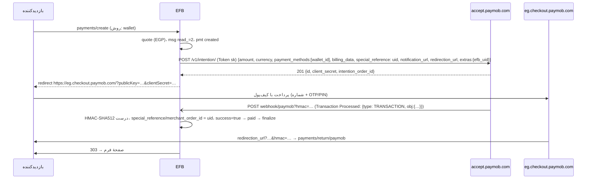

وضعیت: فاز ۱ پیاده و تست شد (۲۰۲۶-۱۱-۱۲؛ Intention و Unified Checkout در پنج منطقه، callback با HMAC-SHA512، Transaction Inquiry، بازپرداخت، Test/Live؛ جزئیات در «پیوست: آنچه پیاده شد») · Pixel و اشتراک (۱b) نشد؛ ترجمه به دستور مالک انجام نشد · اولویت: P0 (موج دوم) · تلاش: M · وابستگی: PAY00 (B تا H)

# PAY06 — افزونهٔ Paymob (مصر و خاورمیانه: کارت، Meeza، کیف‌پول‌های موبایل، کیوسک، اقساط، Apple Pay)

تاریخ: ۲۲ آبان ۱۴۰۵ (2026-11-12). بر پایهٔ [PAY00](PAY00-payment-framework.fa.md).

---

## ۰. خلاصهٔ تصمیم‌ها

1. افزونهٔ `vendores-efb/paymob`، کلید `AdnPMB`، نوع فیلد `paymob`، text domain `efb-paymob`.
2. **Intention API** (`POST {base}/v1/intention/`) و سپس **Unified Checkout** (redirect به `https://{region}.checkout.paymob.com/?publicKey=…&clientSecret=…`)؛ حالت اختیاری **Pixel** (تعبیه‌شده با همان `client_secret`) در فاز ۱b.
3. منطقه اجباری: مصر `accept.paymob.com`، عمان `oman.paymob.com`، عربستان `ksa.paymob.com`، امارات `uae.paymob.com`.
4. هر روش پرداخت در Paymob یک **Integration ID** است (Test و Live جدا)؛ مدیر برای هر روش شناسه را وارد می‌کند و فیلد فقط روش‌هایی را نشان می‌دهد که شناسهٔ حالت فعلی را دارند.
5. callback «Transaction Processed» با `hmac` (HMAC-SHA512 hex روی ۲۰ فیلد به ترتیب ثابت، با HMAC Secret داشبورد) تأیید می‌شود؛ redirect بازگشت همان HMAC را روی پارامترهای GET دارد ولی هرگز به‌تنهایی دلیل پرداخت نیست.
6. یکتایی با `special_reference` (= `uid`) که در callback به‌شکل `merchant_order_id` برمی‌گردد.

## ۱. هدف

پذیرش کارت (Visa، Mastercard، Meeza)، کیف‌پول‌های موبایل مصری، پرداخت کیوسک، اقساط و Apple Pay برای فروشندگان مصر، عربستان، امارات و عمان.

## ۲. پژوهش (مستندات رسمی)

| موضوع | واقعیت | منبع |
|---|---|---|
| میزبان‌ها | مصر `https://accept.paymob.com/`، عمان `https://oman.paymob.com/`، عربستان `https://ksa.paymob.com/`، امارات `https://uae.paymob.com/`؛ «Test and live use the same regional base URL… The mode is controlled by the keys and integration IDs» | [Paymob docs index](https://developers.paymob.com/paymob-docs/llms.txt) (بخش Overview) |
| کلیدها | Secret Key، Public Key، API Key، HMAC، Integration IDها در داشبورد؛ نمونه‌ها: `egy_pk_test_…`، `egy_sk_test_…`، `egy_csk_test_…` | همان (Getting Integration Credentials، نمونهٔ Pixel) |
| Intention | `POST {base}/v1/intention/` با `Authorization: Token <secret key>`؛ بدنه: `amount` (سنت)، `currency` (باید با Integration ID بخواند)، `payment_methods` (شناسه‌های عددی یا نام مثل `"card"`؛ وضعیت Test/Live باید با کلید بخواند)، `items[{name, amount}]`، `billing_data` (`phone_number` الزامی)، `extras` (در callback برمی‌گردد)، `special_reference` (یکتا؛ در callback `merchant_order_id`)، `expiration`، `notification_url`، `redirection_url` (فقط کارت و کیف‌پول)؛ پاسخ `201`: `id`، `client_secret`، `intention_order_id`، `payment_keys`، `payment_methods`، `status`، `confirmed` | [Create Intention](https://developers.paymob.com/paymob-docs/developers/intention-apis/create-intention) |
| Unified Checkout | `https://{region}.checkout.paymob.com/?publicKey=…&clientSecret=…`؛ مناطق `eg`، `uae`، `om`، `ksa` | [Unified Checkout](https://developers.paymob.com/paymob-docs/developers/checkout-experiences/unified-checkout-redirection) |
| Pixel | تجربهٔ تعبیه‌شده با همان `client_secret` | [Pixel](https://developers.paymob.com/paymob-docs/developers/checkout-experiences/pixel-embedded) |
| HMAC | SHA-512؛ HMAC Secret؛ ترتیب: `amount_cents`، `created_at`، `currency`، `error_occured`، `has_parent_transaction`، `obj.id` (POST) / `id` (GET)، `integration_id`، `is_3d_secure`، `is_auth`، `is_capture`، `is_refunded`، `is_standalone_payment`، `is_voided`، `order.id` (POST) / `order_id` (GET)، `owner`، `pending`، `source_data.pan`، `source_data.sub_type`، `source_data.type`، `success`؛ بدون جداکننده؛ مقایسه با پارامتر `hmac` | [HMAC Transaction Callback](https://developers.paymob.com/paymob-docs/developers/webhook-callbacks-and-hmac/hmac/hmac-transaction-callback)، [HMAC](https://developers.paymob.com/paymob-docs/developers/webhook-callbacks-and-hmac/hmac) |
| بازپرداخت | `POST https://accept.paymob.com/api/acceptance/void_refund/refund` با `transaction_id` و `amount_cents`؛ احراز در مستند مصر با `auth_token` و در مستند عمان با `Authorization: Token <secret>`؛ همهٔ روش‌ها جز کیوسک؛ جزئی تا سقف مبلغ | [Refund (Oman)](https://docs.oman.paymob.com/docs/refund-transaction)، [Refund (Egypt)](https://docs.paymob.com/docs/refund-transaction)، [Refund overview](https://developers.paymob.com/paymob-docs/llms.txt) |
| اشتراک | ماژول Subscriptions (Paymob کسر دوره‌ای را انجام می‌دهد) و پرداخت با کارت ذخیره (CIT/MIT) | همان (Subscriptions) |
| آزمایش | صفحهٔ Test Credentials (کارت و شماره کیف‌پول آزمایشی) | همان |

## ۳. ساختار افزونه

الگوی PAY01 §۳: `paymob/paymobefb.php`، `class-Emsfb-paymob-gateway.php`، `class-Emsfb-paymob-client.php` (میزبان‌های مجاز: چهار دامنهٔ API و چهار دامنهٔ checkout)، `paymob-phrases-efb.php` (`efb-paymob`)، `assets/js/paymob-efb.js`، `assets/img/` (Meeza، Vodafone Cash و… طبق راهنمای برند)، `languages/` (عربی مصری و انگلیسی اول)، `paymob.zip`.

## ۴. تنظیمات

| کلید | نوع | راز؟ |
|---|---|---|
| `region` | `eg` · `sa` · `ae` · `om` | خیر |
| `mode` | `test` · `live` | خیر |
| `test_secret` / `live_secret` | `^[a-z]{3}_sk_(test|live)_…$` | بله |
| `test_public` / `live_public` | `^[a-z]{3}_pk_(test|live)_…$` | خیر |
| `hmac_secret` | متن | بله |
| `integrations` | جدول: روش (`card`، `wallet`، `kiosk`، `valu`، `souhoola`، `applepay`، `meeza_qr`، `mada`، `stcpay`…) → `test_id`، `live_id` (عدد)، `label` | خیر |
| `checkout` | `unified` · `pixel` | خیر |

«آزمودن اتصال»: ساخت intention آزمایشی ۱۰٫۰۰ با اولین Integration ID حالت Test (بی‌خطر؛ تا پرداخت نشود اثری ندارد) یا endpoint فقط‌خواندنی اگر Paymob ارائه دهد (پرسش باز ۱). پیشوند کلید با منطقه (`egy_`، `ksa_`…) و حالت (`_test_`/`_live_`) سنجیده می‌شود.

## ۵. روش‌ها (Integration ID در هر منطقه)

| منطقه | روش‌های رایج | یادداشت |
|---|---|---|
| مصر EGP | کارت (Visa/Mastercard/Meeza)، کیف‌پول موبایل (Vodafone Cash، Orange Cash، Etisalat Cash، WE Pay)، Meeza QR/دیجیتال، کیوسک (Aman/Masary)، valU و Souhoola (اقساط)، Apple Pay | کیف‌پول شمارهٔ موبایل می‌خواهد؛ کیوسک کد مرجع و تأیید دیرهنگام |
| عربستان SAR | کارت، mada، STC Pay، Apple Pay، Tabby/Tamara | |
| امارات AED / عمان OMR | کارت، Apple Pay؛ OmanNet در عمان | OMR سه رقم اعشار، ولی `amount` به «سنت» (بیسه = ۱/۱۰۰۰) — قاعدهٔ دقیق با fixture تأیید شود (پرسش باز ۲) |

## ۶. جریان



- Pixel (۱b): `next.type = embedded` با `{publicKey, clientSecret, paymentMethods}`؛ آداپتور `new Pixel({…, elementId: <slot>})`؛ پس از تکمیل `EFBPay.poll(uid)`.
- کیوسک: callback با `pending=true` و کد مرجع (`data.bill_reference` یا مشابه) → وضعیت `pending`، پیام «با این کد در کیوسک بپردازید» در صفحهٔ بازگشت و ایمیل «منتظر پرداخت» (اقدام `pay_act_user_mail=submit|both`).

## ۷. فراخوانی‌های API

### ۷.۱ Intention

```http
POST https://accept.paymob.com/v1/intention/
Authorization: Token egy_<PAYMOB_TEST_SECRET_KEY>
Content-Type: application/json

{
  "amount": 60000,
  "currency": "EGP",
  "payment_methods": [4567890],
  "items": [ { "name": "Workshop seat", "amount": 60000, "quantity": 1 } ],
  "billing_data": { "first_name": "…", "last_name": "…", "email": "…", "phone_number": "+2010…" },
  "special_reference": "Q3x…",
  "extras": { "efb_uid": "Q3x…", "form_id": 12 },
  "expiration": 3600,
  "notification_url": "https://example.com/wp-json/Emsfb/v1/payments/webhook/paymob?p=Q3x…&t=…",
  "redirection_url":  "https://example.com/wp-json/Emsfb/v1/payments/return/paymob?p=Q3x…&s=…"
}
```

- `items`: جمع `amount`ها باید برابر `amount` باشد؛ از `quote.items` ساخته می‌شود و تخفیف/مالیات/کارمزد به‌شکل اقلام جدا (تخفیف با مبلغ منفی پذیرفته نیست → تخفیف از قلم‌ها کسر و یک قلم «جمع پس از تخفیف» فرستاده می‌شود؛ پرسش باز ۳).
- `billing_data.phone_number` الزامی: از فیلد موبایل/تلفن فرم با نگاشت `pgw_map_phone` (F01 یکسان‌سازی ارقام)؛ اگر فرم ندارد، فیلد درگاه پرسش تلفن را خودش در جزء `fields` اضافه می‌کند (کلید `pf_ask_phone`).
- `expiration` (ثانیه) = تنظیم `pending_ttl` برای کارت و کیف‌پول (۱ ساعت)؛ کیوسک طولانی‌تر.

### ۷.۲ خواندن

callback و redirect منبع اصلی‌اند؛ برای cron و «بررسی دوباره»: Transaction Inquiry با `merchant_order_id` (= `special_reference`) یا شناسهٔ تراکنش (`obj.id`) از callback. نشانی و احراز دقیق endpoint استعلام در پیاده‌سازی از بخش «Transaction Inquiry» مستند تأیید و fixture شود (پرسش باز ۱). تا آن زمان، بدون callback، ردیف پس از `pending_ttl` → `expired` فقط وقتی استعلام «تراکنشی نیست» گفته باشد.

### ۷.۳ بازپرداخت

```http
POST https://accept.paymob.com/api/acceptance/void_refund/refund
Authorization: Token <secret key>
{ "transaction_id": 192036465, "amount_cents": 20000 }
```

نتیجه یک تراکنش فرزند (`has_parent_transaction=true`، `is_refunded`/`is_refund`) است که callback جدا دارد؛ `emsfb_pmt_rfd_` با `gateway_ref` = شناسهٔ تراکنش فرزند. کیوسک: `unsupported`.

## ۸. بررسی callback (طرح کد)

```php
private const HMAC_FIELDS = array( 'amount_cents','created_at','currency','error_occured','has_parent_transaction',
    'id','integration_id','is_3d_secure','is_auth','is_capture','is_refunded','is_standalone_payment','is_voided',
    'order.id','owner','pending','source_data.pan','source_data.sub_type','source_data.type','success' );

private static function hmac_string( array $obj ): string {
    $out = '';
    foreach ( self::HMAC_FIELDS as $path ) {
        $v = $obj;
        foreach ( explode( '.', $path ) as $k ) { $v = is_array( $v ) && array_key_exists( $k, $v ) ? $v[ $k ] : ''; }
        $out .= is_bool( $v ) ? ( $v ? 'true' : 'false' ) : (string) $v;   // بولی‌ها به‌شکل true/false
    }
    return $out;
}

public function parse_webhook( \WP_REST_Request $r, Settings $s ): ?Webhook_Event {
    $j = json_decode( $r->get_body(), true );
    if ( ! is_array( $j ) || ( $j['type'] ?? '' ) !== 'TRANSACTION' || ! is_array( $j['obj'] ?? null ) ) return null; // TOKEN و… → 200
    $obj   = $j['obj'];
    $given = strtolower( (string) $r->get_param( 'hmac' ) );
    $calc  = hash_hmac( 'sha512', self::hmac_string( $obj ), $s->secret( 'any', 'hmac_secret' ) );
    if ( $given === '' || ! hash_equals( $calc, $given ) ) return Webhook_Event::auth_failed();
    $ref = (string) ( $obj['order']['merchant_order_id'] ?? '' );         // = special_reference = uid
    return Webhook_Event::verified_by_uid( $ref, (string) $obj['id'], hash( 'sha256', 'paymob|' . $obj['id'] . '|' . ( $obj['success'] ? 1 : 0 ) . ( $obj['pending'] ? 1 : 0 ) ), $obj );
}
```

- در GET بازگشت، `obj.id` → `id` و `order.id` → `order_id` (§۲)؛ تابع جدا `hmac_string_get()`.
- قالب بولی‌ها (`true`/`false`) و اعداد در رشته طبق نمونهٔ رشتهٔ رسمی؛ با fixture رسمی تأیید شود.
- `verified_by_uid`: پرداخت با `uid` پیدا می‌شود و `gateway_ref` (شناسهٔ تراکنش) بار اول ذخیره می‌شود؛ مبلغ (`amount_cents`) و ارز با quote مقایسه می‌شود.

## ۹. نگاشت وضعیت (از `obj`)

| شرط | EFB |
|---|---|
| `success=true`، `pending=false`، `is_auth=false`، `is_voided=false`، `is_refunded=false` | `paid` |
| `success=true`، `is_auth=true`، `is_capture=false` | `authorized` |
| `pending=true` | `pending` (کیوسک، کیف‌پول در انتظار) |
| `success=false`، `pending=false` | `failed` |
| `is_voided=true` | `canceled` |
| `is_refunded=true` یا تراکنش فرزند بازپرداخت | `refunded`/`partially_refunded` بر اساس جمع |
| بدون callback تا `pending_ttl` | `expired` (پس از استعلام) |

## ۱۰. فیلد و تجربهٔ کاربری

- `pf_methods_style=list` با لوگو و نام عربی/انگلیسی هر روش؛ «کیف‌پول موبایل» زیرعنوان «Vodafone Cash، Orange، Etisalat، WE».
- عربی مصری برای متن‌ها؛ RTL؛ مبلغ EGP با دو رقم.
- کیوسک: صفحهٔ بازگشت کد مرجع و مهلت را بزرگ و قابل کپی نشان می‌دهد.

## ۱۱. دوره‌ای

ماژول Subscriptions Paymob `native` است؛ ولی API دقیق ساخت پلن و اشتراک در این پژوهش خوانده نشد → فاز ۱b پس از مطالعهٔ بخش Subscriptions (پرسش باز ۴).

## ۱۲. امنیت

- میزبان‌های مجاز فقط هشت دامنهٔ منطقه‌ای؛ `client_secret` یک‌ساعته و مخصوص همان intention به مرورگر داده می‌شود (طراحی Paymob)، ولی Secret Key هرگز.
- `source_data.pan` در callback چهار رقم آخر/پوشانده است؛ فقط چهار رقم آخر نگه داشته می‌شود.
- تلفن کیف‌پول فقط به Paymob.

## ۱۳. سطح نسخه

افزونه Free Plus (پیشنهاد)؛ Pixel در Free Plus؛ اشتراک Pro.

## ۱۴. رشته‌های ترجمه (`efb-paymob`)

| کلید | متن انگلیسی |
|---|---|
| `paymob` | Paymob |
| `paymobRegion` / `paymobRegionEg` / `paymobRegionSa` / `paymobRegionAe` / `paymobRegionOm` | Account region / Egypt / Saudi Arabia / United Arab Emirates / Oman |
| `paymobSecret` / `paymobPublic` / `paymobHmac` | Secret key / Public key / HMAC secret |
| `paymobIntegrations` | Payment methods and their integration IDs |
| `paymobIntegrationHelp` | Each payment method has its own integration ID in the Paymob dashboard, one for test and one for live. |
| `paymobCard` / `paymobWallet` / `paymobKiosk` / `paymobValu` / `paymobMeeza` | Card / Mobile wallet / Pay at a kiosk / valU instalments / Meeza |
| `paymobPhoneNeeded` | Mobile number (needed by Paymob) |
| `paymobKioskRef` | Pay at any Aman or Masary outlet with this reference before %s: |
| `paymobSecureNote` | Payments are processed by Paymob. |

## ۱۵. تست

fixtureها `tests/fixtures/payments/paymob/`: `intention-201.json`، `callback-success.json` + `hmac` ساخته‌شده با راز آزمایشی، `callback-pending-kiosk.json`، `callback-failed.json`، `callback-refund-child.json`، `redirect-get-success.txt`، `refund-200.json`؛ و نمونهٔ رشتهٔ HMAC رسمی صفحهٔ HMAC با هش آن.

| تست | چه می‌سنجد |
|---|---|
| `php tests/test-pay-paymob-hmac.php` | ترتیب ۲۰ فیلد، مسیرهای تودرتو، بولی‌ها، POST و GET، بردار رسمی |
| `php tests/test-pay-paymob-intention.php` | `amount` سنت، `items` جمع برابر، `special_reference`، تلفن از نگاشت، منطقه و دامنهٔ checkout |
| `php tests/test-pay-paymob-status-map.php` | جدول §۹ |
| `php tests/test-pay-paymob-refund.php` | تراکنش فرزند، کیوسک unsupported |

چک‌لیست دستی (حساب Test مصر): کارت آزمایشی موفق و رد؛ کیف‌پول با شمارهٔ آزمایشی؛ بستن مرورگر؛ کیوسک (معلق)؛ بازپرداخت جزئی؛ Unified و Pixel؛ عربی RTL و موبایل.

## ۱۶. زیرتسک‌ها

### A. اسکلت، ثبت، تنظیمات منطقه و Integration IDها
- فایل‌ها: پوشهٔ `paymob/`، رجیستری هسته.
- پذیرش: §۴ و §۵.
- تست‌ها: `test-pay-paymob-intention.php` (بخش تنظیمات).

**Checkpoint**
- فایل‌های تغییرکرده: `vendores-efb/paymob/` (`paymobefb.php`، `routes-efb.php`، `class-Emsfb-paymob-gateway.php`، `class-Emsfb-paymob-client.php`، `paymob-phrases-efb.php`، `languages/`، `assets/`)؛ هسته تغییری نکرد (کلید `AdnPMB`، پوشهٔ `paymob` و فایل‌های لازم از PAY00 در `functions.php` و `Registry::ADDONS` بودند).
- تست‌ها: `php tests/test-addon-paymob-create.php` ۸۵ موفق (ثبت، `supports()` بر پایهٔ منطقه، تنظیمات رمزشده، الگوی کلیدها، نقشهٔ `method=ID`، «آزمودن اتصال»: حالت و منطقهٔ کلید پیش از هر درخواست، توکن از API key، intention آزمایشی ۱۰٫۰۰ با اولین Integration ID همان حالت، ۴۰۳ و ۴۰۴ و شبکه).
- وضعیت ترجمه: فقط متن انگلیسی و `languages/efb-paymob.pot` (۵۶ عبارت)؛ `locales.json` بی‌زبان؛ به دستور مالک ترجمه نشد.
- مورد باز: منطقهٔ پنجم **پاکستان** (`pakistan.paymob.com`، Unified Checkout در `https://pakistan.paymob.com/unifiedcheckout/`) از مستند پاکستان و افزونهٔ رسمی WooCommerce افزوده شد. تنظیم تازهٔ `api_key` (یکی برای Test و Live) لازم است چون Transaction Inquiry با auth token کار می‌کند (پرسش باز ۱). جدول Integration ID متنی `card=123, wallet=456` در هر حالت است (کنترل جدول در کارت تنظیمات هسته نیست).
- اقدام بعدی: —

### B. Intention، Unified Checkout، callback با HMAC، بازگشت
- فایل‌ها: gateway، client، آداپتور.
- پذیرش: §۶ تا §۹.
- تست‌ها: `test-pay-paymob-hmac.php`، `test-pay-paymob-intention.php`، `test-pay-paymob-status-map.php`.

**Checkpoint**
- فایل‌های تغییرکرده: gateway (`create()`، `parse_webhook()`، `parse_return()`، `pending_ttl()`، هوک‌های اختیاری)، client (منطقه‌ها، روش‌ها، HMAC، نگاشت §۹)، `assets/js/paymob-efb.js`، `assets/css/paymob-efb.css`، `assets/img/*.svg`.
- تست‌ها: `php tests/test-addon-paymob-hmac.php` ۴۲ موفق (رشتهٔ رسمی صفحهٔ HMAC، ترتیب ۲۰ فیلد، بولی‌ها، null، `order` عددی، GET با `order_id`/`order` و `source_data_pan`، نمونهٔ GET رسمی، HMAC intention، نگاشت §۹)؛ `php tests/test-addon-paymob-webhook.php` ۵۳ موفق؛ `node tests/test-addon-paymob-adapter.js` ۲۳ موفق (فیلد واقعی هسته، فیلتر روش با ارز، یادداشت‌ها، RTL در ۳۷۵ پیکسل، HMAC مستقل Node)؛ سناریوی e2e `paymob` ۳۰ موفق.
- وضعیت ترجمه: همان بالا.
- مورد باز: callback شکل intention (`{intention, transaction, hmac}`) فقط مبلغ و شناسهٔ intention را امضا می‌کند؛ پس فقط استعلام را راه می‌اندازد. مرجع پرداخت `intention_order_id` (= `obj.order.id` امضاشده) است، نه `special_reference` که در HMAC نیست (یافتن با uid خطرناک بود؛ کلید `efb_uid` در payload نیست).
- اقدام بعدی: یک بار با حساب Test واقعی مصر (چک‌لیست دستی §۱۵).

### C. استعلام تراکنش و cron
- فایل‌ها: gateway (`fetch()`).
- پذیرش: §۷.۲ پس از تأیید endpoint.
- تست‌ها: `php tests/test-pay-paymob-inquiry.php`.

**Checkpoint**
- فایل‌های تغییرکرده: gateway (`fetch()`، `inquiry()`).
- تست‌ها: بخش‌های بازگشت بی‌callback، cron، انقضا و ناهمخوانی مبلغ در `test-addon-paymob-webhook.php` (نام `test-pay-paymob-inquiry.php` به قرارداد افزونه‌ها `test-addon-paymob-*` درآمد).
- وضعیت ترجمه: —
- مورد باز: endpoint تأیید شد: `POST {base}/api/auth/tokens {api_key}` ← `token`؛ `POST {base}/api/ecommerce/orders/transaction_inquiry {auth_token, order_id}` ← آخرین تراکنش سفارش؛ اگر آن تراکنش فرزند (بازپرداخت) باشد، `GET {base}/api/acceptance/transactions/{parent}` با `Bearer`. پاسخ «تراکنشی نیست» در مستند نیامده؛ ۴۰۴ «هنوز تراکنشی نیست» = pending فرض شد و پس از `pending_ttl` به expired می‌رود (پرسش باز ۱).
- اقدام بعدی: تأیید پاسخ سفارش بی‌تراکنش با حساب واقعی.

### D. بازپرداخت و Pixel
- فایل‌ها: gateway، آداپتور.
- پذیرش: §۷.۳ و Pixel §۶.
- تست‌ها: `test-pay-paymob-refund.php`، `node tests/test-pay-paymob-pixel.js`.

**Checkpoint**
- فایل‌های تغییرکرده: gateway (`refund()`).
- تست‌ها: `php tests/test-addon-paymob-refund.php` ۲۱ موفق (جزئی و کامل، یافتن تراکنش پدر، callback فرزند بی‌اثر، مجموع امضاشدهٔ پدر بی‌شمارش دوباره، بازپرداخت داشبورد، کیوسک unsupported بی‌درخواست، رد شدن، شبکه، کلید Live، پاسخ `{type, obj}` پاکستان، نمونهٔ مستند با مقادیر رشته‌ای).
- وضعیت ترجمه: —
- مورد باز: **Pixel ساخته نشد** (§۰ آن را فاز ۱b گذاشته؛ اسکریپت `paymob-pixel@latest` از CDN با نسخهٔ ثابت و تست آداپتور لازم است). Paymob کلید یکتایی برای بازپرداخت ندارد؛ یکتایی با جدول بازپرداخت هسته است.
- اقدام بعدی: Pixel (`next.type = embedded`) پس از تصمیم مالک.

### E. ترجمه و zip
- فایل‌ها: phrases، `languages/`، `paymob.zip`.
- پذیرش: §۱۴.
- تست‌ها: خط لولهٔ i18n افزونه.

**Checkpoint**
- فایل‌های تغییرکرده: `paymob-phrases-efb.php`، `languages/efb-paymob.pot`، `languages/locales.json`، `languages/index.php`، `vendores-efb/paymob.zip`.
- تست‌ها: `php tests/test-addon-paymob-package.php` ۱۵ موفق (فایل‌های لازم هسته، هر رشتهٔ `efb-paymob` کد در `.pot` و برعکس، دامنهٔ یگانه، بی‌کلید، شبکه فقط از `Http` هسته، پنج میزبان، چیدمان zip).
- وضعیت ترجمه: به دستور مالک هیچ زبانی ترجمه نشد (عربی مصری و انگلیسی §۳ منتظر دستور).
- مورد باز: `paymobKioskRef` (متن کد مرجع کیوسک در صفحهٔ بازگشت) افزوده نشد چون هسته هوکی برای متن درگاه در صفحهٔ وضعیت ندارد (BUGS-FOUND)؛ `paymobPhoneNeeded` برچسب گزینهٔ `pgw_map_phone` شد. لوگوها نشان سادهٔ نام‌اند، نه طرح رسمی.
- اقدام بعدی: ترجمه با خط لولهٔ `docs/addon-i18n` وقتی مالک بخواهد.

## ۱۷. پرسش‌های باز

1. endpoint و احراز رسمی استعلام تراکنش با `merchant_order_id` در API فعلی (Intention-based)، و یک endpoint فقط‌خواندنی برای «آزمودن اتصال».
2. قاعدهٔ `amount` (کوچک‌ترین واحد) برای OMR با سه رقم اعشار.
3. تخفیف و مالیات در `items`: Paymob مبلغ منفی یا قلم «تخفیف» می‌پذیرد؟
4. API ماژول Subscriptions (ساخت پلن، اشتراک، webhook تمدید).
5. سیاست تلاش دوبارهٔ callback و اینکه پاسخ غیر ۲۰۰ دوباره فرستاده می‌شود یا نه.
6. اعتبار `client_secret` (یک صفحه «یک ساعت» می‌گوید) و رابطه‌اش با `expiration`.

## پیوست: آنچه پیاده شد (۲۰۲۶-۱۱-۱۲)

- **افزونه:** `vendores-efb/paymob/` و `paymob.zip` (کلید `AdnPMB`، نوع فیلد `paymob`، text domain `efb-paymob`)، فقط از راه قرارداد PAY00 و هوک‌های اختیاری آن؛ هسته تغییر نکرد.
- **منطقه‌ها:** مصر `accept.paymob.com` (Unified Checkout `eg.checkout.paymob.com`)، عربستان `ksa` (`ksa.checkout`)، امارات `uae` (`uae.checkout`)، عمان `oman` (`om.checkout`)، پاکستان `pakistan.paymob.com` (`/unifiedcheckout/`). `api_hosts()` فقط این پنج میزبان API است؛ نشانی checkout فقط مقصد redirect است. ارز هر منطقه: EGP، SAR، AED، OMR، PKR (فیلتر `efb_paymob_currencies`).
- **مبلغ:** `amount` = `$p->amount_minor` (کوچک‌ترین واحد؛ OMR به بیسه، ×۱۰۰۰ مانند افزونهٔ رسمی WooCommerce Paymob، پرسش باز ۲)؛ `items` از خطوط quote وقتی جمعشان برابر است، وگرنه یک خط (پرسش باز ۳ بی‌اثر شد)؛ فیلتر `efb_paymob_intention_body` نمی‌تواند مبلغ یا ارز را عوض کند.
- **ساخت:** `POST /v1/intention/` با `Token <secret>`، `payment_methods` = Integration ID روش انتخابی یا همهٔ روش‌های سازگار با ارز («all»)، `billing_data` (نام، ایمیل، موبایل از `pgw_map_*` یا فیلد موبایل/تلفن فرم با ارقام فارسی و عربی؛ بی‌شماره «NA» مانند افزونه‌های رسمی، ولی کیف‌پول بی‌شماره رد می‌شود)، `special_reference` = uid، `extras` بی‌کلید `efb_uid`، `expiration` ۳۶۰۰ (کیوسک ۷۲ ساعت)، `notification_url`، `redirection_url`. بی‌ایمیل ساخته نمی‌شود.
- **تأیید callback:** `?hmac=` = HMAC-SHA512 hex روی ۲۰ فیلد به ترتیب مستند با HMAC secret (`hash_equals`)؛ رشتهٔ رسمی صفحهٔ HMAC بایت‌به‌بایت آزموده شد. callback امضاشده وضعیت را با خود دارد (مبلغ، ارز، success، pending، refund و void امضا شده‌اند)؛ مبلغ یا ارز دیگر ← استعلام و سپس failed. شکل intention ← فقط استعلام. TOKEN و ناشناخته ← ۲۰۰ بی‌اثر؛ امضای بد ← ۴۰۱. بازگشت GET با همان HMAC فقط شمارهٔ سفارشِ بررسی را می‌دهد (امضای بد ← هیچ بررسی).
- **وضعیت (§۹):** void ← canceled، refunded با مجموع ← refunded/partially_refunded، pending ← pending، success+is_auth ← authorized، success ← paid، بقیه failed؛ تراکنش فرزند وضعیت پرداخت نیست. `aggregator` (کیوسک) روش `kiosk` نام می‌گیرد. `pending_ttl` دو ساعت، کیوسک ۷۳ ساعت.
- **هوک‌های اختیاری هسته (با پیش‌فرض امن):** ارز هر روش در `methods()`، `field_schema()` با `pgw_map_phone` (برچسب «Mobile number (needed by Paymob)») و `pgw_map_name`، `field_defaults()` (متن امنیت، سبک list)، `form_warnings()` (`paymob_no_phone` وقتی کیف‌پول هست و فیلد موبایل نیست).
- **پیش‌فرض‌هایی که مالک باید تأیید کند:** حد ۱٫۰۰ تا ۱٬۰۰۰٬۰۰۰ واحد هر ارز؛ «آزمودن اتصال» یک intention پرداخت‌نشدهٔ ۱۰٫۰۰ می‌سازد (Paymob endpoint فقط‌خواندنی برای secret key ندارد)؛ تلفن «NA» برای کارت؛ «all» = همهٔ Integration IDهای سازگار؛ OMR به بیسه؛ توکن استعلام فقط در حافظهٔ همان درخواست (ذخیره نمی‌شود).
- **تست‌ها:** `test-addon-paymob-create.php` ۸۵، `test-addon-paymob-hmac.php` ۴۲، `test-addon-paymob-webhook.php` ۵۳، `test-addon-paymob-refund.php` ۲۱، `test-addon-paymob-package.php` ۱۵، `test-addon-paymob-adapter.js` ۲۳ (۲۳۹ بررسی)؛ سناریوی e2e `paymob` ۳۰. fixtureها در `tests/fixtures/payments/paymob/` از صفحه‌های رسمی (مقادیر کلیدمانند جایگزین شدند)، Paymob ساختگی در `tests/paymob-fake-provider.php` (واحد و e2e)، کلیدها هنگام اجرا ساخته می‌شوند.
- **فقط با حساب Test واقعی آزمودنی:** پاسخ استعلام برای سفارش بی‌تراکنش، شکل دقیق callback intention و اینکه کدام شکل به `notification_url` می‌رسد، قاعدهٔ OMR، پذیرش «NA» برای تلفن، رفتار `special_reference` تکراری، نشانی‌های checkout منطقه‌ای (`*.checkout.paymob.com`) در برابر `{host}/unifiedcheckout/`، کیوسک و کد مرجع، کلیدهای پاکستان.

#### Checkpoint: error scenarios (2026-11-12)

Paymob: the e-mail is required for every method (format email) and the mobile number for the wallet (format phone), so core warns the owner per method and stops Pay at the field; the add-on's own `paymob_no_phone` warning is gone; a 400 about the phone / e-mail → `payer_invalid` at that field; unpaid transactions carry a reason (voided → canceled, by `data.message`). vendores-efb `a4a57e8`; tests `test-addon-paymob-errors.php` (9). Matrix: [payment-error-matrix.en.md](payment-error-matrix.en.md).

#### Payer e-mail and payer fields checked against the provider's documentation (2026-11-13, owner request)

| Question | Paymob's documentation | Decision |
|---|---|---|
| Is the payer's e-mail required? | the Intention's `billing_data` is required ([Create Intention](https://developers.paymob.com/paymob-docs/developers/intention-apis/create-intention)); the Accept API: "All the fields in this object are mandatory … if it isn't available, please send it to be "NA", except, first_name, last_name, email, and phone_number cannot be sent as "NA"" ([Payment API flow](https://weaccept.readme.io/docs/accept-standard-redirect)) | **required** (unchanged: `pgw_map_email` `required`, `format: email`) |
| Must it be the payer's own? | billing data of the payer | yes: the mapped field or the confirmation e-mail field; never another e-mail field (before: the first e-mail answered) |
| Other payer fields | `phone_number`: the Intention reference shows only `"phone_number": ["This field is required."]`; the Accept API says it cannot be "NA" | **owner decision**: today the mobile number is required only for the mobile wallet and other methods send "NA" (as the earlier PAY06 notes say Paymob's own plug-ins do); first and last name fall back to "NA" too. If Paymob refuses "NA" on a Live account, make `pgw_map_phone` and the name `required` for every method |

Core rule (unchanged, gateway-neutral): the payer e-mail is the field chosen in the payment field's
"Payer e-mail" option, else the form's confirmation e-mail field (row 0 `email_to`, an Email field): the
person who fills in the form is the one who pays, and that field is where the form's own confirmation
goes. New: the add-ons no longer fall back to *another* e-mail field of the form ("the first e-mail
answered"), which may hold somebody else's address (a friend, a colleague).

Tests: `test-addon-paymob-errors.php` (10).
