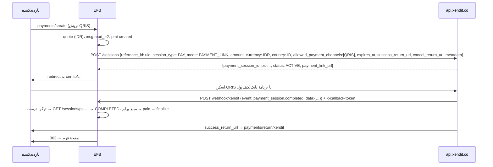

وضعیت: سند آماده، پیاده‌سازی نشده · اولویت: P0 (موج دوم) · تلاش: M · وابستگی: PAY00 (B تا H)

# PAY07 — افزونهٔ Xendit (جنوب شرق آسیا: QRIS، GCash، کیف‌پول‌ها، حساب مجازی، کارت)

تاریخ: ۲۲ آبان ۱۴۰۵ (2026-11-12). بر پایهٔ [PAY00](PAY00-payment-framework.fa.md).

---

## ۰. خلاصهٔ تصمیم‌ها

1. افزونهٔ `vendores-efb/xendit`، کلید `AdnXND`، نوع فیلد `xendit`، text domain `efb-xendit`.
2. **Payment Session** (پشتهٔ تازهٔ Xendit) با `mode: PAYMENT_LINK` (صفحهٔ میزبان `payment_link_url`) به‌جای Invoice API قدیمی؛ مستند Xendit مهاجرت از Invoice/Payment Links به Payment Session را توصیه می‌کند. حالت `COMPONENTS` (فیلدهای تعبیه‌شده) در فاز ۱b.
3. روش‌ها با `allowed_payment_channels` (مثلاً `["QRIS"]`، `["GCASH"]`، `["OVO","DANA"]`) محدود می‌شوند؛ بازدیدکننده می‌تواند در فیلد یا در صفحهٔ Xendit انتخاب کند.
4. webhook (`payment_session.completed`، `payment_session.expired`) با هدر `x-callback-token` (توکن ثابت داشبورد) تأیید و سپس با `GET /sessions/{id}` دوباره خوانده می‌شود، چون توکن ثابت بدنه را امضا نمی‌کند.
5. `reference_id` = `uid`؛ مدیریت نرخ: Test ۶۰ درخواست در دقیقه برای هر endpoint، Live ۶۰۰.
6. دوره‌ای: `session_type: SUBSCRIPTION` (بومی) در فاز ۱b.

## ۱. هدف

پذیرش QRIS (اندونزی)، GCash و کیف‌پول‌های فیلیپین، و روش‌های دیگر Xendit در اندونزی، فیلیپین، تایلند، ویتنام، مالزی و سنگاپور، با یک افزونه.

## ۲. پژوهش (مستندات رسمی)

| موضوع | واقعیت | منبع |
|---|---|---|
| میزبان | `https://api.xendit.co` | [Create session](https://docs.xendit.co/apidocs/create-session.md) |
| احراز | HTTP Basic (کلید مخفی به‌عنوان نام کاربری)؛ کلیدهای Test و Live جدا (پیشوندهای `xnd_development_` و `xnd_production_` در داشبورد) | همان (`securitySchemes: basic`) |
| ساخت | `POST /sessions`؛ `reference_id`، `session_type` (`PAY`/`SAVE`/`SUBSCRIPTION`)، `mode` (`PAYMENT_LINK`/`COMPONENTS`)، `amount`، `currency` (`IDR`، `PHP`، `VND`، `THB`، `SGD`، `MYR`، `USD`)، `country`، `customer{reference_id, type: INDIVIDUAL, individual_detail}`، `items`، `allowed_payment_channels`، `expires_at` (دست‌کم ۱۰ دقیقه بعد، تا سقف مجاز)، `locale`، `description`، `metadata`، `success_return_url`، `cancel_return_url`، `capture_method`، `allow_save_payment_method` (`DISABLED`/`OPTIONAL`/`FORCED`)؛ پاسخ: `payment_session_id` (`ps-…`)، `status: ACTIVE`، `payment_link_url` (`https://xen.to/…`) | همان، [Payment Session overview](https://docs.xendit.co/docs/payment-sessions-overview.md) |
| وضعیت session | `ACTIVE`، `COMPLETED`، `EXPIRED`، `CANCELED`؛ پس از تکمیل `payment_request_id`/`payment_id` | [Create session](https://docs.xendit.co/apidocs/create-session.md)، [Session webhook](https://docs.xendit.co/apidocs/webhook-notification-sent-defined-webhook-url-updates-payment-session.md) |
| webhook | رویدادها `payment_session.completed`، `payment_session.expired` (برای همهٔ انواع session)؛ هدر `x-callback-token` (از Webhook settings داشبورد)؛ باید سریع `2xx`؛ تا ۶ تلاش دوباره (۱۵ دقیقه، ۱، ۳، ۶، ۱۲، ۲۴ ساعت پس از اولی)؛ ارسال دوبارهٔ دستی در داشبورد؛ تکراری و بی‌ترتیب ممکن است | [Handling webhooks](https://docs.xendit.co/docs/handling-webhooks.md)، [Webhook behavior](https://docs.xendit.co/apidocs/webhook-behavior.md) |
| بازپرداخت | `POST /refunds` با هدر `api-version: 2024-11-11`؛ `payment_id` (`py-…`)، `reference_id`، `amount` (اختیاری = کل)، `reason` (`REQUESTED_BY_CUSTOMER`…)، `metadata` | [Create a refund](https://docs.xendit.co/apidocs/create-a-refund.md) |
| نرخ | الگوریتم پنجرهٔ لغزان؛ Test ۶۰ RPM و Live ۶۰۰ RPM برای هر endpoint و حساب؛ هر IP ۱۸٬۰۰۰ RPM؛ `429` با `RATE_LIMIT_EXCEEDED`؛ سرآیندهای `Rate-Limit-Limit`، `Rate-Limit-Remaining`، `Rate-Limit-Reset` | [Rate limits](https://docs.xendit.co/apidocs/rate-limits.md) |
| QRIS | اندونزی، IDR، کمینه ۱ و بیشینه ۱۰٬۰۰۰٬۰۰۰، نمایش QR به مشتری، انقضای پیش‌فرض درخواست ۴۸ ساعت، پردازش فوری، تسویه T+1؛ بازپرداخت کامل و جزئی تا ۷ روز ولی فقط برای برخی صادرکننده‌ها (مثلاً Gopay جزئی نه، CIMB در ۲۴ ساعت اول نه)؛ اعتراض تا ۹۰ روز | [QRIS](https://docs.xendit.co/docs/qris.md) |
| GCash | فیلیپین، PHP، کمینه ۱ و بیشینه ۱۰۰٬۰۰۰، redirect (وب و deeplink)، انقضای درخواست ۰٫۲۵ ساعت (۱۵ دقیقه)؛ `GCASH` یکبار، `GCASH_LINK_AND_PAY` دوره‌ای با فعال‌سازی نزد شریک | [GCash](https://docs.xendit.co/docs/gcash.md) |
| Components | `mode: COMPONENTS` → `components_sdk_key`؛ `components_configuration.origins` | [How payment sessions work](https://docs.xendit.co/docs/how-payment-sessions-work.md) |
| آزمایش | endpoint «Simulate payment [test mode]» | [docs index](https://docs.xendit.co/llms.txt) |
| مهاجرت | راهنمای «Migrate from (legacy) Payment Links/Invoice to Payment Session» | [Migrate](https://docs.xendit.co/docs/migrate-to-payment-session.md) |

## ۳. ساختار افزونه

الگوی PAY01 §۳: `xendit/xenditefb.php`، `class-Emsfb-xendit-gateway.php`، `class-Emsfb-xendit-client.php` (میزبان مجاز `api.xendit.co`؛ مدیریت `429` با `Rate-Limit-Reset`)، `xendit-phrases-efb.php` (`efb-xendit`)، `assets/js/xendit-efb.js`، `assets/img/` (QRIS، GCash، Maya، OVO، DANA… طبق راهنمای برند)، `languages/` (اندونزیایی، فیلیپینی، انگلیسی اول)، `xendit.zip`.

## ۴. تنظیمات

| کلید | نوع | راز؟ |
|---|---|---|
| `mode` | `test` · `live` | خیر |
| `test_secret` / `live_secret` | `^xnd_(development|production)_[A-Za-z0-9]{20,}$` | بله |
| `test_callback_token` / `live_callback_token` | متن (Webhook verification token) | بله |
| `country` | `ID` · `PH` · `TH` · `VN` · `MY` · `SG` | خیر |
| `channels` | زیرمجموعه از کدهای کانال (`QRIS`، `GCASH`، `PAYMAYA`، `OVO`، `DANA`، `SHOPEEPAY`، `CARDS`، حساب‌های مجازی…) | خیر |
| `session_ttl_minutes` | ۱۰ تا ۲۸۸۰ (پیش‌فرض ۶۰؛ GCash خودش ۱۵ دقیقه) | خیر |

صفحهٔ تنظیمات آدرس webhook (`…/payments/webhook/xendit`) را برای «Payment Session» در Webhook settings داشبورد Xendit نشان می‌دهد. «آزمودن اتصال»: `GET /sessions/ps-000000000000000000000000` → `404` با کلید درست و `401` با نادرست (یا `GET /balance` اگر دسترسی کلید اجازه دهد).

## ۵. روش‌ها

| کشور | ارز | کانال‌های پیشنهادی | یادداشت |
|---|---|---|---|
| اندونزی | IDR | `QRIS`، `DANA`، `OVO`، `SHOPEEPAY`، حساب مجازی بانک‌ها، `CARDS` | IDR بدون اعشار در عمل (`efb_currency_exponent` = ۰ برای Xendit، پرسش باز ۲) |
| فیلیپین | PHP | `GCASH`، `PAYMAYA`، `GRABPAY`، `CARDS` | GCash ۱۵ دقیقه |
| تایلند/ویتنام/مالزی/سنگاپور | THB/VND/MYR/SGD | PromptPay، کیف‌پول‌ها، FPX، PayNow… | بسته به فعال‌سازی حساب |

کدهای دقیق کانال از مرجع «Payment channels» در پیاده‌سازی تأیید و در `channels` به‌شکل فهرست بسته ثبت شوند.

## ۶. جریان



- چون webhook Payment Session در داشبورد برای کل حساب تنظیم می‌شود، آدرس per-payment با توکن ندارد؛ نگاشت با `data.reference_id` (= `uid`) و `payment_session_id`.
- تکراری و بی‌ترتیب: `claim_event` با کلید `xendit|<payment_session_id>|<event>`؛ رسیدن `expired` پس از `completed` بی‌اثر است (ماشین وضعیت PAY00).

## ۷. فراخوانی‌های API

### ۷.۱ ساخت session

```http
POST https://api.xendit.co/sessions
Authorization: Basic base64(xnd_development_xxxxxxxx:)
Content-Type: application/json

{
  "reference_id": "Q3x…",
  "session_type": "PAY",
  "mode": "PAYMENT_LINK",
  "amount": 150000,
  "currency": "IDR",
  "country": "ID",
  "customer": { "reference_id": "efb-<sha1(email)>", "type": "INDIVIDUAL",
                "individual_detail": { "given_names": "…", "surname": "…" }, "email": "…" },
  "items": [ { "reference_id": "opt_1", "name": "Workshop seat", "net_unit_amount": 150000, "quantity": 1, "currency": "IDR" } ],
  "allowed_payment_channels": ["QRIS"],
  "expires_at": "2026-11-12T13:00:00Z",
  "locale": "id",
  "description": "Pendaftaran workshop EFB-7KQ2M9",
  "metadata": { "efb_uid": "Q3x…", "form_id": "12" },
  "success_return_url": "https://example.com/wp-json/Emsfb/v1/payments/return/xendit?p=Q3x…&s=…",
  "cancel_return_url":  "https://example.com/wp-json/Emsfb/v1/payments/return/xendit?p=Q3x…&s=…&c=1"
}
```

پاسخ (کوتاه‌شده از نمونهٔ رسمی): `{"payment_session_id": "ps-661f87c614802d6c402cd82d", "reference_id": "…", "status": "ACTIVE", "payment_link_url": "https://xen.to/kGxPCi60", "payment_request_id": null}`.

- `customer.reference_id` باید «یکتا، حروف و عدد» باشد؛ از هش ایمیل (بدون افشای ایمیل) ساخته می‌شود؛ اگر فرم ایمیل ندارد، `efb-<uid>`.
- `items` از `quote.items`؛ تخفیف و مالیات به‌شکل قلم جدا یا در `amount` (پرسش باز ۳).
- خطای `INVALID_EXPIRY_DATE` → `expires_at` حداقل ۱۰ دقیقه بعد.

### ۷.۲ خواندن

`GET /sessions/{payment_session_id}` → `status`، `amount`، `currency`، `reference_id`، `payment_request_id`، `latest_payment_request_id`، `payment_id` (برای بازپرداخت)؛ روش استفاده‌شده از درخواست پرداخت (`GET /v3/payment_requests/{id}`، اختیاری، فقط برای نمایش `method`).

### ۷.۳ لغو و بازپرداخت

- لغو session فعال هنگام انقضای محلی یا «QR تازه»: `POST /sessions/{id}/cancel`.
- بازپرداخت:

```http
POST https://api.xendit.co/refunds
api-version: 2024-11-11
{ "reference_id": "R-<rfd idem>", "payment_id": "py-1402feb0-…", "amount": 50000, "reason": "REQUESTED_BY_CUSTOMER", "metadata": { "efb_uid": "Q3x…" } }
```

پاسخ وضعیت در انتظار/موفق/ناموفق دارد و webhook بازپرداخت جدا می‌آید. محدودیت‌های QRIS (۷ روز، برخی صادرکننده‌ها بدون جزئی) در خطای Xendit برمی‌گردد و پیامش در صفحهٔ پرداخت‌ها نشان داده می‌شود.

## ۸. بررسی webhook (طرح کد)

```php
public function parse_webhook( \WP_REST_Request $r, Settings $s ): ?Webhook_Event {
    $j = json_decode( $r->get_body(), true );
    $event = is_array( $j ) ? (string) ( $j['event'] ?? '' ) : '';
    if ( ! in_array( $event, array( 'payment_session.completed', 'payment_session.expired', 'refund.succeeded', 'refund.failed' ), true ) ) return null;
    $data = (array) ( $j['data'] ?? array() );
    $uid  = (string) ( $data['reference_id'] ?? '' );
    $p    = Store::find_by_uid( $uid );
    if ( ! $p ) return null;                                             // مال ما نیست → 200
    $token = (string) $r->get_header( 'x-callback-token' );
    if ( $token === '' || ! hash_equals( $s->secret( $p->mode, 'callback_token' ), $token ) ) return Webhook_Event::auth_failed();
    $sid = (string) ( $data['payment_session_id'] ?? $p->gateway_ref );
    return Webhook_Event::verified( $sid, hash( 'sha256', 'xendit|' . $sid . '|' . $event . '|' . ( $data['updated'] ?? '' ) ), $data, /* needs_refetch */ true );
}
```

- نام دقیق رویدادهای بازپرداخت از صفحهٔ «Refund webhook notification» تأیید شود.
- توکن ثابت → همیشه refetch؛ پاسخ `2xx` سریع و پردازش سنگین پس از پاسخ (PAY00 §۹.۱).

## ۹. نگاشت وضعیت

| Xendit session | EFB |
|---|---|
| `ACTIVE` | `pending` |
| `COMPLETED` (`session_type = PAY`) | `paid` (پس از تطبیق مبلغ و ارز) |
| `EXPIRED` | `expired` |
| `CANCELED` | `canceled` |
| بازپرداخت موفق | `partially_refunded`/`refunded` بر اساس جمع |

Payment Session چند تلاش را می‌پذیرد؛ تلاش ناموفق session را `ACTIVE` نگه می‌دارد (وضعیت EFB `pending`)، پس `failed` فقط برای خطای ساخت.

## ۱۰. فیلد و تجربهٔ کاربری

- `pf_methods_style=grid` با لوگوها؛ QRIS برچسب «QRIS — semua aplikasi bank & e-wallet».
- `locale` از `determine_locale()` (`id`، `en`، `th`، `vi`…).
- اعداد IDR با جداکنندهٔ نقطه (`Intl` `id-ID`).
- GCash روی موبایل deeplink باز می‌کند؛ متن «برنامهٔ GCash باز می‌شود».

## ۱۱. دوره‌ای (۱b)

`session_type: SUBSCRIPTION` با پیکربندی اشتراک (طرح در مرجع Subscriptions)؛ webhook «Subscription Webhook» برای تمدید → ردیف `renewal`. GCash دوره‌ای کانال `GCASH_LINK_AND_PAY` و فعال‌سازی شریک می‌خواهد.

## ۱۲. امنیت

- فقط `api.xendit.co`؛ اسکریپت Components فقط از دامنهٔ رسمی Xendit.
- توکن webhook راز است؛ هرگز در لاگ.
- نرخ: کلاینت `Rate-Limit-Remaining` را می‌خواند و cron در `429` برای این درگاه متوقف می‌شود.

## ۱۳. سطح نسخه

افزونه Free Plus (پیشنهاد)؛ Components و اشتراک Pro.

## ۱۴. رشته‌های ترجمه (`efb-xendit`)

| کلید | متن انگلیسی |
|---|---|
| `xendit` | Xendit |
| `xenditSecretTest` / `xenditSecretLive` | Test secret key / Live secret key |
| `xenditCallbackToken` | Webhook verification token |
| `xenditWebhookUrl` | Add this address for Payment Session events in Xendit Dashboard → Webhooks: |
| `xenditCountry` | Business country |
| `xenditChannels` | Payment channels to offer |
| `xenditQris` / `xenditGcash` | QRIS (all banking and e-wallet apps) / GCash |
| `xenditGcashOpens` | The GCash app will open to confirm the payment. |
| `xenditRateLimited` | Xendit is limiting requests right now. Please try again in a minute. |
| `xenditRefundQrisLimit` | QRIS refunds are only possible within 7 days and not for every bank or e-wallet. |
| `xenditSecureNote` | Payments are processed by Xendit. |

## ۱۵. تست

fixtureها `tests/fixtures/payments/xendit/`: `session-create-201.json` (نمونهٔ رسمی)، `session-get-completed.json`، `session-get-expired.json`، `webhook-completed.json`، `webhook-expired.json`، `refund-200.json`، `rate-limit-429.json`.

| تست | چه می‌سنجد |
|---|---|
| `php tests/test-pay-xendit-create.php` | بدنه (`reference_id`، کانال‌ها، `expires_at` ≥ ۱۰ دقیقه، `customer.reference_id` بدون PII)، IDR بدون اعشار |
| `php tests/test-pay-xendit-webhook.php` | توکن درست/نادرست، refetch، تکرار، `expired` پس از `completed` بی‌اثر، رویداد ناشناخته → 200 |
| `php tests/test-pay-xendit-status-map.php` | جدول §۹ |
| `php tests/test-pay-xendit-ratelimit.php` | `429` → توقف cron برای درگاه، پیام بازدیدکننده |
| `php tests/test-pay-xendit-refund.php` | `api-version`، خطای محدودیت QRIS |

چک‌لیست دستی (حساب Test): session QRIS و «Simulate payment»؛ GCash در PH؛ انقضا؛ بستن مرورگر؛ ارسال دوبارهٔ دستی webhook از داشبورد (بی‌اثر)؛ بازپرداخت؛ فرم اندونزیایی و موبایل.

## ۱۶. زیرتسک‌ها

### A. اسکلت، ثبت، تنظیمات و آدرس webhook
- فایل‌ها: پوشهٔ `xendit/`، رجیستری هسته.
- پذیرش: §۴.
- تست‌ها: `test-pay-xendit-create.php` (بخش تنظیمات).

**Checkpoint**
- فایل‌های تغییرکرده:
- تست‌ها:
- وضعیت ترجمه:
- مورد باز:
- اقدام بعدی:

### B. session، webhook با توکن، refetch، بازگشت
- فایل‌ها: gateway، client، آداپتور.
- پذیرش: §۶ تا §۹.
- تست‌ها: `test-pay-xendit-create.php`، `test-pay-xendit-webhook.php`، `test-pay-xendit-status-map.php`، `test-pay-xendit-ratelimit.php`.

**Checkpoint**
- فایل‌های تغییرکرده:
- تست‌ها:
- وضعیت ترجمه:
- مورد باز:
- اقدام بعدی:

### C. لغو و بازپرداخت
- فایل‌ها: gateway.
- پذیرش: §۷.۳.
- تست‌ها: `test-pay-xendit-refund.php`.

**Checkpoint**
- فایل‌های تغییرکرده:
- تست‌ها:
- وضعیت ترجمه:
- مورد باز:
- اقدام بعدی:

### D. Components و اشتراک (۱b)
- فایل‌ها: آداپتور، gateway.
- پذیرش: §۲ (Components)، §۱۱.
- تست‌ها: `node tests/test-pay-xendit-components.js`، `php tests/test-pay-xendit-subscription.php`.

**Checkpoint**
- فایل‌های تغییرکرده:
- تست‌ها:
- وضعیت ترجمه:
- مورد باز:
- اقدام بعدی:

### E. ترجمه (اندونزیایی، فیلیپینی، تایلندی، ویتنامی، انگلیسی، فارسی) و zip
- فایل‌ها: phrases، `languages/`، `xendit.zip`.
- پذیرش: §۱۴.
- تست‌ها: خط لولهٔ i18n افزونه.

**Checkpoint**
- فایل‌های تغییرکرده:
- تست‌ها:
- وضعیت ترجمه:
- مورد باز:
- اقدام بعدی:

## ۱۷. پرسش‌های باز

1. حساب‌هایی که هنوز روی Invoice API هستند: آیا Payment Session برای همهٔ حساب‌های تازه و قدیمی فعال است، یا افزونه باید Invoice را هم پشتیبانی کند؟
2. قاعدهٔ اعشار IDR/VND در Payment Session (عدد صحیح؟).
3. تخفیف و مالیات در `items` (قلم منفی؟).
4. آیا Xendit هدر یکتایی (`idempotency-key`) برای `POST /sessions` دارد؟ در صفحه‌های خوانده‌شده پیدا نشد؛ تا آن زمان یکتایی با `reference_id` و `uq_attempt`.
5. کدهای دقیق کانال‌ها برای هر کشور و فعال‌سازی‌های لازم نزد شریک (GCash دوره‌ای).
